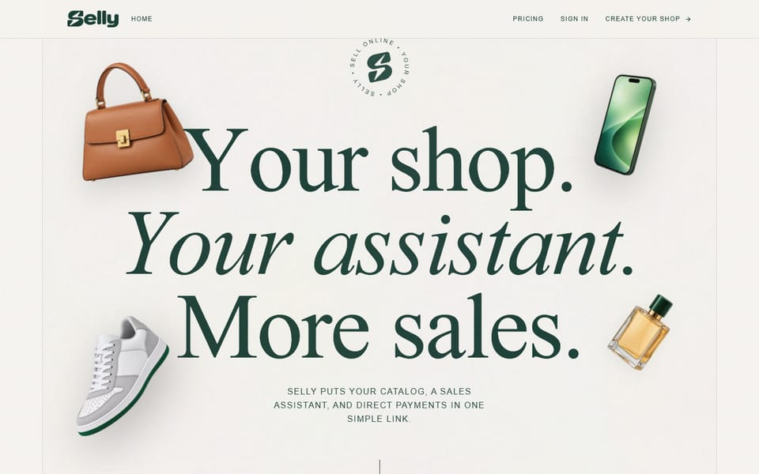
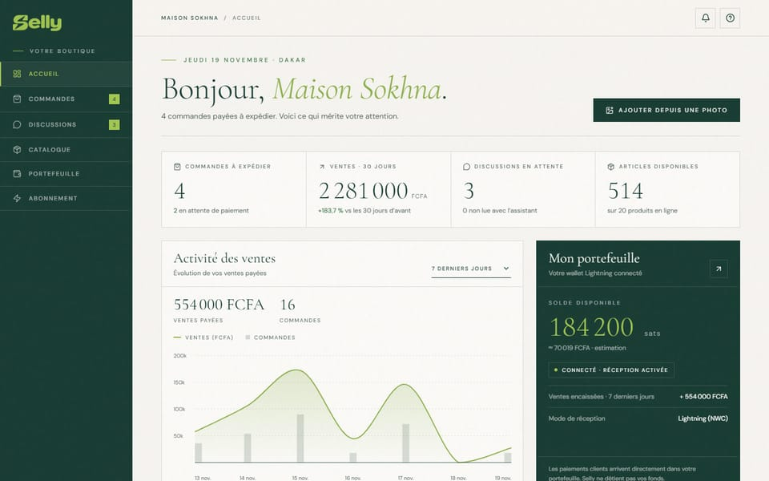
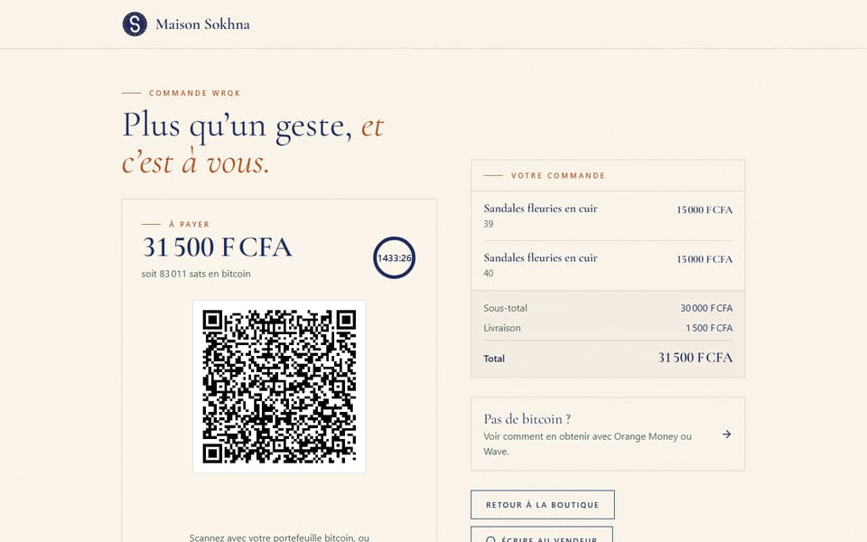
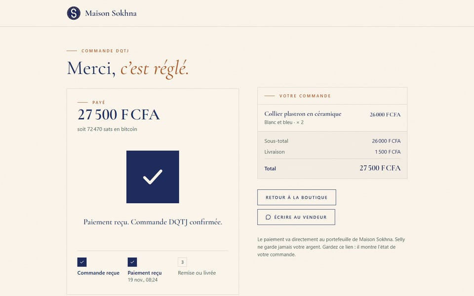
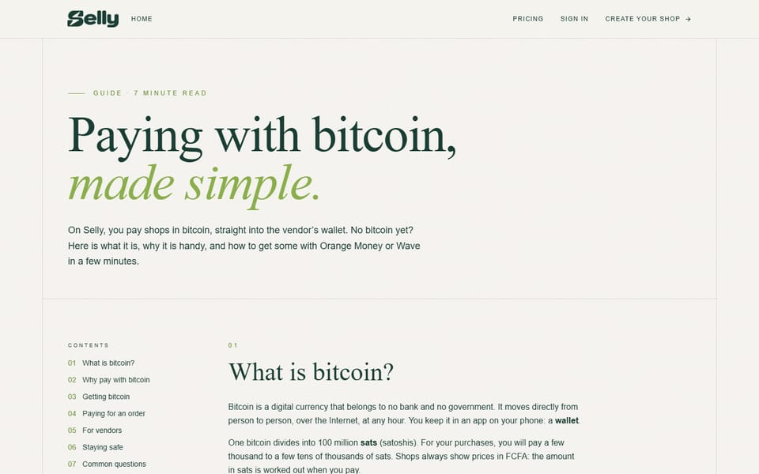
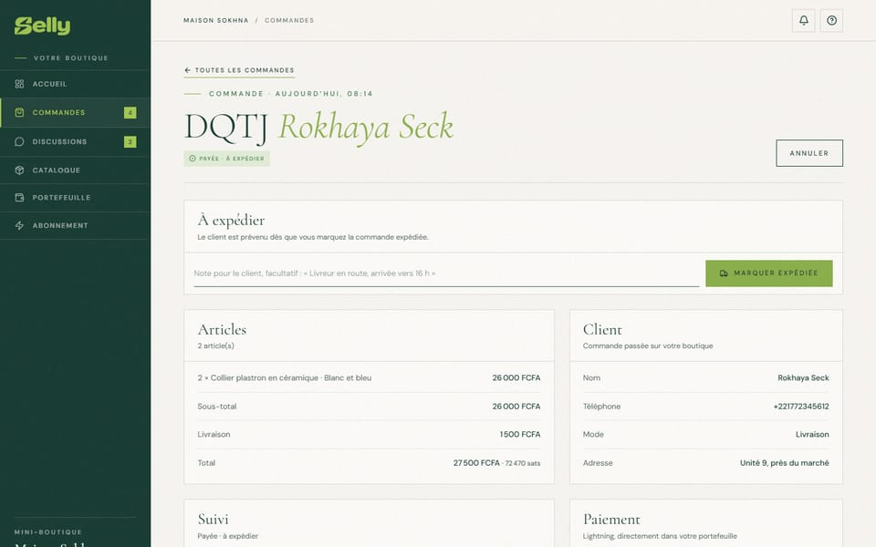
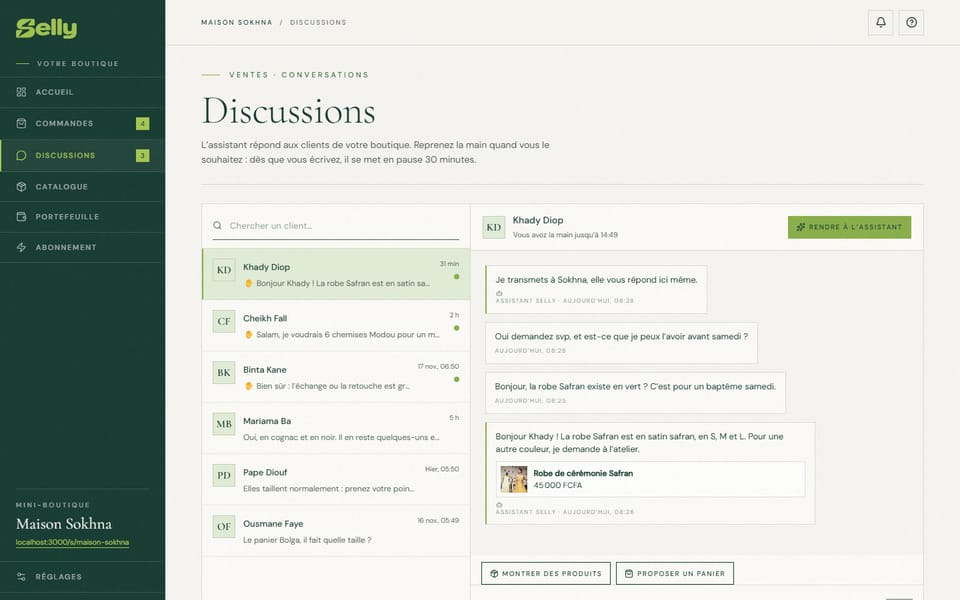
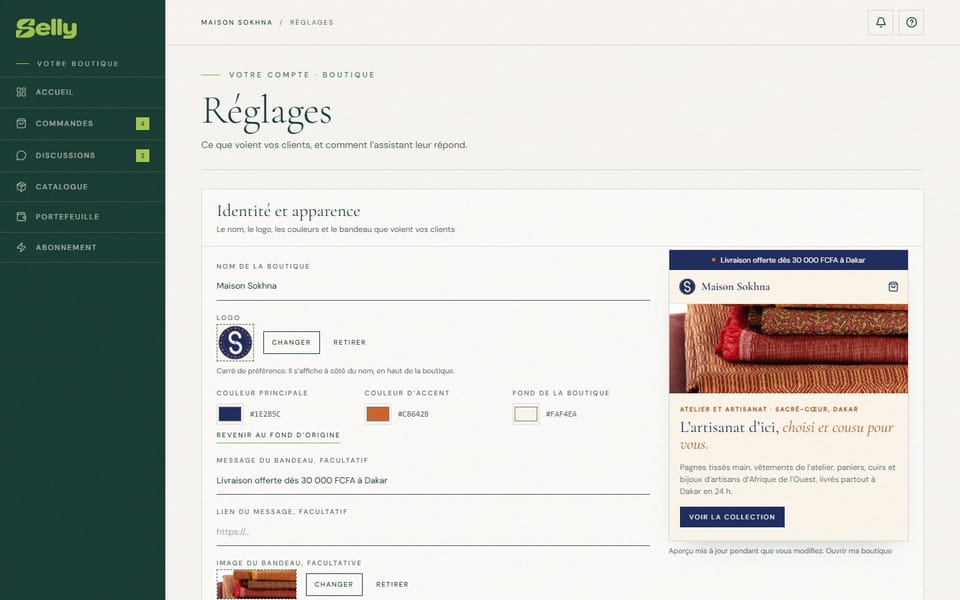
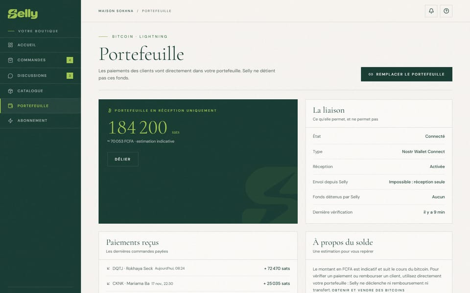
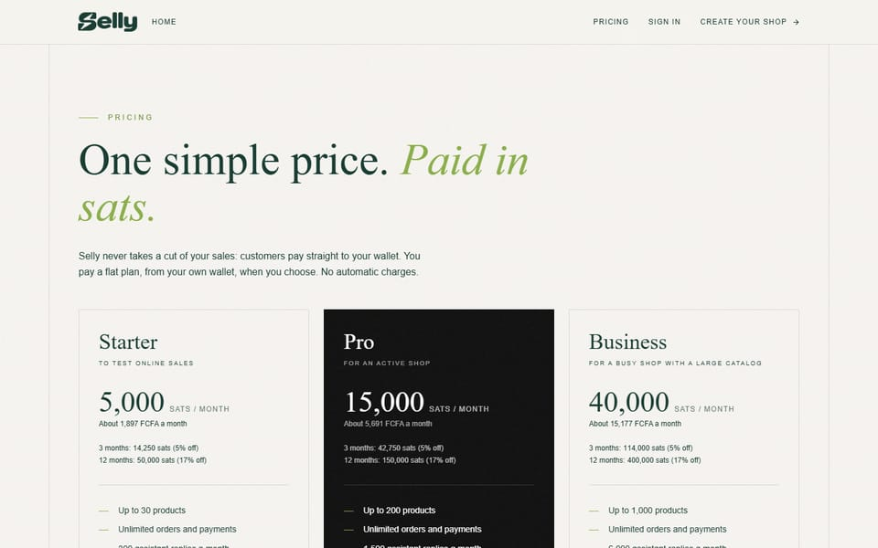

<p align="center">
  <picture>
    <source media="(prefers-color-scheme: dark)" srcset="apps/web/public/brand/selly-wordmark-light.png">
    
  </picture>
</p>

<p align="center">
  <strong>An online shop, a sales assistant and bitcoin payments, in one link.</strong><br>
  Mobile-first micro-storefronts for social commerce in West Africa, starting in Senegal.
</p>

<p align="center">
  
</p>

<p align="center">
  <a href="docs/screenshots/landing.jpg"></a>
</p>

<p align="center">
  <a href="docs/screenshots/storefront.jpg"></a>
  <a href="docs/screenshots/dashboard.jpg"></a>
</p>

## What Selly does

A vendor who sells on WhatsApp or Instagram gets a shop at their own link. Customers browse it from their phone, ask
Selly (the shop's assistant) about stock, sizes and delivery, and pay in bitcoin over Lightning, straight into the
vendor's own wallet. The vendor runs everything from a dashboard: orders, conversations, catalogue, wallet and
subscription.

- **Storefront per vendor.** The vendor's logo, colours, banner and welcome text; a catalogue with photos, sizes and
  stock; a cart with delivery zones or pickup; a payment page that follows the order until delivery.
- **Selly, the sales assistant.** A chat in every shop that answers questions, shows products and builds carts. The
  vendor can take over a conversation at any time, show products as cards or propose a cart the customer completes.
- **Payments that never touch Selly.** Each order gets a Lightning invoice from the vendor's wallet, linked with Nostr
  Wallet Connect (NWC). Selly creates the invoice and watches it; the money goes from the customer to the vendor.
- **A dashboard made for the phone.** Orders to ship, sales over time, discussions waiting for an answer, stock to
  watch, products added from a photo and a sentence, alerts by push, Nostr or email.
- **Nostr sign-in, subscription in sats.** Vendors sign in with a Nostr key, start with a 14-day Pro trial, then pay
  Selly a monthly plan (Starter, Pro, Business) in sats.

## Screenshots

The shop in the screenshots is **Maison Sokhna**, a demo vendor made by
[`apps/core/scripts/demo-shop.mts`](apps/core/scripts/demo-shop.mts): its own logo and colours, 20 products, six
weeks of paid orders and a few customer conversations. Click a picture for the full page.

### For customers

<table>
  <tr>
    <td width="33%"><a href="docs/screenshots/storefront.jpg"></a><br><sub><b>Storefront</b>: the vendor's colours, banner and catalogue</sub></td>
    <td width="33%"><a href="docs/screenshots/product.jpg"></a><br><sub><b>Product</b>: sizes, stock, ask Selly</sub></td>
    <td width="33%"><a href="docs/screenshots/checkout.jpg"></a><br><sub><b>Payment</b>: Lightning invoice, paid to the vendor</sub></td>
  </tr>
  <tr>
    <td><a href="docs/screenshots/checkout-paid.jpg"></a><br><sub><b>Payment received</b>: the order's progress</sub></td>
    <td><a href="docs/screenshots/bitcoin-guide.jpg"></a><br><sub><b>Bitcoin guide</b>: what it is, how to get it with Orange Money or Wave</sub></td>
    <td></td>
  </tr>
</table>

### For vendors

<table>
  <tr>
    <td width="33%"><a href="docs/screenshots/dashboard.jpg"></a><br><sub><b>Home</b>: what to ship, sales, who is waiting</sub></td>
    <td width="33%"><a href="docs/screenshots/orders.jpg"></a><br><sub><b>Orders</b>: paid, to ship, delivered</sub></td>
    <td width="33%"><a href="docs/screenshots/order.jpg"></a><br><sub><b>Order</b>: items, customer, delivery</sub></td>
  </tr>
  <tr>
    <td><a href="docs/screenshots/discussions.jpg"></a><br><sub><b>Discussions</b>: Selly answers, the vendor takes over</sub></td>
    <td><a href="docs/screenshots/catalogue.jpg"></a><br><sub><b>Catalogue</b>: products, stock per size, categories</sub></td>
    <td><a href="docs/screenshots/settings.jpg"></a><br><sub><b>Settings</b>: logo, colours, banner, delivery, assistant</sub></td>
  </tr>
  <tr>
    <td><a href="docs/screenshots/wallet.jpg"></a><br><sub><b>Wallet</b>: the vendor's NWC wallet</sub></td>
    <td><a href="docs/screenshots/subscription.jpg"></a><br><sub><b>Subscription</b>: trial and plans in sats</sub></td>
    <td><a href="docs/screenshots/security.jpg"></a><br><sub><b>Security</b>: Nostr keys and connected devices</sub></td>
  </tr>
</table>

### The public site

<table>
  <tr>
    <td width="33%"><a href="docs/screenshots/landing.jpg"></a><br><sub><b>Landing page</b></sub></td>
    <td width="33%"><a href="docs/screenshots/pricing.jpg"></a><br><sub><b>Pricing</b>: Starter, Pro, Business</sub></td>
    <td width="33%"><a href="docs/screenshots/sign-in.jpg"></a><br><sub><b>Sign in</b> with a Nostr key</sub></td>
  </tr>
  <tr>
    <td><a href="docs/screenshots/onboarding.jpg"></a><br><sub><b>Onboarding</b>: name the shop, link the wallet</sub></td>
    <td></td>
    <td></td>
  </tr>
</table>

## How a payment works

1. The customer orders in the shop (or Selly builds the cart in the chat).
2. Core asks the **vendor's** wallet for a Lightning invoice over NWC, priced in FCFA and converted to sats at the
   current rate.
3. The customer pays it from any Lightning wallet; the payment page updates on its own.
4. The vendor's wallet tells core the invoice is paid; the order turns paid and the vendor is alerted.

Selly holds no funds at any point. Vendors pay their own subscription in sats to the platform's wallet the same way.

## Under the hood

| App                        | Port | What it is                                                                                      |
| -------------------------- | ---- | ----------------------------------------------------------------------------------------------- |
| [`apps/web`](apps/web)     | 3000 | Next.js: landing page, storefronts, payment pages and the vendor dashboard (installable PWA)    |
| [`apps/core`](apps/core)   | 4000 | Fastify: vendors, catalogue, orders, invoices over NWC, subscriptions, media, alerts            |
| [`apps/agent`](apps/agent) | 4100 | Fastify: Selly, the sales assistant (chat, tools, vendor inbox), with a choice of LLM providers |

Shared packages live in [`packages`](packages): `db` (Drizzle schema and migrations), `nwc` (Nostr Wallet Connect
client and a fake wallet for tests), `nostr`, `money`, `contracts`, `ui` and `config`. Data is in PostgreSQL, photos in
S3-compatible storage, and NWC talks through Nostr relays.

## Run it locally

Requirements: Node 24, pnpm 10 and Docker.

```bash
pnpm install
cp .env.example .env
pnpm infra:up      # PostgreSQL, S3 storage (RustFS) and a local Nostr relay
pnpm dev           # web on :3000, core on :4000, agent on :4100
```

Payments without a real wallet: set `INVOICE_PROVIDER=nwc` and `NWC_ALLOW_INSECURE_RELAYS=true` in `.env`, then run
the fake NWC wallets (development only):

```bash
pnpm dev:testwallet                     # keep it running
pnpm testwallet link --slug <your-shop>  # or paste the vendor link in the dashboard
pnpm testwallet pay                     # pays the newest unpaid invoice
```

The demo shop of the screenshots, with the fake wallets running and `MEDIA_STORE=s3`:

```bash
pnpm --filter @selly/core exec tsx scripts/demo-shop.mts
```

Its photos are public-domain images in `apps/core/scripts/demo-shop-photos`. The shop has a fixed, public demo key, so
anyone can sign in as it: **[JUDGES.txt](JUDGES.txt)** walks through the whole setup, the demo shop and the sign-in
with a Nostr extension, step by step. More setup, Docker and test details are in [CONTRIBUTING.md](CONTRIBUTING.md).

```bash
pnpm test        # unit and integration tests
pnpm typecheck
pnpm lint
```

## Documentation

- [`docs/architecture.md`](docs/architecture.md): architecture, decisions, data model, flows, plans and pricing.
- [`docs/api.json`](docs/api.json): OpenAPI 3.1 contract with every request and response in full.

Status: design v0.3. WhatsApp, Instagram and a mobile-money on-ramp (Banxaas) are perspectives, not part of the MVP.
