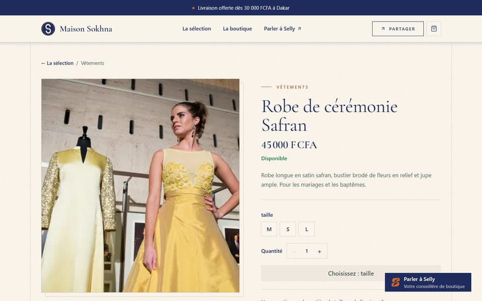
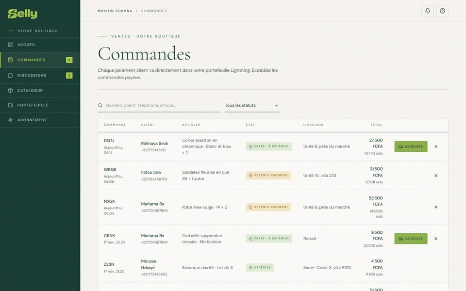
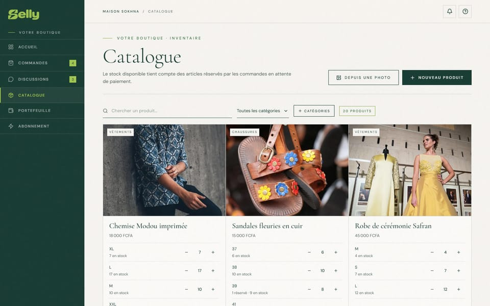
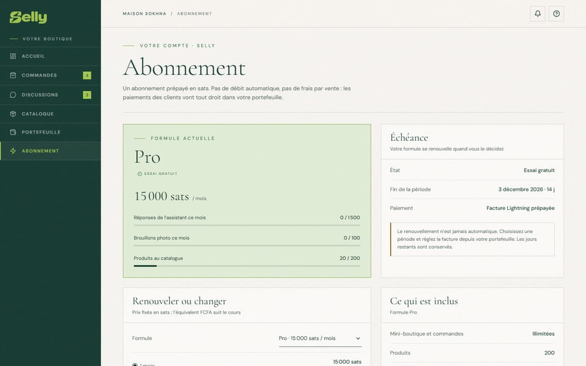
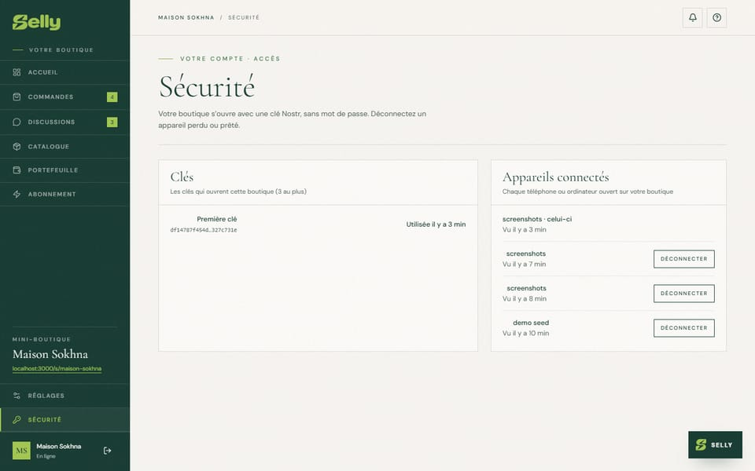
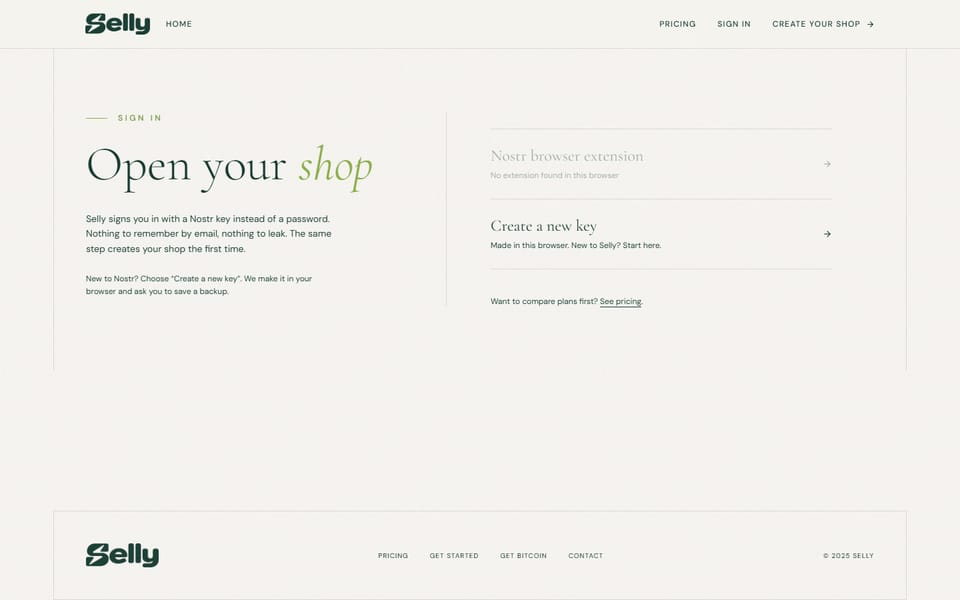
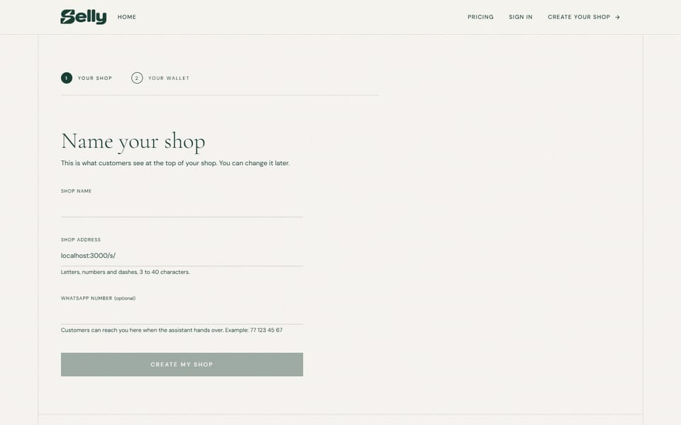
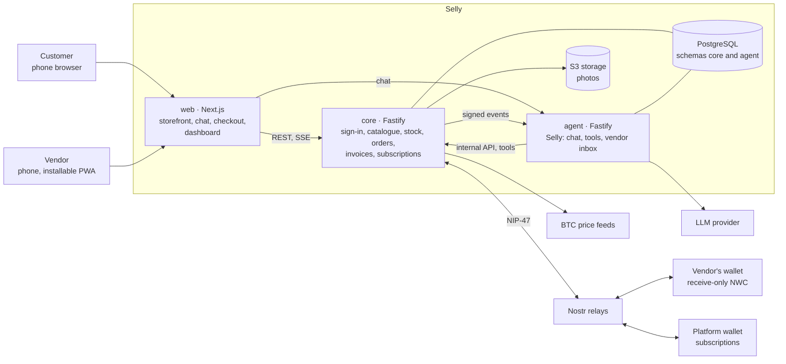

<p align="center">
  <picture>
    <source media="(prefers-color-scheme: dark)" srcset="apps/web/public/brand/selly-wordmark-light.png">
    
  </picture>
</p>

<p align="center">
  <strong>An online shop, a sales assistant and bitcoin payments, in one link.</strong><br>
  Mobile-first micro-storefronts for social commerce in West Africa, starting in Senegal.
</p>

<p align="center">
  
</p>

<p align="center">
  <a href="docs/screenshots/landing.jpg"></a>
</p>

<p align="center">
  <a href="docs/screenshots/storefront.jpg"></a>
  <a href="docs/screenshots/dashboard.jpg"></a>
</p>

## Try it in one command

Requirements: Docker Desktop, running. Nothing else to install, no key, no `.env`.

```bash
docker compose up --build
```

The first start takes about ten minutes: it builds the three apps, then makes **Maison Sokhna**, the demo shop of the
screenshots. That shop has 20 products with photos, six weeks of orders paid through the fake wallet, and a few customer
conversations. The site opens once the shop is ready. After that, a restart takes seconds.

The happy path, about five minutes:

1. Open **http://localhost:3000/s/maison-sokhna** on a phone-sized window. Browse, open a product, and ask Selly in the
   chat: « robe rouge » (price and sizes in stock), « livraison » (zones and fees).
2. Add something to the cart and order: you get a Lightning payment page, priced in FCFA and converted to sats.
3. Pay it with the fake wallet, from a second terminal:

   ```bash
   docker compose exec demo pnpm testwallet pay
   ```

   The payment page turns to « Paiement reçu » by itself. The order is paid into the shop's own wallet.
4. Sign in as the shop to see its dashboard: [JUDGES.txt](JUDGES.txt), step 6, gives the public demo key and the
   browser extension to use. The new order is at the top of _Commandes_.

- `DEMO_LANG=en docker compose up --build` makes the shop in English, as in the demo video. This only applies
  to an empty database.
- `docker compose down` stops everything; `docker compose down -v` also wipes the data, so the next start makes the
  shop again.
- The chat runs a scripted assistant without any AI key. For real answers, set `LLM_PRIMARY` and its key in a
  root `.env` (see [JUDGES.txt](JUDGES.txt), "The sales assistant").
- The fake wallets speak real Nostr Wallet Connect over a local relay. They are development tools and never run in
  production.

## What Selly does

A vendor who sells on WhatsApp or Instagram gets a shop at their own link. Customers browse it from their phone, ask
Selly (the shop's assistant) about stock, sizes and delivery, and pay in bitcoin over Lightning, straight into the
vendor's own wallet. The vendor runs everything from a dashboard: orders, conversations, catalogue, wallet and
subscription.

- **Storefront per vendor.** The vendor's logo, colours, banner and welcome text; a catalogue with photos, sizes and
  stock; a cart with delivery zones or pickup; a payment page that follows the order until delivery.
- **Selly, the sales assistant.** A chat in every shop that answers questions, shows products and builds carts. The
  vendor can take over a conversation at any time, show products as cards or propose a cart the customer completes.
- **Payments that never touch Selly.** Each order gets a Lightning invoice from the vendor's wallet, linked with Nostr
  Wallet Connect (NWC). Selly creates the invoice and watches it; the money goes from the customer to the vendor.
- **A dashboard made for the phone.** Orders to ship, sales over time, discussions waiting for an answer, stock to
  watch, products added from a photo and a sentence, alerts by push, Nostr or email.
- **Nostr sign-in, subscription in sats.** Vendors sign in with a Nostr key, start with a 14-day Pro trial, then pay
  Selly a monthly plan (Starter, Pro, Business) in sats.

## Who it is for, and what changes

**Our primary users are vendors who run their sales through social media**: WhatsApp, Instagram, Facebook, TikTok.
In Senegal, where we start, they sell clothes, cloth, shoes and cosmetics, work alone or with one helper, on an
Android phone, in French and Wolof.

| Today, in the chats                                                                       | With Selly                                                                                        |
| ----------------------------------------------------------------------------------------- | ------------------------------------------------------------------------------------------------- |
| The same questions all day: « dispo ? », « c'est combien ? », « vous avez en 42 ? »       | Selly answers from the live stock, at any hour, and hands the chat over when the vendor wants it  |
| Stock tracked by hand across conversations; the same item sold twice                      | One catalogue; stock is reserved at order time and released when the order expires                |
| Payments chased one by one: cash on delivery, or Wave and Orange Money transfers to check | A payment link per order; the order turns paid by itself, into the vendor's own wallet            |
| New products typed and photographed again for each channel                                | A photo and a sentence (« 20 000, 5 paires du 40 au 44 ») become a product after one confirmation |

**Reach.** [TO FILL: how many vendors the pilot targets, and how many orders a vendor takes per week.] Capacity is
sized for 200 vendors, 50,000 chat messages and 2,000 orders a day, on one region and one database
([architecture.md §10](docs/architecture.md#10-non-functional-requirements)).

## Screenshots

The shop in the screenshots is **Maison Sokhna**, a demo vendor made by
[`apps/core/scripts/demo-shop.mts`](apps/core/scripts/demo-shop.mts): its own logo and colours, 20 products, six
weeks of paid orders and a few customer conversations. Click a picture for the full page.

### For customers

<table>
  <tr>
    <td width="33%"><a href="docs/screenshots/storefront.jpg"></a><br><sub><b>Storefront</b>: the vendor's colours, banner and catalogue</sub></td>
    <td width="33%"><a href="docs/screenshots/product.jpg"></a><br><sub><b>Product</b>: sizes, stock, ask Selly</sub></td>
    <td width="33%"><a href="docs/screenshots/checkout.jpg"></a><br><sub><b>Payment</b>: Lightning invoice, paid to the vendor</sub></td>
  </tr>
  <tr>
    <td><a href="docs/screenshots/checkout-paid.jpg"></a><br><sub><b>Payment received</b>: the order's progress</sub></td>
    <td><a href="docs/screenshots/bitcoin-guide.jpg"></a><br><sub><b>Bitcoin guide</b>: what it is, how to get it with Orange Money or Wave</sub></td>
    <td></td>
  </tr>
</table>

### For vendors

<table>
  <tr>
    <td width="33%"><a href="docs/screenshots/dashboard.jpg"></a><br><sub><b>Home</b>: what to ship, sales, who is waiting</sub></td>
    <td width="33%"><a href="docs/screenshots/orders.jpg"></a><br><sub><b>Orders</b>: paid, to ship, delivered</sub></td>
    <td width="33%"><a href="docs/screenshots/order.jpg"></a><br><sub><b>Order</b>: items, customer, delivery</sub></td>
  </tr>
  <tr>
    <td><a href="docs/screenshots/discussions.jpg"></a><br><sub><b>Discussions</b>: Selly answers, the vendor takes over</sub></td>
    <td><a href="docs/screenshots/catalogue.jpg"></a><br><sub><b>Catalogue</b>: products, stock per size, categories</sub></td>
    <td><a href="docs/screenshots/settings.jpg"></a><br><sub><b>Settings</b>: logo, colours, banner, delivery, assistant</sub></td>
  </tr>
  <tr>
    <td><a href="docs/screenshots/wallet.jpg"></a><br><sub><b>Wallet</b>: the vendor's NWC wallet</sub></td>
    <td><a href="docs/screenshots/subscription.jpg"></a><br><sub><b>Subscription</b>: trial and plans in sats</sub></td>
    <td><a href="docs/screenshots/security.jpg"></a><br><sub><b>Security</b>: Nostr keys and connected devices</sub></td>
  </tr>
</table>

### The public site

<table>
  <tr>
    <td width="33%"><a href="docs/screenshots/landing.jpg"></a><br><sub><b>Landing page</b></sub></td>
    <td width="33%"><a href="docs/screenshots/pricing.jpg"></a><br><sub><b>Pricing</b>: Starter, Pro, Business</sub></td>
    <td width="33%"><a href="docs/screenshots/sign-in.jpg"></a><br><sub><b>Sign in</b> with a Nostr key</sub></td>
  </tr>
  <tr>
    <td><a href="docs/screenshots/onboarding.jpg"></a><br><sub><b>Onboarding</b>: name the shop, link the wallet</sub></td>
    <td></td>
    <td></td>
  </tr>
</table>

## How a payment works

1. The customer orders in the shop (or Selly builds the cart in the chat).
2. Core asks the **vendor's** wallet for a Lightning invoice over NWC, priced in FCFA and converted to sats at the
   current rate.
3. The customer pays it from any Lightning wallet; the payment page updates on its own.
4. The vendor's wallet tells core the invoice is paid; the order turns paid and the vendor is alerted.

Selly holds no funds at any point. Vendors pay their own subscription in sats to the platform's wallet the same way.

## Architecture



The agent never touches the database tables of core: it calls core's internal API with a service token, and only the
tools of its role (customer or vendor). Core alone creates invoices, confirms payments and changes stock.

| App                        | Port | What it is                                                                                      |
| -------------------------- | ---- | ----------------------------------------------------------------------------------------------- |
| [`apps/web`](apps/web)     | 3000 | Next.js: landing page, storefronts, payment pages and the vendor dashboard (installable PWA)    |
| [`apps/core`](apps/core)   | 4000 | Fastify: vendors, catalogue, orders, invoices over NWC, subscriptions, media, alerts            |
| [`apps/agent`](apps/agent) | 4100 | Fastify: Selly, the sales assistant (chat, tools, vendor inbox), with a choice of LLM providers |

Shared packages live in [`packages`](packages): `db` (Drizzle schema and migrations), `nwc` (Nostr Wallet Connect
client and a fake wallet for tests), `nostr`, `money`, `contracts`, `ui` and `config`. Data is in PostgreSQL, photos in
S3-compatible storage, and NWC talks through Nostr relays.

## Security by design

The full threat model, asset by asset, is in [architecture.md §9](docs/architecture.md#9-security-privacy-and-compliance).
The main lines:

- **No funds to steal.** Selly holds no bitcoin and no balance. Each invoice is made on the vendor's own wallet, and
  wallets are linked **receive-only**: a connection that can pay is refused, so a leaked connection cannot move money.
- **Wallet connections encrypted at rest** with AES-256-GCM under a versioned key from the environment. Linking,
  replacing or removing a vendor's wallet needs a fresh signature and writes an audit record.
- **No passwords.** Vendors sign in by signing a single-use, 5-minute challenge with their Nostr key (NIP-98). Sessions
  are httpOnly cookies; mutating requests check the origin.
- **Payments are proven, not claimed.** An order turns paid only when the vendor's wallet reports the invoice
  settled, matched by wallet connection and payment hash. Visiting the "paid" page does nothing.
- **Least privilege between services.** The agent has a service token, its own database schema, and only the tools
  of the role it serves. Plan limits and prices are checked in core, never in the browser or the agent.
- **Validated input.** Request bodies are parsed with strict zod schemas, and the tests check the responses against
  the [OpenAPI contract](docs/api.json). Uploads go through presigned URLs with type and size limits, and every image
  is re-encoded.
- **No secrets or personal data in logs.** Request logs redact authorization headers and cookies; the agent masks
  phone numbers in what it records of tool calls (`+221 77 *** ** 67`). Customers belong to one vendor, and every
  query is filtered by vendor.
- **Proven libraries, secure defaults.** `nostr-tools` for keys and signatures, NIP-47 for wallets,
  `light-bolt11-decoder` to decode invoices. Production refuses to start on the development secrets of this repository.

## Built for low bandwidth and mid-range phones

Targets for the pilot, from [architecture.md §10](docs/architecture.md#10-non-functional-requirements):

- Storefront under 150 KB of JavaScript (gzip) before the chat and cart load, and the first product image at most 60 KB.
  LCP under 2.5 s on a mid-range Android over "Slow 4G".
- The chat and the cart load after the first interaction, never on the critical path. Product pages work without
  JavaScript.
- Payment pages update on their own (SSE) and fall back to a « J'ai payé, actualiser » button.
- WCAG 2.2 AA on the storefront, chat and checkout; text at least 16 px; tap targets at least 44 px.
- French by default, English throughout. Plain copy: the dashboard talks about « portefeuille », not NIP-47, and
  a help page explains how to get bitcoin with Orange Money or Wave.

## Constraints

- **Bitcoin only.** Customers need a Lightning wallet, or bitcoin bought first (the help page shows how, with Orange
  Money or Wave). This is the main adoption risk ([architecture.md §14.1](docs/architecture.md#141-risks)).
- **Vendors need an always-online NWC wallet** to receive. Without one, the shop stays « Bientôt en ligne ».
- **No WhatsApp or Instagram channel yet:** that needs Meta API access we do not have. The chat on the storefront
  proves the agent end to end, and the engine is channel-agnostic.
- **Nostr keys are new to vendors.** The sign-in screen can make a key in the browser in one tap, with a forced
  backup and up to three keys per shop.
- **Wolof is not checked yet:** the assistant answers in French or English.
- **Regulatory position to confirm with counsel:** a bitcoin-only shop and subscriptions paid in bitcoin
  ([architecture.md §9.4](docs/architecture.md#94-regulatory-position-to-confirm-with-counsel)).

## Metrics to track

- **Adoption:** shops created, shops published (wallet linked), trial to paid conversion, renewals on time.
- **Sales:** orders created and paid per shop per week, conversion from chat to order to paid, sats collected per month.
- **Assistant:** chats opened, share of questions answered without the vendor, handoffs, reply latency (p50, p95),
  tool error rate, LLM cost per vendor and per plan.
- **Payments:** time from order to settlement, invoices that expire unpaid, NWC failures per wallet.
- **Experience:** LCP and JavaScript weight on the storefront, from the CI budgets.

The full list, with the alerts, is in [architecture.md §11.4](docs/architecture.md#114-observability).

## Next iteration

1. **A pilot with five vendors in Dakar**, to measure the metrics above and set the plan prices on real agent costs.
2. **Pay with Orange Money or Wave** through Banxaas: the customer pays in FCFA, the vendor still receives sats into
   their own wallet, and Selly still holds nothing ([architecture.md §3.9](docs/architecture.md#39-perspectives)).
3. **The WhatsApp channel**, the same agent behind a Meta adapter, once API access is granted.
4. **Wolof**, behind an evaluation gate, and voice notes.
5. **A pay-at-delivery QR** for customers used to cash on delivery.

## Develop locally

To work on the code with hot reload. Requirements: Node 24, pnpm 10 and Docker.

```bash
pnpm install
cp .env.example .env
pnpm infra:up      # PostgreSQL, S3 storage (RustFS) and a local Nostr relay
pnpm dev           # web on :3000, core on :4000, agent on :4100
```

Payments without a real wallet: set `INVOICE_PROVIDER=nwc` and `NWC_ALLOW_INSECURE_RELAYS=true` in `.env`, then run
the fake NWC wallets (development only):

```bash
pnpm dev:testwallet                     # keep it running
pnpm testwallet link --slug <your-shop>  # or paste the vendor link in the dashboard
pnpm testwallet pay                     # pays the newest unpaid invoice
```

The demo shop of the screenshots, with the fake wallets running and `MEDIA_STORE=s3`:

```bash
pnpm --filter @selly/core exec tsx scripts/demo-shop.mts
```

Its photos are public-domain images in `apps/core/scripts/demo-shop-photos`. The shop has a fixed, public demo key, so
anyone can sign in as it: **[JUDGES.txt](JUDGES.txt)** walks through this setup, the demo shop and the sign-in with a
Nostr extension, step by step. More setup, Docker and test details are in [CONTRIBUTING.md](CONTRIBUTING.md).

```bash
pnpm test        # unit and integration tests
pnpm typecheck
pnpm lint
```

## Documentation

- [`docs/architecture.md`](docs/architecture.md): architecture, decisions, data model, flows, plans and pricing.
- [`docs/api.json`](docs/api.json): OpenAPI 3.1 contract with every request and response in full.

Status: MVP, design v0.3. WhatsApp, Instagram and a mobile-money on-ramp (Banxaas) are the next steps above, not part
of the MVP.
