# Selly: architecture

> Product name: **Selly** (renamed from the working name Jaay in v0.3).
> Status: draft v0.3, 17 November 2026. Written for the three developers, reviewers and Kiro.
> v0.3: Bitcoin only. Customers pay on Lightning into each vendor's own wallet through Nostr Wallet Connect (NWC). Vendors pay Selly a subscription in sats (ADR-14, §3.7). The sales agent lives in a chat on the vendor's website (ADR-15, §3.8). Every client is a React web app (ADR-10). Vendors sign in with a Nostr key (ADR-03). DexPay and NabooPay are removed. Banxaas and WhatsApp stay perspectives (§3.9).
> Scope: an AI sales agent and micro-storefronts for social commerce in Senegal, settled in bitcoin on Lightning into each vendor's own wallet, financed by vendor subscriptions priced in sats.
> Contract: [`api.json`](api.json), an OpenAPI 3.1 file with every request and response in full.

## 0. How to read this document

- MUST, SHOULD and MAY mark requirements. Everything else explains them.
- Section 1 lists the facts this design depends on (checked on 16 and 17 November 2026, with sources) and the conflicts found in the brief.
- Section 2 summarises every decision, with the alternative it replaces.
- Section 5 is the contract between the three developers. Section 12 says who builds what, in which order.

| Brief section                                        | Answered in                   |
| ---------------------------------------------------- | ----------------------------- |
| 1. Executive summary and scope                       | §1, §2                        |
| 2. Team division of labour                           | §12                           |
| 3. High-level architecture and component diagram     | §3, §6                        |
| 4. Class diagram and data model                      | §4                            |
| 5. Endpoint map (API contracts)                      | §5 and [`api.json`](api.json) |
| 6. Inter-service communication, errors and fallbacks | §7                            |

---

## 1. Context and scope

### 1.1 Problem

Vendors in Senegal sell through WhatsApp, Instagram and Facebook. They answer the same questions all day ("dispo ?", "c'est combien ?", "vous avez en 42 ?"), track stock by hand across chats, and chase payments: cash on delivery, or manual Wave and Orange Money transfers that they check one by one.

Selly gives each vendor a web shop with an assistant that answers those questions and takes payment in bitcoin. The vendor shares the shop link in the chats and statuses they already use.

### 1.2 What we build

- **Sales agent on the vendor's website.** A chat on the vendor's storefront answers customers. It checks live stock, quotes the total with delivery, creates the order and opens the payment page. The vendor can take over any chat from the dashboard.
- **Vendor assistant.** The same engine in vendor mode, in a chat inside the dashboard. The vendor uploads a photo and writes "Ajoute ces baskets à 20 000, 5 paires du 40 au 44". The catalog is updated after one confirmation.
- **Micro-storefront.** One light web catalog per vendor, shareable in chats and statuses.
- **Vendor dashboard.** Mobile-first, installable (PWA): orders, chats, stock, drafts, wallet, subscription.
- **Settlement in bitcoin, into the vendor's own wallet.** The customer pays a Lightning invoice created on the vendor's own wallet through Nostr Wallet Connect (NWC). The platform holds nothing.
- **Subscription in sats.** Vendors pay Selly a monthly, quarterly or yearly subscription, in three tiers, with Lightning invoices created on the platform's own wallet (§3.7). Selly takes no fee per order.
- **Nostr sign-in.** A vendor signs in with a Nostr key. There are no passwords and no SMS or WhatsApp codes.

### 1.3 Non-goals for the MVP

- Fiat money anywhere in the system: no mobile money, no cards, no fiat gateway. Customers need bitcoin. Banxaas, which converts mobile money to bitcoin, is a perspective (§3.9), not a dependency.
- WhatsApp and Instagram. They need Meta API access that we do not have. The chat on the vendor's website is the proof of concept (ADR-15). The agent engine stays channel-agnostic so the Meta channels can return (§3.9).
- Holding bitcoin for anyone. No platform Lightning node and no custodial balance. Subscription revenue lands in the platform's own wallet. It is the platform's income, not customers' money.
- Payouts or refunds initiated by the platform. Vendors refund from their own wallet.
- Per-order fees, and automatic recurring debits. Lightning invoices are paid by the payer, so each subscription period is a prepaid invoice.
- Native mobile apps, delivery management, staff accounts, a marketplace across vendors, marketing broadcasts.

### 1.4 Users

| User     | Device and habits                                                                                                                                                                           | What they need                                                                                       |
| -------- | ------------------------------------------------------------------------------------------------------------------------------------------------------------------------------------------- | ---------------------------------------------------------------------------------------------------- |
| Vendor   | Android phone with Chrome, WhatsApp open all day, French and Wolof. A Lightning wallet that supports NWC. A Nostr signer app (for example Amber), or a key created by Selly in the browser. | fewer repetitive questions, accurate stock, paid orders without chasing, a predictable monthly price |
| Customer | Android phone, opens the shop link from a chat or a status. Needs a Lightning wallet, or bitcoin bought first through an on-ramp such as Banxaas (§3.9).                                    | quick answers, a simple way to pay, a page that shows the order status                               |

### 1.5 Facts this design depends on

F1 to F10 were checked on 16 November 2026 and F5 on 17 November 2026. F11 to F14 only matter when the Meta channels return (§3.9) and must be re-checked then: Meta changes its rules often.

| #   | Fact                                                                                                                                                                                                                                                                                                                                        | Consequence for the design                                                                                                                                                              | Source                                                                                                                                                                                                                  |
| --- | ------------------------------------------------------------------------------------------------------------------------------------------------------------------------------------------------------------------------------------------------------------------------------------------------------------------------------------------- | --------------------------------------------------------------------------------------------------------------------------------------------------------------------------------------- | ----------------------------------------------------------------------------------------------------------------------------------------------------------------------------------------------------------------------- |
| F1  | NWC (NIP-47) gives a client a scoped credential to a remote wallet. Requests (`make_invoice`, `lookup_invoice`, `get_balance`, `get_info`, `pay_invoice`) travel as encrypted Nostr events (NIP-44 preferred) through a relay. The connection URI contains the client's secret key. The wallet service key should be unique per connection. | NWC is a wallet capability, not a user identity: whoever holds the URI can use it, within its permissions.                                                                              | [NIP-47](https://github.com/nostr-protocol/nips/blob/master/47.md)                                                                                                                                                      |
| F2  | Optional NWC extensions exist for notifications (`payment_received`), hold invoices, deep links, client-initiated connection creation and budgets. Support varies by wallet.                                                                                                                                                                | Settlement detection MUST work by polling `lookup_invoice`. Notifications only make it faster.                                                                                          | [nostr-wallet-connect/nwc](https://github.com/nostr-wallet-connect/nwc)                                                                                                                                                 |
| F3  | The Alby JS SDK (`@getalby/sdk`) implements an NWC client in TypeScript: `makeInvoice` (msat), `lookupInvoice`, `subscribeNotifications`.                                                                                                                                                                                                   | TypeScript has the best libraries for the payment layer.                                                                                                                                | [getalby/js-sdk](https://github.com/getalby/js-sdk)                                                                                                                                                                     |
| F4  | LUD-21 lets a Lightning Address server return a `verify` URL that says whether an invoice is settled.                                                                                                                                                                                                                                       | A Lightning Address can be a fallback invoice source when the NWC wallet does not answer, if the provider supports LUD-21.                                                              | [LUD-21](https://github.com/lnurl/luds/blob/luds/21.md)                                                                                                                                                                 |
| F5  | A Nostr key can sign an ephemeral HTTP authorisation event (NIP-98, kind 27235) that names the URL and method. Browsers with a signer extension expose `window.nostr` (NIP-07). Signer apps keep the private key outside the web page: on Android, Amber works through NIP-55 (same device) or NIP-46 (remote signing).                     | Sign-in is a signed one-time challenge. The server never sees a private key, and there is no password, SMS or WhatsApp code. A vendor with no signer gets a key created in the browser. | [NIP-98](https://nips.nostr.com/98), [NIP-55](https://nips.nostr.com/55), [NIP-46](https://github.com/nostr-protocol/nips/blob/master/46.md), [Amber](https://github.com/greenart7c3/Amber)                             |
| F6  | Banxaas lets people in Senegal exchange CFA francs and bitcoin with Orange Money or Wave, without an account, in seconds. We found no public API documentation.                                                                                                                                                                             | Customers and vendors can already get and cash out bitcoin there. An automatic path inside Selly needs a partnership (§3.9, questions in §14.2).                                        | [HRF](https://hrf.org/latest/hrfs-bitcoin-development-fund-announces-support-for-26-projects-worldwide/), [Ellipse-21](https://ellipse-21.co/banxaas-la-solution-pour-enfin-echanger-facilement-du-bitcoin-au-senegal/) |
| F7  | The CFA franc (XOF) is pegged to the euro at 1 EUR = 655.957 XOF.                                                                                                                                                                                                                                                                           | BTC/XOF = BTC/EUR × 655.957, so any reliable BTC/EUR price gives an exact XOF price.                                                                                                    | BCEAO parity                                                                                                                                                                                                            |
| F8  | Cloudflare has a data centre in Dakar (DKR).                                                                                                                                                                                                                                                                                                | Cached storefront pages and images can be served from Dakar.                                                                                                                            | [Cloudflare status](https://community.cloudflare.com/t/dkr-dakar-on-2025-10-28/850826)                                                                                                                                  |
| F9  | Meta's open-source Omnilingual ASR (November 2025) covers more than 1,600 languages.                                                                                                                                                                                                                                                        | A candidate for Wolof voice notes. Quality must be measured before we rely on it.                                                                                                       | [omnilingual-asr](https://github.com/facebookresearch/omnilingual-asr)                                                                                                                                                  |
| F10 | Senegal uses UTC all year (Africa/Dakar, no daylight saving time).                                                                                                                                                                                                                                                                          | Store UTC. Display needs no daylight saving logic.                                                                                                                                      | IANA time zone database                                                                                                                                                                                                 |
| F11 | WhatsApp has used per-message pricing since 1 July 2025. Since 1 October 2026, replies inside the 24-hour window are billable after 1,000 free per business phone number per month.                                                                                                                                                         | Later: every bot reply on WhatsApp costs money, so one complete message per turn.                                                                                                       | [Meta pricing](https://developers.facebook.com/docs/whatsapp/pricing), [summary of the October changes](https://www.saysimple.com/blog/how-whatsapp-business-api-pricing-works)                                         |
| F12 | Since 15 January 2026, WhatsApp's Business Solution Terms bar general-purpose AI assistants. A business using AI to answer its own customers is allowed.                                                                                                                                                                                    | The agent already stays on the vendor's business and declines general chat. This keeps the WhatsApp door open.                                                                          | [TechCrunch](https://techcrunch.com/2025/10/18/whatssapp-changes-its-terms-to-bar-general-purpose-chatbots-from-its-platform/), [respond.io](https://respond.io/blog/whatsapp-general-purpose-chatbots-ban)             |
| F13 | Coexistence keeps a number working in the WhatsApp Business app while it is connected to the Cloud API. Messages the owner types in the app arrive as `smb_message_echoes` webhooks. Onboarding goes through Embedded Signup, which needs Meta Tech Provider status or a BSP.                                                               | Later: vendors keep their number and app, and the bot steps back when they reply.                                                                                                       | [360dialog docs](https://docs.360dialog.com/docs/resources/phone-numbers/coexistence)                                                                                                                                   |
| F14 | Instagram messaging has a 24-hour window. Production messaging permissions need App Review.                                                                                                                                                                                                                                                 | Later: Instagram needs App Review before real vendors can use it.                                                                                                                       | [Meta platform policy](https://developers.facebook.com/docs/messenger-platform/policy/policy-overview)                                                                                                                  |

### 1.6 Conflicts in the brief and how they are resolved

| The brief says                                                                                                                                                                                                      | Problem                                                                                                                                                                        | Resolution                                                                                                                                                  |
| ------------------------------------------------------------------------------------------------------------------------------------------------------------------------------------------------------------------- | ------------------------------------------------------------------------------------------------------------------------------------------------------------------------------ | ----------------------------------------------------------------------------------------------------------------------------------------------------------- |
| Part 1: customers pay through NabooPay, which "routes the equivalent value into the vendor's Lightning wallet". Part 2: payments "exclusively in Bitcoin (Lightning)", conversion through Banxaas, no fiat custody. | Two payment designs. NabooPay settles fiat.                                                                                                                                    | Follow part 2: bitcoin only, no fiat rail (ADR-07). Banxaas is a perspective for customers without bitcoin (§3.9).                                          |
| `Product.price_sats`                                                                                                                                                                                                | Vendors and customers price in FCFA. A sats price would change value every minute.                                                                                             | Prices in XOF (or in sats for bitcoin-native vendors). Sats are computed when the order is created, and the rate is stored on the order (ADR-04).           |
| "Vendors authenticate via NWC"                                                                                                                                                                                      | NWC proves access to a wallet, not who the person is (F1). Letting a new NWC URI open an existing account would let an attacker redirect a vendor's sales to their own wallet. | Identity is a Nostr key (ADR-03). NWC is the wallet link, receive-only. Replacing the wallet needs a fresh signature.                                       |
| "LND / Lightning node client" and `POST /lightning/webhook`                                                                                                                                                         | NWC already creates invoices on the vendor's wallet and reports settlement. A platform node adds custody, liquidity and operations work.                                       | No platform node. An NWC gateway worker replaces the webhook (ADR-05).                                                                                      |
| `Order.lightning_invoice`, `Order.payment_hash`                                                                                                                                                                     | An order can need a second invoice (an expired invoice).                                                                                                                       | A separate `invoices` table: one order, one or more invoices.                                                                                               |
| `Product.stock_quantity`                                                                                                                                                                                            | "Black, size 42" needs stock per option.                                                                                                                                       | `product_variants` with their own stock. Products without options get one default variant.                                                                  |
| Redis for caching and rate limiting                                                                                                                                                                                 | More infrastructure for a three-person team.                                                                                                                                   | PostgreSQL only for the MVP (jobs, pub/sub, search), CDN caching for the storefront. Add Redis when several API instances need shared rate limits (ADR-08). |
| Flutter Web as a front-end option                                                                                                                                                                                   | A multi-megabyte first download on mobile networks.                                                                                                                            | React with Next.js (ADR-10).                                                                                                                                |
| LangChain, CrewAI or LlamaIndex                                                                                                                                                                                     | One agent with about ten tools does not need a framework.                                                                                                                      | A direct tool-calling loop over a provider SDK (ADR-11).                                                                                                    |
| The agent answers on WhatsApp and Instagram                                                                                                                                                                         | Meta API access is not available now.                                                                                                                                          | The agent answers in a chat on the vendor's website (ADR-15). Meta channels are a perspective (§3.9).                                                       |
| Swap through Banxaas (`POST /swap/banxaas-quote`)                                                                                                                                                                   | Banxaas has no public API (F6).                                                                                                                                                | Not built. The swap interface is kept as a perspective (§3.9).                                                                                              |
| No business model in the brief                                                                                                                                                                                      | The platform needs income, and it cannot take a cut of payments it never touches.                                                                                              | A subscription in sats, three tiers (ADR-14, §3.7).                                                                                                         |

---

## 2. Decisions

Each decision names the alternative we did not take and why. Full records can go in `docs/adr/`.

| ID     | Decision                                                                                                                                                                                                                                                                                                                                        | Instead of                                                            | Why                                                                                                                                                                                                                                                                                                                                                                                  |
| ------ | ----------------------------------------------------------------------------------------------------------------------------------------------------------------------------------------------------------------------------------------------------------------------------------------------------------------------------------------------- | --------------------------------------------------------------------- | ------------------------------------------------------------------------------------------------------------------------------------------------------------------------------------------------------------------------------------------------------------------------------------------------------------------------------------------------------------------------------------ |
| ADR-01 | TypeScript everywhere on Node.js 24 LTS, in one pnpm monorepo with a shared contract package                                                                                                                                                                                                                                                    | A Python agent with a Node or Java core                               | One language and shared types between web, agent and core. The NWC and Nostr libraries are TypeScript-first (F3, F5). If the agent developer prefers Python, the agent can consume the same OpenAPI contract, at the cost of a second toolchain.                                                                                                                                     |
| ADR-02 | Three deployables (web, core, agent) and one PostgreSQL, with separate schemas and database roles for core and agent                                                                                                                                                                                                                            | Microservices, or a single monolith                                   | Matches the three owners (fewer merge conflicts) and keeps one database to run.                                                                                                                                                                                                                                                                                                      |
| ADR-03 | Vendor identity is a Nostr key. The vendor signs a one-time challenge (a NIP-98 event) with a browser signer, a signer app such as Amber, or a key that Selly creates in the browser. A vendor can register up to three keys, so a lost key has a spare. Sessions use httpOnly cookies. NWC is a receive-only wallet capability, never a login. | WhatsApp or SMS codes; using the NWC URI as a login                   | F1, F5. It needs no Meta access, no SMS cost and no password, and it prevents payout redirection.                                                                                                                                                                                                                                                                                    |
| ADR-04 | Prices in XOF (or SAT). Sats are computed at order time from a stored rate quote, rounded up to the next whole sat.                                                                                                                                                                                                                             | `price_sats`                                                          | Matches how vendors sell. The vendor never receives less than the FCFA price at the quoted rate.                                                                                                                                                                                                                                                                                     |
| ADR-05 | Invoices are created on the vendor's wallet with NWC `make_invoice`. Settlement comes from NWC notifications, confirmed by `lookup_invoice`. The fallback invoice source is the vendor's Lightning Address with LUD-21.                                                                                                                         | A platform LND node                                                   | Non-custodial, no liquidity to manage, no node to run.                                                                                                                                                                                                                                                                                                                               |
| ADR-06 | An order or a subscription invoice is paid only when the wallet that received the money confirms it in a direct `lookup_invoice`, matched by wallet connection and payment hash. Notifications only trigger that read.                                                                                                                          | Trusting the body of a notification or the browser's return to a page | One source of truth per invoice.                                                                                                                                                                                                                                                                                                                                                     |
| ADR-07 | Bitcoin only. No fiat rail, no payment gateway. Customers without bitcoin use an external on-ramp (Banxaas) for now.                                                                                                                                                                                                                            | DexPay or NabooPay for mobile money                                   | The platform holds no fiat, runs no fiat KYC and depends on no gateway. The cost is that customers need a Lightning wallet (§14.1).                                                                                                                                                                                                                                                  |
| ADR-08 | PostgreSQL 18 for everything in the MVP: data, job queue (pg-boss), pub/sub (LISTEN/NOTIFY), search (full text and `pg_trgm`).                                                                                                                                                                                                                  | Redis and a separate search engine                                    | Fewer moving parts.                                                                                                                                                                                                                                                                                                                                                                  |
| ADR-09 | Server-Sent Events for live updates (dashboard, checkout, chat), with polling as fallback                                                                                                                                                                                                                                                       | WebSockets                                                            | The traffic is server to client only. SSE reconnects by itself and passes through proxies more easily.                                                                                                                                                                                                                                                                               |
| ADR-10 | Every client is a React 19 web app: Next.js (App Router, server components, Node output) with Tailwind CSS v4. One app serves the storefront, the checkout, the chat widget and the dashboard PWA.                                                                                                                                              | Astro with Preact islands; Flutter Web; native apps                   | One skill set and one component library (`packages/ui`) for all clients. Server rendering gives shared product links an OpenGraph preview card. The cost is a larger JavaScript baseline than Astro, so the budget rises from 60 to 150 KB gzip for the storefront (§10). Server components, lazy loading of cart, chat and Nostr code, and a Lighthouse budget in CI keep it there. |
| ADR-11 | One agent loop with tool calling over a provider SDK, behind a provider-agnostic interface, with a scripted provider for tests                                                                                                                                                                                                                  | Agent frameworks                                                      | Easier to debug, test and keep within budget.                                                                                                                                                                                                                                                                                                                                        |
| ADR-12 | Products extracted from photos stay drafts until the vendor confirms them.                                                                                                                                                                                                                                                                      | Writing straight to the catalog                                       | Vision models and LLMs misread prices and quantities.                                                                                                                                                                                                                                                                                                                                |
| ADR-13 | Stock is reserved when the order is created and released when the order expires.                                                                                                                                                                                                                                                                | Checking stock only at payment                                        | Small vendors have one to five units. Overselling is worse than a short hold. Rate limits and caps prevent abuse.                                                                                                                                                                                                                                                                    |
| ADR-14 | The business model is a subscription in three tiers (Starter, Pro, Business), priced in sats and paid by prepaid periods of 1, 3 or 12 months through a Lightning invoice on the platform's own NWC wallet. A 14-day Pro trial needs no payment. No fee per order.                                                                              | A fee per order; automatic debits; prices in FCFA                     | The platform never touches customers' money, so it cannot take a cut. Lightning has no pull payments, so a prepaid period is the honest unit. Sats pricing matches "everything in BTC".                                                                                                                                                                                              |
| ADR-15 | The sales agent runs in a chat widget on the vendor's storefront. Agent logic sits behind a `ChannelAdapter` interface, and the web chat is the first adapter.                                                                                                                                                                                  | WhatsApp and Instagram first                                          | Meta API access is not available now. The web chat proves the agent, the payment and the handoff end to end, and the same engine can serve Meta later (§3.9).                                                                                                                                                                                                                        |

---

## 3. System overview

### 3.1 At a glance

```
 Customers                                   Vendors
 browser: storefront, chat, checkout         browser: dashboard PWA
          │                                           │
          ▼                                           ▼
 ┌─────────────────────────────────────────────────────────────┐
 │              web (React, Next.js) behind a CDN              │
 │   storefront · chat widget · checkout · dashboard · pricing │
 └──────────┬───────────────────────────────────┬──────────────┘
            │ chat: REST + SSE                  │ REST + SSE
            ▼                                   ▼
 ┌────────────────┐   internal REST   ┌──────────────────────┐
 │     agent      │ ────────────────▶ │         core         │
 │ chat sessions  │ ◀──── events ──── │ catalog, stock       │
 │ LLM loop       │   (signed HTTP)   │ orders, rates        │
 │ vision, ASR    │                   │ payments, NWC        │
 └───────┬────────┘                   │ subscriptions, auth  │
         │                            └───┬──────────┬───────┘
         ▼                                │          │ HTTPS
   LLM provider, speech to text           │          ▼
                                          │    BTC/EUR price feeds
                                          ▼
                       Nostr relays ◀──▶ vendor's NWC wallet     (order invoices)
                                    ◀──▶ platform's NWC wallet   (subscription invoices)
```

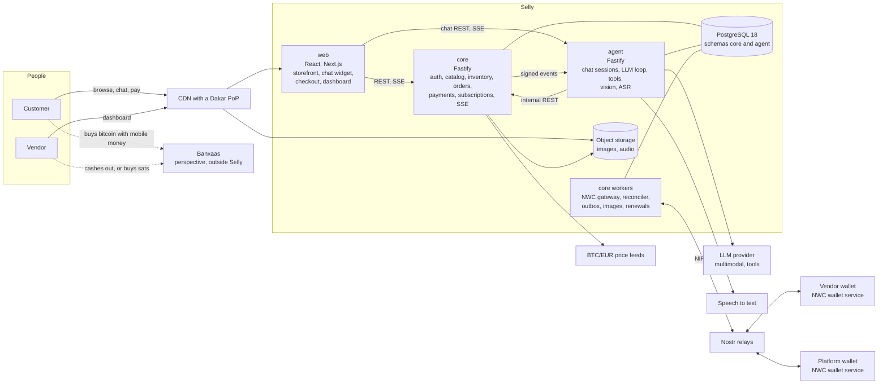

### 3.2 Components and owners

| Component            | Owner                             | Responsibilities                                                                                                                                                                               | Talks to                                                              |
| -------------------- | --------------------------------- | ---------------------------------------------------------------------------------------------------------------------------------------------------------------------------------------------- | --------------------------------------------------------------------- |
| `apps/web`           | Dev 1                             | storefront `/s/{slug}`, chat widget, checkout and order page `/c/{token}`, dashboard PWA `/app`, public pages (`/tarifs`, `/aide/payer-en-bitcoin`)                                            | core (public and vendor API, SSE), agent (chat)                       |
| `apps/agent`         | Dev 2                             | chat sessions, conversation store, agent loop and tools, vendor assistant, product extraction from photos, voice transcription, human handoff, quota checks                                    | LLM, speech to text, core (internal API)                              |
| `apps/core`          | Dev 3                             | vendors, Nostr sign-in and sessions, wallet links, catalog, inventory ledger, orders, invoices, rates, subscriptions and plan limits, media, outbox, SSE, notifications; public and vendor API | PostgreSQL, object storage, Nostr relays, price feeds, agent (events) |
| core workers         | Dev 3                             | NWC gateway, invoice reconciler, reservation expiry, outbox dispatcher, image processing, subscription renewals and grace periods                                                              | same codebase as core, separate entrypoint                            |
| `packages/contracts` | Dev 3 maintains, everyone reviews | Zod schemas for every request, response, error and event; OpenAPI 3.1 generation; typed clients                                                                                                | everyone                                                              |

### 3.3 Technology stack

| Layer                | Choice                                                                                                                                                          | Notes                                                              |
| -------------------- | --------------------------------------------------------------------------------------------------------------------------------------------------------------- | ------------------------------------------------------------------ |
| Language and runtime | TypeScript (strict), Node.js 24 LTS                                                                                                                             | one toolchain for the whole team                                   |
| Monorepo             | pnpm workspaces, Turborepo                                                                                                                                      | cached builds and tests                                            |
| HTTP servers         | Fastify 5 with the Zod type provider, `@fastify/multipart`, `@fastify/rate-limit`, `@fastify/helmet`                                                            | the same Zod schemas validate requests and generate OpenAPI        |
| Contracts            | `docs/api.json` by hand now, then Zod → OpenAPI 3.1 (generated) → typed clients                                                                                 | single source of truth (§5.4)                                      |
| Database             | PostgreSQL 18 (`uuidv7()`, full-text search, `pg_trgm`, `unaccent`)                                                                                             | managed, with point-in-time recovery                               |
| ORM and migrations   | Drizzle ORM, drizzle-kit                                                                                                                                        | SQL-first and light                                                |
| Jobs                 | pg-boss                                                                                                                                                         | retries, schedules, dead letters, in PostgreSQL                    |
| Live updates         | PostgreSQL LISTEN/NOTIFY → SSE                                                                                                                                  | LISTEN needs a direct (non-pooled) connection                      |
| Web                  | React 19, Next.js 16 (App Router, Node output), Tailwind CSS v4, TanStack Query for the dashboard, Serwist for the service worker, Web Push                     | §3.4                                                               |
| Chat client          | `fetch` streaming for SSE (the chat uses a bearer token, which `EventSource` cannot send)                                                                       | the same widget can later be embedded on another domain (§3.8)     |
| Nostr sign-in        | `nostr-tools` in the browser (NIP-07, NIP-46, NIP-55, local key with NIP-49 encryption) and on the server (signature check). Loaded only on the sign-in screen. | §6.4                                                               |
| Images               | `sharp` (libvips) at upload: re-encode, strip EXIF, three widths, WebP and AVIF                                                                                 | public variants served through the CDN                             |
| Object storage       | S3-compatible: Cloudflare R2 recommended (no egress fees), RustFS locally                                                                                        | private bucket for originals and audio, public bucket for variants |
| Lightning and NWC    | `@getalby/sdk` (NWC client), `nostr-tools`, a BOLT11 decoder (for example `light-bolt11-decoder`)                                                               | §3.6                                                               |
| LLM                  | provider SDK behind an `LlmProvider` interface; a fast multimodal model with tool calling and structured output                                                 | chosen by evaluation (§12.4)                                       |
| Speech to text       | `AsrProvider` interface; candidates include Omnilingual ASR (F9) and commercial multilingual services                                                           | Wolof quality measured first                                       |
| Observability        | pino JSON logs with redaction, OpenTelemetry traces and metrics, error tracking (Sentry or GlitchTip)                                                           | §11                                                                |
| Lint and format      | Biome                                                                                                                                                           | one fast tool                                                      |
| Tests                | Vitest, fast-check, Playwright (mobile profiles), k6                                                                                                            | §13                                                                |

### 3.4 Web app

One Next.js app, four surfaces, all React.

| Route                                | Rendering                                                                                                   | Caching                                                           | Client JavaScript                                                 |
| ------------------------------------ | ----------------------------------------------------------------------------------------------------------- | ----------------------------------------------------------------- | ----------------------------------------------------------------- |
| `/`, `/tarifs`                       | server-rendered, static                                                                                     | CDN 5 min                                                         | none                                                              |
| `/aide/payer-en-bitcoin`             | server-rendered, static                                                                                     | CDN 1 h                                                           | none                                                              |
| `/s/{slug}` storefront               | server components                                                                                           | CDN 30 s, stale-while-revalidate 5 min, purged on catalog changes | cart and chat widget, both loaded after first interaction or idle |
| `/s/{slug}/p/{product}` product      | server components, with OpenGraph tags (title, price, image) so links shared in chats show a preview card   | same                                                              | variant picker, add to cart                                       |
| `/s/{slug}/cart` cart                | server-rendered shell with a client component; the cart lives in `localStorage` and the server re-prices it | none                                                              | cart                                                              |
| `/c/{token}` checkout and order page | server-rendered, `noindex`, never cached                                                                    | none                                                              | QR, copy button, SSE status                                       |
| `/app/*` dashboard                   | PWA shell with client components                                                                            | static assets only                                                | dashboard                                                         |
| `/app/login`                         | server-rendered shell                                                                                       | none                                                              | Nostr sign-in (lazy)                                              |

- **Progressive enhancement.** Catalog and product pages work without JavaScript. Add to cart falls back to a form post. The checkout renders the invoice QR as inline SVG on the server; live status needs JavaScript (SSE), with a "J'ai payé, actualiser" button as fallback. The chat needs JavaScript. Without it, the page shows the vendor's optional WhatsApp contact link.
- **Payment.** The checkout shows the amount in FCFA and sats, a QR code, a `lightning:` deep link that opens any installed wallet, and a copy button. Below it, « Pas de bitcoin ? Voir comment en obtenir » links to the help page, which explains how to buy bitcoin with Orange Money or Wave through Banxaas (§3.9) and lists wallet types that work.
- **Order page.** `/c/{token}` stays valid for 30 days after payment and shows the order status (payée, expédiée, livrée). It replaces the status messages that WhatsApp would have carried. The customer finds it again from the chat history.
- **Chat widget.** A floating button on storefront and product pages, loaded lazily (§3.8).
- **Images.** `srcset` with 320, 640 and 960 px widths in WebP and AVIF, lazy loading below the fold, explicit width and height, and a dominant-colour placeholder.
- **Fonts.** The system font stack, no web fonts.
- **Language.** French by default, English, and Wolof strings where a native speaker has checked them. Amounts are formatted with `Intl.NumberFormat('fr-SN')`.
- **Dashboard.** Installable PWA with Web Push for paid orders, new chats and renewal reminders. A worker on the job leader turns those notifications into alerts: Web Push to every browser the vendor registered (payload `{title, body, url, tag}`, dead browsers dropped), and on Pro and Business a NIP-17 direct message from the platform's Nostr key to the key the vendor chose. Each notification is claimed before sending, so it is sent at most once. Photos come from `<input type="file" accept="image/*" capture="environment">`. Offline, the dashboard shows a cached shell and read-only lists. Changes need the network; there is no offline queue in the MVP.
- **Service worker rule.** It caches hashed static assets and an offline shell only. It never caches server-component payloads or API responses. A worker that caches those can leave an installed app on a blank screen after a deploy.
- **JavaScript budget.** React and the Next.js client make the 60 KB budget of the earlier Astro design unrealistic. The budget is 150 KB gzip for the storefront (§10). Keep it with server components for everything that does not need state, dynamic imports for chat and Nostr code, and no client-side data libraries on public pages.

### 3.5 Core modules

| Module          | Owns                                                                      | Main operations                                                                                                                                      |
| --------------- | ------------------------------------------------------------------------- | ---------------------------------------------------------------------------------------------------------------------------------------------------- |
| `auth`          | Nostr challenges, vendor keys, sessions                                   | issue a challenge, verify a signed event, sessions, step-up, add and remove keys                                                                     |
| `vendors`       | vendors, shop settings                                                    | create, update, profile for the agent                                                                                                                |
| `wallet`        | wallet connections (vendors and the platform)                             | link (validate, test, encrypt), status, revoke                                                                                                       |
| `catalog`       | products, variants, images                                                | create, update, search (full text and trigram), store view                                                                                           |
| `inventory`     | stock columns, inventory movements                                        | reserve, release, commit, adjust: the only writer of stock                                                                                           |
| `orders`        | orders, order items, customers                                            | quote, create, cancel, fulfil, expire                                                                                                                |
| `payments`      | invoices (orders and subscriptions)                                       | create invoice (NWC, then Lightning Address fallback), settle, reconcile                                                                             |
| `rates`         | rate quotes                                                               | current BTC/XOF quote from the median of sources                                                                                                     |
| `subscriptions` | plans, subscriptions, subscription invoices, usage counters, trial claims | start a trial, price and create a renewal or upgrade invoice, extend a period on settlement, grace and suspension, enforce plan limits, report usage |
| `media`         | uploads                                                                   | presign, process with sharp, purge CDN URLs                                                                                                          |
| `events`        | outbox, vendor notifications, SSE                                         | publish after commit, dispatch to the agent, the vendor's live stream (7 days kept), Web Push registration, alerts by Web Push and Nostr DM          |

Boundary rules:

- Only `inventory` writes stock columns.
- Only `payments` (and the `wallet` link check) decrypts NWC URIs, for vendors and for the platform wallet.
- Only `subscriptions` writes subscription state, and every other module asks it for limits through a service interface.
- Modules call each other through service interfaces, never through each other's tables.

### 3.6 Lightning payments and the NWC gateway

**Wallet connection lifecycle.** A link is checked in five steps: parse the URI, read the wallet's info event, call `get_info`, apply the permission policy, then create and look up a 1-sat test invoice. Only then is the URI encrypted and stored as `active`. Repeated failures move it to `degraded` (§7.5). The vendor can revoke it. The platform's own wallet, which receives subscription payments, goes through the same checks. It is stored with `owner = 'platform'` and linked by an operator command, not through the API.

**Permission policy** (from `get_info.methods` for this connection):

- MUST include `make_invoice` and `lookup_invoice`. Without `lookup_invoice`, a missed notification would leave a paid order unconfirmed, so the link is refused.
- MUST NOT include spending methods (`pay_invoice`, `pay_keysend`, `multi_pay_*`, `pay`). A leaked receive-only URI cannot move funds. Vendors are shown how to create a receive-only connection in their wallet.
- SHOULD include `get_balance` (shown on the dashboard) and notifications (faster confirmation).

**Client.** One Alby SDK `NWCClient` per active connection, cached with a 10-minute idle timeout and a size cap. The gateway runs as a single active instance, elected with a PostgreSQL advisory lock, so relay subscriptions are never duplicated. At larger scale, many connections can share one subscription per relay.

**Invoice sources, in order:**

1. NWC `make_invoice` on the wallet (the vendor's for orders, the platform's for subscriptions).
2. If NWC does not answer and a Lightning Address is configured whose server supports LUD-21 (F4): LNURL-pay callback with the amount. It returns a BOLT11 invoice and a `verify` URL, and settlement is checked through that URL.
3. Otherwise no invoice can be made. An order is not created and the caller gets `PAYMENT_UNAVAILABLE`. A subscription checkout gets the same error and the vendor is told to retry. A vendor must have a working wallet before the shop goes live.

**Invoice parameters.**

- Amount in msat, always whole sats.
- Description: `"<shop name> commande <number>"` for orders, `"Selly Pro 1 mois"` for subscriptions. It appears in the payer's wallet, so it never contains customer data.
- Expiry: 20 minutes for an order. 60 minutes for a subscription, because a vendor may have to buy sats first (§3.9).
- Every returned BOLT11 is decoded locally, and its amount, payment hash and expiry MUST match the request. A wrong answer from a wallet must never become an order or a paid period.

**A Lightning Address as the wallet.** A vendor whose wallet has no NWC can link a Lightning Address (`kind: lightning_address`), if its server supports LUD-21 `verify`. Core requests a test invoice for the smallest amount it accepts and checks the verify link; invoices then come from the address, and the reconciler confirms payments at each invoice's verify link (no notifications, so up to the reconciler interval). An address without LUD-21 is refused: many addresses only issue invoices, and Selly could not tell a paid order from an unpaid one. The address goes through the outbound guard below.

**Pairing without copy and paste.** For wallets that support Nostr Wallet Auth, `POST /vendors/me/wallet/pairing` returns a `nostr+walletauth://` link with a client key that core made (its secret is encrypted in `core.wallet_pairings` and never shown). The wallet creates a receive-only connection for that key and publishes its info event tagged with it on the pairing relay. A watcher in core sees the event, builds the `nostr+walletconnect://` URI itself and runs the five checks; the secret is then dropped from the pairing row. Links expire after 10 minutes.

**Implementation status.** Built: URI parsing, the permission policy, the five link checks, encryption at rest (AES-256-GCM, bound to the vendor), the invoice check, the circuit breaker with `degraded` and restored states, notifications that trigger a lookup, and a per-wallet throttle. `packages/nwc/testkit` holds a test relay and a fake wallet that speak real NIP-47. Vendors link wallets from the dashboard (or by pairing); the operator can also use `pnpm --filter @selly/core cli wallet:link`. Background work (reconciler, outbox dispatcher, subscription job, wallet notification subscriptions, pairing watcher) runs on one process, the job leader, which holds a session advisory lock on a dedicated connection; another process takes over within 10 seconds when it stops. Invoices that expired or were cancelled in the last 24 hours are looked up again every 10 minutes for late payments. The Lightning Address fallback is built: when NWC fails (timeout, wallet error, open circuit breaker) and the connection has a `lud16` (from the URI, or `PLATFORM_LUD16` for the platform), core asks the address for an invoice, only if its server returns a LUD-21 `verify` URL; the invoice is checked like an NWC one, Selly keeps its own expiry when the server gives a longer one, and settlement is checked at the verify URL (the preimage must match the payment hash). Every request to an address goes through the outbound guard: https only, public addresses only (checked at DNS lookup), no redirects, 5-second timeout, 64 KB body. An order whose wallet cannot be reached waits up to 30 minutes past its deadline before it expires; a payment that arrives later is still recorded (§4.4).

**Rates.** The median of at least two BTC/EUR sources, multiplied by 655.957 (F7), cached for 60 seconds. Each quote used by an order is stored. Subscriptions are priced in sats and need no rate. The pricing page uses the same quote to show an indicative FCFA amount.

### 3.7 Subscriptions

**Model.** Vendors pay Selly in sats. Selly cannot take a share of sales, because customer payments go straight to the vendor's wallet (ADR-05, ADR-14). A subscription has a plan (tier) and a prepaid period of 1, 3 or 12 months. Lightning has no pull payments and we hold no spending key, so renewal is a new invoice that the vendor pays from their wallet. There are no automatic debits and no surprise charges.

**Plans.** Prices are fixed in sats and stored in `core.plans`. Indicative FCFA and euro amounts use the example rate of §4.5 (59,036,130 XOF per BTC, BTC = 90,000 EUR) and move with the market. The pricing page shows the current value.

|                                     | Starter                                 | Pro                                       | Business                                |
| ----------------------------------- | --------------------------------------- | ----------------------------------------- | --------------------------------------- |
| For                                 | a vendor testing online sales           | an active shop                            | a busy shop with a large catalog        |
| 1 month                             | 5,000 sats (about 2,950 FCFA, 4.50 EUR) | 15,000 sats (about 8,850 FCFA, 13.50 EUR) | 40,000 sats (about 23,600 FCFA, 36 EUR) |
| 3 months (5 % off)                  | 14,250 sats                             | 42,750 sats                               | 114,000 sats                            |
| 12 months (2 months free)           | 50,000 sats                             | 150,000 sats                              | 400,000 sats                            |
| Products                            | 30                                      | 200                                       | 1,000                                   |
| Orders and payments                 | unlimited                               | unlimited                                 | unlimited                               |
| Agent replies per month             | 300                                     | 1,500                                     | 6,000                                   |
| Photo-to-product drafts per month   | 10                                      | 100                                       | 500                                     |
| Voice notes understood by the agent | no                                      | yes                                       | yes                                     |
| Alerts                              | dashboard and Web Push                  | plus Nostr direct messages                | plus Nostr direct messages              |
| « Propulsé par Selly » on the shop  | shown                                   | hidden                                    | hidden                                  |
| Chat on the vendor's own domain     | no                                      | no                                        | yes, planned after the MVP (§3.8)       |
| Support                             | help pages                              | a reply within 2 working days             | a reply within 1 working day            |
| Nostr keys per vendor               | 3                                       | 3                                         | 3                                       |

Why these numbers: a Starter shop pays about the price of a few mobile data bundles per month. The limits follow the cost of the agent. If one agent reply costs about 0.004 EUR (an assumption that §8.7 must measure), a Pro shop that uses all 1,500 replies costs about 6 EUR and a Business shop about 24 EUR, against 13.50 and 36 EUR of income. The pilot with five vendors tests both the prices and the limits before launch (§14.3). Plan prices live in the database. A price change applies to new invoices only and is announced 30 days ahead.

**Trial.** A new vendor with a working wallet can start a 14-day Pro trial without paying. One trial per Nostr key and per wallet public key (`core.trial_claims`).

**Lifecycle** (state machine in §4.4):

- `trialing` or `active`: everything on. Reminders go out 7, 3 and 1 days before the end (dashboard banner, Web Push, and a Nostr direct message when the vendor has that alert on).
- `grace`: 7 days after the end, everything still on, with a banner.
- `suspended`: the storefront shows « Boutique momentanément fermée » and takes no new orders (`STORE_PAUSED`), the chat is off, and the dashboard stays open so the vendor can renew and read orders. Orders created before suspension can still be paid and are still confirmed, because the money goes to the vendor's wallet. Data is kept for 90 days.
- A payment at any time returns the subscription to `active`.

**Paying.** One subscription invoice per request, created on the platform's NWC wallet through the same `payments` code as order invoices (§3.6):

1. The vendor picks a plan and a period. `POST /api/v1/vendors/me/subscription/invoices` (idempotent) returns a BOLT11 invoice valid for 60 minutes.
2. The dashboard shows the QR code, a `lightning:` link and a countdown. A vendor without sats follows the help page to buy some first (§3.9), which is why the invoice lasts an hour.
3. The gateway sees the settlement (notification or `lookup_invoice`, ADR-06). One transaction marks the invoice settled and extends the subscription (rules below). The dashboard updates through SSE.
4. The settled invoice is the receipt: it shows the amount, the date and the preimage, which proves payment.

**Period rules at settlement.**

- Same plan, or a lapsed subscription (grace or suspended): the period starts at the later of now and the current end, and lasts the months paid.
- Higher plan while active: the plan changes immediately and the period starts now. The unused time of the current plan is credited at issue time: `credit_sat = floor(current monthly price × remaining days ÷ 30)`, subtracted from the invoice (and shown on it).
- During a trial: any plan can be bought, and it starts when the trial ends.
- Lower plan: allowed only in the grace period, when suspended, or in the last 7 days of the current period. In the last 7 days, it starts when the current period ends (`next_plan_id`, `next_plan_at`). A downgrade is refused when current usage exceeds the lower plan's limits, for example more products than it allows (`PLAN_LIMIT_REACHED`).
- A booked plan (bought during the trial, or a lower plan from the end of the period) can only be bought again until it starts: other plan changes wait until then (`VALIDATION_FAILED`). It becomes the plan at `next_plan_at`; reads apply it at once and the status job persists it.
- Every settled invoice extends the period, even a duplicate payment of two invoices, or an invoice paid after it expired. No money is kept without service in return.
- Free trial days are never credited on an upgrade. When the credit covers the whole price, the vendor is asked for a longer period.

**Limits.** `subscriptions` answers limit questions for the other modules:

- Products: core refuses a new product past the limit (`PLAN_LIMIT_REACHED`, 409).
- Agent replies and photo drafts: counted per calendar month in UTC (`core.usage_counters`). The agent asks for the entitlements before each turn (cached 60 seconds) and reports usage after it. At 80 % the dashboard shows a banner. At 100 % the agent stops: customers get the fixed reply « Je transmets votre message au vendeur » and the vendor is alerted. The storefront, checkout and orders are never limited. A customer can always pay.
- Features such as voice notes are flags in `plans.limits`.

**Platform wallet.** The wallet that receives subscriptions is a receive-only NWC connection owned by the platform, linked on first start from `SECRETS_PLATFORM_NWC_URI`, or by the operator with `pnpm --filter @selly/core cli wallet:link --platform` (same checks as a vendor wallet, encrypted at rest; a linked wallet is kept until replaced with the CLI), with a Lightning Address with LUD-21 as a fallback. If it is down, vendors cannot renew. The grace period covers short outages, and customer payments are unaffected because they never touch this wallet. The operator sweeps funds out of it from their own wallet app.

**Implementation status.** Built: the trial and its claims, pricing with the upgrade credit and the downgrade window, invoices on the platform wallet (or the fake provider), settlement by lookup or notification with the period rules above, late payments, the status job (every 5 minutes: grace, suspension, booked plans, reminders 7, 3 and 1 days before the end on the dashboard stream), and `entitlements.changed` for the agent. The Lightning Address fallback works for the platform wallet too (`PLATFORM_LUD16`). Reminders, grace and suspension also go out by Web Push, and by Nostr direct message where the plan and the vendor allow it (§3.4). Late payments on expired invoices are found by the late-payment check (every 10 minutes, for 24 hours).

### 3.8 Chat on the vendor's website

The proof of concept answers customers in a chat on the vendor's own storefront. This replaces WhatsApp and Instagram until Meta API access exists (ADR-15, §3.9).

- **Session.** The widget calls `POST /api/v1/chat/sessions` with the store slug. The server returns an opaque bearer token (128 bits, stored hashed), which the widget keeps in `localStorage`. The token identifies the conversation. The browser never sends a vendor id or a sender id: the agent derives the vendor from the slug at session creation. A session expires after 30 days without activity.
- **Messages.** The widget posts a message (`POST /api/v1/chat/messages`, with a `client_message_id` for idempotency) and gets `202`. The agent's reply, and any vendor reply, arrive on the SSE stream `GET /api/v1/chat/events`. If the stream drops, the widget polls `GET /api/v1/chat/messages?after=`. A message that arrives while a turn is running waits and is merged into the next turn, which gives one LLM call and one reply for a burst such as "Salam", "robe bi", "42 ?".
- **Replies are rich.** A reply has text, optional product or order cards, and quick replies. A card carries a link to the product page or the checkout. The checkout opens in the same tab and returns to the chat through the browser history.
- **Payment status in the chat.** When core sends `order.paid`, the agent adds a system message to the conversation (« Paiement reçu. Commande A7K2 confirmée. ») and it appears on the SSE stream.
- **Entry points.** The floating button, a « Poser une question » button on each product page that opens the chat with the product attached, and a `?chat=open` link parameter for the vendor to share.
- **Handoff.** The agent can hand off (§8.4). The vendor sees the chat in the dashboard inbox (Web Push and a banner), writes in the thread, and the customer sees the vendor's name next to the messages. While the vendor is active the bot stays silent (§6.6).
- **Contact.** The vendor can set an optional WhatsApp number. The storefront shows it as a plain `wa.me` link for people who prefer to talk there. This needs no Meta API.
- **Abuse.** Rate limits per IP and per token, 1,000 characters per message, 30 turns per hour per conversation, and a daily token budget per vendor (§8.4). A challenge such as proof of work is added only if abuse appears.
- **Embedding later.** The Business plan promises the chat on the vendor's own domain. The widget is built for it from the start: bearer token in a header (no third-party cookies), CORS on the chat endpoints with the vendor's allowed origins, and the widget bundle served separately. It is not in the MVP.

### 3.9 Perspectives

Two things are deliberately outside the MVP. The design keeps a door open for each.

**A. A fiat on-ramp with Banxaas (mobile money to bitcoin).** Banxaas exchanges FCFA and bitcoin with Orange Money or Wave (F6). Most customers in Senegal have mobile money and no bitcoin, so this is the largest adoption risk (§14.1). Three steps, in order of effort:

1. **Now, no integration.** The help page `/aide/payer-en-bitcoin` explains how a customer or vendor buys bitcoin with Orange Money or Wave and pays an invoice, and how a vendor cashes out sats in FCFA. Vendors short of sats for their subscription do the same.
2. **Partner flow, if Banxaas offers an API.** The checkout offers « Payer avec Orange Money ou Wave ». The customer pays the partner in FCFA and the partner pays our Lightning invoice into the vendor's wallet. The vendor always receives sats, and Selly still holds nothing. This needs the `SwapProvider` interface below, a `swaps` table and a state machine, added then. The questions are in §14.2.
3. **Vendor-side conversion.** Vendors who want FCFA convert their sats themselves. This works today and needs nothing from us.

```ts
export type MobileMoneyMethod = 'wave' | 'orange_money' | 'free_money';

export interface SwapProvider {
  readonly id: 'banxaas' | 'fake';
  methods(): Promise<MobileMoneyMethod[]>;
  quote(req: { bolt11: string; amountSat: number; method: MobileMoneyMethod }): Promise<SwapQuote>;
  start(req: { quoteId: string; payerPhone?: string; returnUrl: string }): Promise<SwapSession>;
  status(providerRef: string): Promise<SwapStatusUpdate>;
  verifyWebhook?(rawBody: Buffer, headers: Record<string, string>): SwapStatusUpdate | null;
}

export interface SwapQuote {
  quoteId: string;
  fiatAmountXof: number;
  feeXof: number;
  expiresAt: Date;
}
export interface SwapSession {
  providerRef: string;
  action: { type: 'redirect' | 'ussd' | 'qr'; value: string };
}
export interface SwapStatusUpdate {
  providerRef: string;
  status: 'awaiting_fiat' | 'fiat_received' | 'paying' | 'completed' | 'failed' | 'expired';
  detail?: string;
}
```

A `FakeSwapProvider` would show a simulated Wave screen and then pay the invoice from a test wallet, so the flow can be demonstrated before a partner API exists.

**B. WhatsApp and Instagram.** They return when Meta API access is available. The agent engine, the tools and the conversation store do not depend on the web chat. Each channel is an adapter:

```ts
export interface ChannelAdapter {
  readonly channel: 'web' | 'whatsapp' | 'instagram';
  /** Turn a provider payload or an HTTP request into one normalised message. */
  normalise(input: unknown): Promise<NormalisedMessage | null>;
  /** Render one agent reply for this channel and send it. */
  send(conversation: ConversationRef, reply: AgentReply): Promise<{ providerMessageId?: string }>;
  /** Reply window of the channel in hours: 24 for Meta, none for the web. */
  readonly windowHours?: number;
}
```

What returns with a Meta adapter: webhook ingestion with signature checks and the raw-event table, `agent.channel_connections`, the 24-hour window and approved templates for order updates, `smb_message_echoes` for human takeover, Embedded Signup with coexistence, a platform assistant number for vendor commands, and the WhatsApp costs of F11. The conversation tables already have a `channel` column. Facts F11 to F14 and the Meta rules were checked for the earlier design and need a new check then.

---

## 4. Domain model

### 4.1 Glossary

| Term                         | Meaning                                                                                                                 |
| ---------------------------- | ----------------------------------------------------------------------------------------------------------------------- |
| Vendor                       | A shop owner, identified by one or more Nostr keys. One shop per vendor in the MVP, so vendor and store are one record. |
| Vendor key                   | A Nostr public key (32 bytes, hex) allowed to sign in as the vendor. Up to three per vendor.                            |
| Product                      | An item for sale, with images, a price and one or more variants.                                                        |
| Variant                      | A sellable combination of options (size 42, black) with its own stock.                                                  |
| On hand, reserved, available | Units the vendor has; units held by unpaid orders; on hand minus reserved.                                              |
| Reservation                  | A hold on stock by a pending order, released when it expires or is cancelled.                                           |
| Order                        | A customer's purchase, priced in XOF and in sats.                                                                       |
| Invoice                      | A BOLT11 Lightning invoice on the vendor's wallet, for one order.                                                       |
| Rate quote                   | The BTC/XOF rate used to price an order, with its sources and time.                                                     |
| Wallet connection            | An NWC link: the encrypted URI and its permissions. Owned by a vendor, or by the platform for subscriptions.            |
| Plan                         | A subscription tier (Starter, Pro, Business) with prices in sats and limits.                                            |
| Subscription                 | A vendor's current plan, status and paid period.                                                                        |
| Subscription invoice         | A BOLT11 invoice on the platform's wallet, for a plan and a number of months.                                           |
| Usage counter                | The number of agent replies or photo drafts used in a calendar month.                                                   |
| Chat session                 | A browser's bearer token for one conversation with a shop.                                                              |
| Conversation                 | A thread between one customer (or the vendor) and the agent on one channel. The brief calls it AgentSession.            |
| Product draft                | A product the agent extracted from a photo or a message, waiting for the vendor's confirmation.                         |
| Handoff                      | The bot steps back and the vendor answers by hand from the dashboard.                                                   |

### 4.2 Class diagram

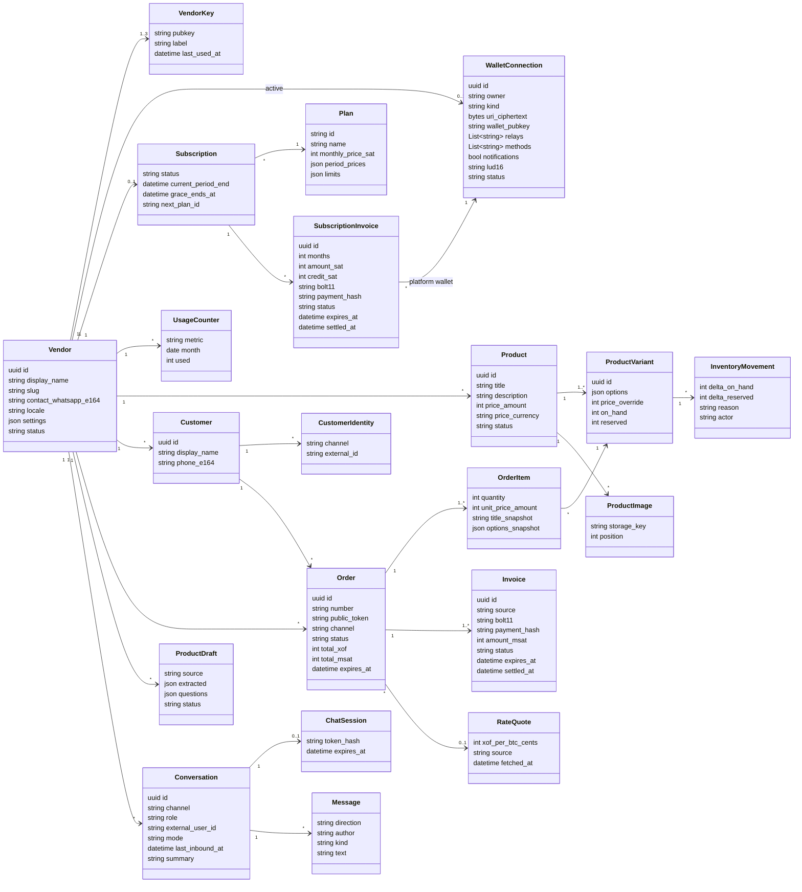

`ChatSession`, `Conversation` and `Message` live in the `agent` schema. Everything else lives in the `core` schema. The agent never reads or writes the core schema: it uses the core API.

### 4.3 Tables

The Drizzle schema in `packages/db/src/core/schema.ts` and the SQL in `packages/db/migrations` are the source of truth. The sketch below follows them, with these implementation choices:

- Ids are UUIDv7, generated by the application (the `uuidv7` package), so the same code runs on PostgreSQL 18 and on PGlite in tests. `default uuidv7()` in the sketch shows the intent.
- `unaccent_i` lives in the `public` schema, so the first migration can create it before the `core` schema exists.
- A rate is stored as integer centi-francs per BTC (`xof_per_btc_cents bigint`), so no floating point or decimal type reaches the money code.
- Products have a `slug`, unique per vendor, for the product page URL `/s/{store}/p/{slug}`.
- The plans of §3.7 are seeded by a migration (`0002_seed_plans.sql`).

```sql
create schema core;
create extension if not exists citext;
create extension if not exists pg_trgm;
create extension if not exists unaccent;

-- unaccent() is not IMMUTABLE, so generated columns and indexes use this wrapper.
create function public.unaccent_i(text) returns text
  language sql immutable parallel safe as $$ select public.unaccent('public.unaccent', $1) $$;

create type core.currency as enum ('XOF', 'SAT');
create type core.channel as enum ('whatsapp', 'instagram', 'web');
create type core.order_status as enum ('pending_payment', 'paid', 'fulfilled', 'cancelled', 'expired');
create type core.invoice_status as enum ('pending', 'settled', 'expired', 'cancelled');

create table core.vendors (
  id                    uuid primary key default uuidv7(),
  display_name          text not null check (length(display_name) between 2 and 60),
  slug                  citext not null unique check (slug ~ '^[a-z0-9][a-z0-9-]{1,38}[a-z0-9]$'),
  contact_whatsapp_e164 text check (contact_whatsapp_e164 ~ '^\+[1-9][0-9]{7,14}$'),  -- shown as a wa.me link, never verified, never messaged
  locale                text not null default 'fr-SN',
  -- pricing_currency, delivery zones and fees, pickup, hours, policies, tone, negotiation limits,
  -- notifications (web_push, nostr_dm)
  settings              jsonb not null default '{}',
  status                text not null default 'active' check (status in ('active', 'suspended')),  -- 'suspended' is an operator action (abuse), not a billing state
  created_at            timestamptz not null default now(),
  updated_at            timestamptz not null default now()
);

create table core.vendor_keys (
  pubkey       text primary key check (pubkey ~ '^[0-9a-f]{64}$'),   -- Nostr public key, hex
  vendor_id    uuid not null references core.vendors(id),
  label        text,                                                  -- 'Amber sur mon téléphone', 'Clé de secours'
  created_at   timestamptz not null default now(),
  last_used_at timestamptz,
  revoked_at   timestamptz
);
create index vendor_keys_by_vendor on core.vendor_keys(vendor_id) where revoked_at is null;
-- At most three live keys per vendor: enforced in the auth module, inside the transaction that adds a key.

create table core.nostr_challenges (
  id          uuid primary key default uuidv7(),
  challenge   text not null unique,            -- 32 random bytes, hex
  purpose     text not null check (purpose in ('sign_in', 'step_up', 'add_key')),
  session_id  uuid,                            -- set for step_up and add_key
  expires_at  timestamptz not null,            -- 5 minutes
  used_at     timestamptz,                     -- single use
  created_at  timestamptz not null default now()
);

create table core.wallet_connections (
  id             uuid primary key default uuidv7(),
  owner          text not null default 'vendor' check (owner in ('vendor', 'platform')),
  vendor_id      uuid references core.vendors(id),   -- null for the platform wallet
  kind           text not null check (kind in ('nwc', 'lightning_address')),
  uri_ciphertext bytea,          -- AES-256-GCM of the NWC URI; null for a Lightning Address
  key_version    smallint,       -- which encryption key; supports rotation
  wallet_pubkey  text,           -- NWC wallet service key (hex)
  client_pubkey  text,           -- public key of the URI secret (hex), for relay filters
  relays         text[] not null default '{}',
  methods        text[] not null default '{}',   -- from get_info for this connection
  notifications  boolean not null default false,
  encryption     text,           -- 'nip44_v2' or 'nip04'
  lud16          text,           -- Lightning Address, if any
  status         text not null default 'active' check (status in ('active', 'degraded', 'revoked')),
  last_ok_at     timestamptz,
  last_error     text,
  created_at     timestamptz not null default now(),
  revoked_at     timestamptz,
  check ((owner = 'vendor') = (vendor_id is not null))
);
create unique index wallet_connections_one_live on core.wallet_connections(vendor_id)
  where status <> 'revoked' and owner = 'vendor';
create unique index wallet_connections_one_platform on core.wallet_connections((true))
  where status <> 'revoked' and owner = 'platform';

create table core.products (
  id             uuid primary key default uuidv7(),
  vendor_id      uuid not null references core.vendors(id),
  title          text not null check (length(title) between 2 and 120),
  slug           text not null,  -- product page URL, unique per vendor
  description    text not null default '',
  category       text,
  price_amount   bigint not null check (price_amount > 0),
  price_currency core.currency not null default 'XOF',  -- MUST equal the vendor's pricing_currency
  status         text not null default 'active' check (status in ('active', 'hidden', 'archived')),
  search         tsvector generated always as
                   (to_tsvector('simple', public.unaccent_i(title || ' ' || description))) stored,
  created_at     timestamptz not null default now(),
  updated_at     timestamptz not null default now()
);
create unique index products_vendor_slug on core.products(vendor_id, slug);
create index products_search on core.products using gin (search);
create index products_title_trgm on core.products using gin (public.unaccent_i(title) gin_trgm_ops);

create table core.product_variants (
  id             uuid primary key default uuidv7(),
  product_id     uuid not null references core.products(id) on delete cascade,
  sku            text,
  options        jsonb not null default '{}',   -- {"size": "42", "color": "noir"}
  price_override bigint check (price_override > 0),
  on_hand        integer not null default 0 check (on_hand >= 0),
  reserved       integer not null default 0 check (reserved >= 0),
  check (reserved <= on_hand),
  unique (product_id, options)
);

create table core.product_images (
  id          uuid primary key default uuidv7(),
  product_id  uuid not null references core.products(id) on delete cascade,
  storage_key text not null,
  width       integer not null,
  height      integer not null,
  dominant    text,               -- placeholder colour, '#rrggbb'
  position    smallint not null default 0
);

create table core.inventory_movements (
  id             uuid primary key default uuidv7(),
  variant_id     uuid not null references core.product_variants(id),
  delta_on_hand  integer not null default 0,
  delta_reserved integer not null default 0,
  reason         text not null check (reason in ('restock', 'adjustment', 'reserve', 'release', 'sale', 'return')),
  order_id       uuid,
  draft_id       uuid,
  actor          text not null,   -- 'vendor:<id>', 'agent', 'system'
  created_at     timestamptz not null default now()
);

create table core.customers (
  id           uuid primary key default uuidv7(),
  vendor_id    uuid not null references core.vendors(id),   -- customers are never shared between vendors
  display_name text,
  phone_e164   text,
  created_at   timestamptz not null default now()
);

create table core.customer_identities (
  vendor_id   uuid not null references core.vendors(id),
  channel     core.channel not null,
  external_id text not null,      -- WhatsApp wa_id, Instagram-scoped id, or web session id
  customer_id uuid not null references core.customers(id),
  primary key (vendor_id, channel, external_id)
);

create table core.rate_quotes (
  id          uuid primary key default uuidv7(),
  xof_per_btc_cents bigint not null check (xof_per_btc_cents > 0),  -- 59,036,130.00 XOF per BTC is 5903613000
  source      text not null,      -- 'index' (BTC/EUR median × 655.957) or a partner name
  inputs      jsonb not null,     -- each source price used
  fetched_at  timestamptz not null,
  valid_until timestamptz not null
);

create table core.orders (
  id               uuid primary key default uuidv7(),
  vendor_id        uuid not null references core.vendors(id),
  customer_id      uuid not null references core.customers(id),
  number           text not null,          -- short code shown in chat, e.g. 'A7K2'
  public_token     text not null unique,   -- 128-bit random, base62, used in checkout and order page links
  channel          core.channel not null,  -- 'web' in the MVP
  conversation_ref text,                   -- agent conversation id, for the payment confirmation
  status           core.order_status not null default 'pending_payment',
  attention        text,                   -- set when the vendor must act (e.g. paid after cancel)
  pricing_currency core.currency not null,
  subtotal_xof     bigint not null,
  delivery_fee_xof bigint not null default 0,
  discount_xof     bigint not null default 0,
  total_xof        bigint not null check (total_xof > 0),
  total_msat       bigint not null check (total_msat > 0 and total_msat % 1000 = 0),
  rate_quote_id    uuid references core.rate_quotes(id),   -- null when the shop prices in sats
  delivery         jsonb not null default '{}',   -- method, zone, address text, contact phone, note
  expires_at       timestamptz not null,
  paid_at          timestamptz,
  fulfilled_at     timestamptz,
  cancelled_at     timestamptz,
  cancel_reason    text,
  created_at       timestamptz not null default now(),
  updated_at       timestamptz not null default now(),
  unique (vendor_id, number)
);
create index orders_vendor_status on core.orders(vendor_id, status, created_at desc);

create table core.order_items (
  id                uuid primary key default uuidv7(),
  order_id          uuid not null references core.orders(id) on delete cascade,
  variant_id        uuid not null references core.product_variants(id),
  quantity          integer not null check (quantity between 1 and 50),
  unit_price_amount bigint not null,       -- the brief's price_at_purchase
  price_currency    core.currency not null,
  title_snapshot    text not null,
  options_snapshot  jsonb not null default '{}'
);

create table core.invoices (
  id                   uuid primary key default uuidv7(),
  order_id             uuid not null references core.orders(id),
  vendor_id            uuid not null references core.vendors(id),
  wallet_connection_id uuid references core.wallet_connections(id),
  source               text not null check (source in ('nwc', 'lnurl')),
  bolt11               text not null,
  payment_hash         text not null check (payment_hash ~ '^[0-9a-f]{64}$'),
  amount_msat          bigint not null check (amount_msat > 0),
  description          text not null,
  verify_url           text,               -- LUD-21, when source = 'lnurl'
  status               core.invoice_status not null default 'pending',
  expires_at           timestamptz not null,
  settled_at           timestamptz,
  preimage             text,
  created_at           timestamptz not null default now(),
  unique (vendor_id, payment_hash)
);
-- No "one settled invoice per order" constraint: a replaced invoice can still be paid, and
-- that second settlement MUST be recorded, not rejected (see the order rules in §4.4).
create index invoices_by_order on core.invoices(order_id);
create index invoices_pending_expiry on core.invoices(expires_at) where status = 'pending';

create table core.plans (
  id                text primary key check (id ~ '^[a-z]+$'),   -- 'starter', 'pro', 'business'
  name              text not null,
  monthly_price_sat bigint not null check (monthly_price_sat > 0),
  period_prices     jsonb not null,    -- {"1": 5000, "3": 14250, "12": 50000}, in sats
  limits            jsonb not null,    -- {"products": 30, "agent_turns": 300, "drafts": 10, "voice_notes": false, "nostr_dm": false, "branding": true, "embed": false}
  active            boolean not null default true,
  sort              smallint not null,
  updated_at        timestamptz not null default now()
);

create table core.subscriptions (
  id                   uuid primary key default uuidv7(),
  vendor_id            uuid not null unique references core.vendors(id),
  plan_id              text not null references core.plans(id),
  next_plan_id         text references core.plans(id),     -- booked: bought during the trial, or a lower plan in the last 7 days
  next_plan_at         timestamptz,                         -- when next_plan_id becomes the plan
  status               text not null check (status in ('trialing', 'active', 'grace', 'suspended')),
  trial_ends_at        timestamptz,                         -- set once, when the trial starts
  current_period_start timestamptz not null,
  current_period_end   timestamptz not null,
  grace_ends_at        timestamptz,                         -- period end + 7 days, set when status = 'grace'
  created_at           timestamptz not null default now(),
  updated_at           timestamptz not null default now()
);
create index subscriptions_expiring on core.subscriptions(current_period_end) where status in ('trialing', 'active', 'grace');

create table core.subscription_invoices (
  id                   uuid primary key default uuidv7(),
  vendor_id            uuid not null references core.vendors(id),
  subscription_id      uuid references core.subscriptions(id),   -- null until the first payment creates one
  plan_id              text not null references core.plans(id),
  months               smallint not null check (months in (1, 3, 12)),
  list_price_sat       bigint not null check (list_price_sat > 0),
  credit_sat           bigint not null default 0 check (credit_sat >= 0),   -- unused time of the current plan, on an upgrade
  amount_sat           bigint not null check (amount_sat > 0),              -- list_price_sat - credit_sat
  wallet_connection_id uuid references core.wallet_connections(id),  -- the platform wallet; null with the fake provider
  source               text not null check (source in ('nwc', 'lnurl')),
  bolt11               text not null,
  payment_hash         text not null check (payment_hash ~ '^[0-9a-f]{64}$'),
  amount_msat          bigint not null check (amount_msat = amount_sat * 1000),
  description          text not null,
  verify_url           text,
  status               core.invoice_status not null default 'pending',
  expires_at           timestamptz not null,
  settled_at           timestamptz,
  preimage             text,                    -- the receipt
  period_start         timestamptz,             -- filled at settlement
  period_end           timestamptz,
  created_at           timestamptz not null default now(),
  unique (wallet_connection_id, payment_hash)
);
create index subscription_invoices_by_vendor on core.subscription_invoices(vendor_id, created_at desc);
create index subscription_invoices_pending_expiry on core.subscription_invoices(expires_at) where status = 'pending';

create table core.usage_counters (
  vendor_id uuid not null references core.vendors(id),
  metric    text not null check (metric in ('agent_turns', 'drafts')),
  month     date not null,                      -- first day of the calendar month, UTC
  used      integer not null default 0 check (used >= 0),
  primary key (vendor_id, metric, month)
);

create table core.trial_claims (
  claim_key  text primary key,                  -- 'key:<vendor pubkey hex>' or 'wallet:<wallet service pubkey hex>'
  vendor_id  uuid not null references core.vendors(id),
  claimed_at timestamptz not null default now()
);

create table core.product_drafts (
  id                uuid primary key default uuidv7(),
  vendor_id         uuid not null references core.vendors(id),
  source            text not null check (source in ('dashboard', 'assistant')),
  image_keys        text[] not null default '{}',
  input_text        text,                  -- the vendor's caption, or the transcript of a voice note
  extracted         jsonb,                 -- fields with value, confidence and origin (§8.6)
  questions         jsonb not null default '[]',
  target_product_id uuid references core.products(id),   -- set when it is a restock
  status            text not null default 'processing' check (status in
                      ('processing', 'needs_review', 'confirmed', 'discarded', 'failed')),
  error             text,
  created_at        timestamptz not null default now(),
  confirmed_at      timestamptz
);

create table core.vendor_sessions (
  id           uuid primary key default uuidv7(),
  pubkey       text not null,                 -- the key that signed in
  vendor_id    uuid references core.vendors(id),   -- null between sign-in and shop creation
  token_hash   bytea not null unique,         -- SHA-256 of the cookie value
  device_label text,
  step_up_at   timestamptz,                   -- last fresh signature, for wallet and key changes
  last_seen_at timestamptz not null default now(),
  expires_at   timestamptz not null,
  revoked_at   timestamptz,
  created_at   timestamptz not null default now()
);

create table core.outbox (
  id              uuid primary key default uuidv7(),
  topic           text not null,           -- 'order.paid', 'order.expired', ...
  key             text not null,           -- aggregate id, keeps events of one order in order
  payload         jsonb not null,
  created_at      timestamptz not null default now(),
  next_attempt_at timestamptz not null default now(),
  attempts        integer not null default 0,
  published_at    timestamptz,
  last_error      text
);

create table core.idempotency_keys (
  scope        text not null,              -- 'svc:agent', 'vendor:<id>', 'ip:<hash>'
  key          text not null,
  request_hash bytea not null,
  status_code  smallint,
  response     jsonb,
  created_at   timestamptz not null default now(),
  primary key (scope, key)
);

create table core.audit_log (
  id         uuid primary key default uuidv7(),
  actor      text not null,                -- 'vendor:<id>', 'agent', 'system', 'customer:<id>'
  action     text not null,                -- 'wallet.linked', 'wallet.replaced', 'order.paid', 'price.changed', ...
  target     text,
  details    jsonb not null default '{}',  -- redacted, never secrets
  created_at timestamptz not null default now()
);

```

```sql
create schema agent;

create table agent.conversations (
  id               uuid primary key default uuidv7(),
  vendor_id        uuid not null,            -- core.vendors.id; no cross-schema foreign key on purpose
  channel          text not null default 'web' check (channel in ('web', 'whatsapp', 'instagram')),   -- only 'web' in the MVP
  role             text not null check (role in ('customer', 'vendor')),
  external_user_id text not null,            -- web: the chat session id; vendor assistant: the vendor id; later: wa_id or Instagram-scoped id
  customer_id      uuid,                     -- core.customers.id once an order exists
  customer_label   text,                     -- 'Visiteur 7H2Q', then the name given at checkout
  mode             text not null default 'bot' check (mode in ('bot', 'human', 'paused')),
  human_until      timestamptz,
  vendor_read_at   timestamptz,              -- for the unread count in the inbox
  last_inbound_at  timestamptz,
  language         text,                     -- 'fr', 'wo', 'en', 'mixed'
  summary          text not null default '',
  state            jsonb not null default '{}',   -- cart in progress, pending question, draft id, product in view
  created_at       timestamptz not null default now(),
  updated_at       timestamptz not null default now(),
  unique (vendor_id, channel, external_user_id)
);

create table agent.chat_sessions (            -- web chat only
  id              uuid primary key default uuidv7(),
  vendor_id       uuid not null,
  conversation_id uuid not null references agent.conversations(id),
  token_hash      bytea not null unique,      -- SHA-256 of the bearer token
  ip_hash         bytea,                      -- for rate limits, never the raw address
  expires_at      timestamptz not null,       -- 30 days after the last activity
  last_seen_at    timestamptz not null default now(),
  created_at      timestamptz not null default now()
);

create table agent.messages (
  id                uuid primary key default uuidv7(),
  conversation_id   uuid not null references agent.conversations(id),
  direction         text not null check (direction in ('in', 'out')),
  author            text not null check (author in ('customer', 'vendor', 'agent', 'system')),
  kind              text not null check (kind in ('text', 'audio', 'image', 'order_link', 'system')),
  text              text,
  cards             jsonb not null default '[]',         -- product and order cards
  quick_replies     jsonb not null default '[]',
  media_key         text,
  client_message_id text,                                -- idempotency key chosen by the widget
  status            text,                                -- accepted, processed, failed
  created_at        timestamptz not null default now(),
  unique (conversation_id, client_message_id)
);
create index messages_by_conversation on agent.messages(conversation_id, id);

create table agent.llm_calls (
  id              uuid primary key default uuidv7(),
  conversation_id uuid,
  purpose         text not null,             -- reply, summary, extraction, transcription
  model           text not null,
  latency_ms      integer,
  input_tokens    integer,
  output_tokens   integer,
  tool_calls      jsonb,
  error           text,
  created_at      timestamptz not null default now()
);
```

Database roles: `core_app` reads and writes the `core` schema only. `agent_app` reads and writes the `agent` schema only. A read-only role serves analytics. When a Meta channel returns (§3.9), the agent schema gains `channel_connections` and a raw `webhook_events` table.

### 4.4 State machines

**Order**

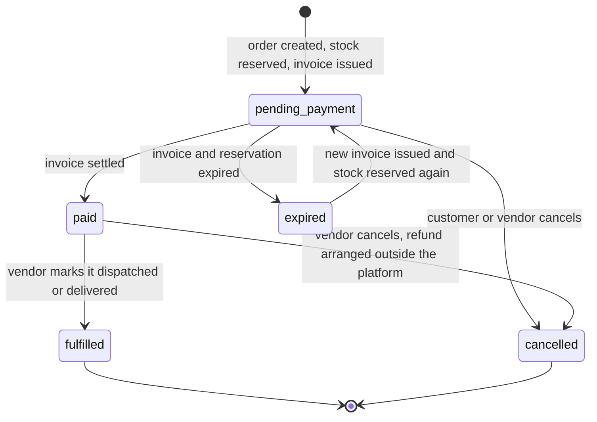

A regular invoice cannot be withdrawn from the payer's wallet. So the invoice of a cancelled order, or an older invoice replaced by a new one (§3.6), can still be paid. Late payments are always recorded:

- For an expired or cancelled order, the order becomes `paid` if the stock can be reserved again. Otherwise it gets `attention = 'paid_without_stock'` and the vendor is alerted to refund the customer from their own wallet.
- For an order that is already paid, the second payment is recorded, the order gets `attention = 'paid_twice'`, and the vendor is alerted to refund it.
- When an invoice is replaced, the old one is marked `cancelled` and disappears from the checkout page, which keeps double payments rare.

**Invoice** (orders and subscriptions)

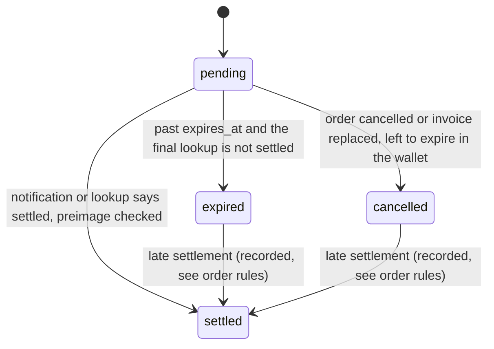

For a subscription invoice, a late settlement extends the period by the months paid (§3.7).

**Subscription**

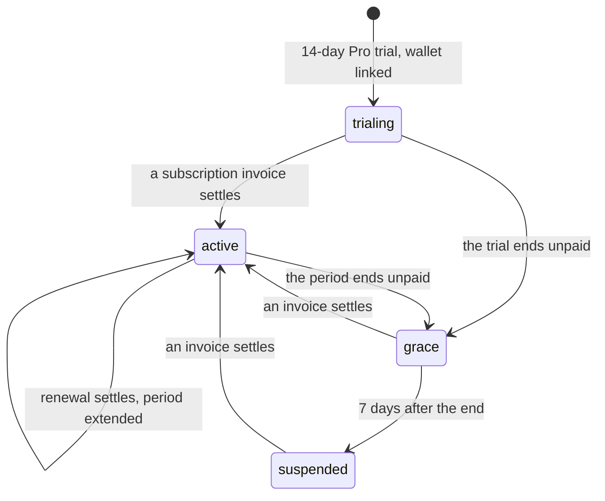

Status changes come from one scheduled job (every 5 minutes) and from settlement. Both are conditional updates (§7.6).

**Conversation mode**

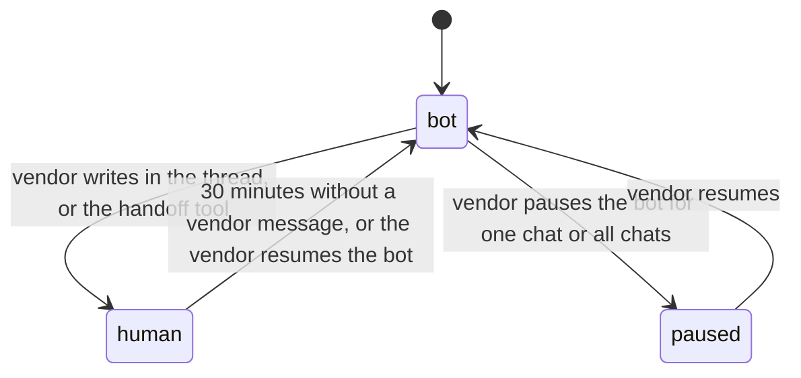

When a conversation returns to `bot` and the customer's last message is unanswered, the bot answers it.

**Product draft:** `processing` → `needs_review` → `confirmed` or `discarded`; `processing` → `failed`.

**Sign-in challenge:** `issued` → `used` (once), or `expired` after 5 minutes. A used or expired challenge is never accepted again (§9.1).

### 4.5 Money rules

- XOF amounts are integers in francs; the CFA franc has no minor unit in use. Sats and msats are integers (`bigint`). Floating point is never used for money.
- Rate: `xof_per_btc = median(BTC/EUR from at least two sources) × 655.957` (F7), cached for 60 seconds. A quote stays attached to its order. It is stored as integer centi-francs per BTC.
- Conversion: `total_sat = ceil(total_xof × 100,000,000 / xof_per_btc)` and `total_msat = total_sat × 1,000`. Rounding up means the vendor never receives less than the FCFA price at the quoted rate. Intermediate products exceed 2^53, so the code uses `bigint` or a decimal library, never `number`.
- Example: at BTC = 90,000 EUR, `xof_per_btc` = 59,036,130. An order of 16,000 FCFA is 27,102.05 sats, so the invoice is 27,103 sats (27,103,000 msat).
- No hidden buffer is added to the rate. The vendor carries the volatility of the invoice lifetime (20 minutes for an order).
- Every order has a sats amount, because a shop cannot go live without a wallet (§6.4). A shop that prices in sats has no rate quote (`rate_quote_id` is null).
- Subscriptions are priced in sats and need no rate. A subscription invoice is `list_price_sat - credit_sat`, always a whole number of sats (§3.7).
- Delivery fees come from the vendor's zones, added by core. Discounts come only from `quote_cart` within the vendor's negotiation limit (§8.4).
- A cart is in one currency: the vendor's `pricing_currency` (XOF by default, SAT for bitcoin-native shops).

### 4.6 Inventory rules

- `available = on_hand − reserved`. Every change goes through the `inventory` module and writes an `inventory_movements` row in the same transaction.
- **Reserve** (order creation), one statement per line, in variant id order to avoid deadlocks:
  `update core.product_variants set reserved = reserved + $q where id = $id and on_hand - reserved >= $q`. Zero rows updated means out of stock, and the transaction rolls back.
- **Commit** (order paid): `on_hand -= q`, `reserved -= q`, movement `sale`.
- **Release** (expired or cancelled): `reserved -= q`, movement `release`.
- **Restock or adjust** (vendor): `on_hand += delta`. Stock can never go below `reserved`. If the vendor tries, the request is refused with the list of pending orders holding it.
- A reservation lasts until the order expires: the invoice expiry plus 2 minutes of grace. It is extended when a new invoice is created for the same order. A job runs every 30 seconds: final `lookup_invoice`, then release.
- **Abuse limits** (configurable): at most 3 pending orders per customer identity per vendor, at most 5 units of one variant per pending order, and web orders need a phone number.

---

## 5. API contract

This section is the contract between web (Dev 1), agent (Dev 2) and core (Dev 3). The machine-readable version is [`api.json`](api.json): OpenAPI 3.1 with every request body, every response and every error in full, plus examples. While `api.json` is written by hand, this section and the file MUST agree. Once `packages/contracts` generates the file (§5.4), the generated file wins and this section is updated.

### 5.1 Conventions

- **Paths.** `/api/v1/...` for the public and vendor API. `/internal/v1/...` for service-to-service calls, reachable only on the private network.
- **JSON** with snake_case keys, like the database and NWC payloads.
- **Identifiers.** UUIDv7 strings. Customers see `order.number` (4 characters from an unambiguous alphabet, unique per vendor, for example `A7K2`) and `order.public_token` (128-bit random, 22 base62 characters) in links. Raw ids never appear in customer URLs.
- **Time.** RFC 3339 in UTC.
- **Money.** `{ "amount": 15000, "currency": "XOF" }`. Sats are plain integers named `*_sat`. Fields that mirror NWC keep `amount_msat`. Plan prices are in sats.
- **Nostr keys and events.** Public keys are 64 lowercase hex characters (never `npub` in the API). Signed events are the standard NIP-01 object (`id`, `pubkey`, `created_at`, `kind`, `tags`, `content`, `sig`).
- **Errors.** RFC 9457 `application/problem+json`, with a stable `code` (catalog in §7.4):

  ```json
  {
    "type": "https://<app-domain>/problems/out-of-stock",
    "title": "Out of stock",
    "status": 409,
    "code": "OUT_OF_STOCK",
    "detail": "Size 42 in black has 0 left.",
    "errors": [{ "variant_id": "0193a8f0-6b2c-7d4e-8f9a-1b2c3d4e5f60", "available": 0 }],
    "trace_id": "4bf92f3577b34da6a3ce929d0e0e4736"
  }
  ```

- **Idempotency.** `Idempotency-Key` is required on `POST /orders`, `POST /checkout/{token}/invoice`, `POST /vendors/me/subscription/invoices`, `POST /inventory` and `POST /inventory/restock-ai`, and on their internal twins. A replay within 24 hours returns the stored response. The same key with a different body returns 422 `IDEMPOTENCY_MISMATCH`. Chat messages use the body field `client_message_id` for the same purpose.
- **Pagination.** `?limit=` (at most 100) and `?cursor=`. Responses look like `{ "data": [...], "next_cursor": "..." }`.
- **Caching.** Public store reads send `ETag` and `Cache-Control: public, max-age=30, stale-while-revalidate=300`. Core purges the store's URLs from the CDN after catalog changes.
- **Rate limits.** 429 with `Retry-After`. Per IP on the public API, per vendor on the vendor API, per chat token on the chat API, per service token on the internal API.
- **Authentication.**

  | Caller                            | Mechanism                                                                                                                                                                                                                                                                                                                                                                                                                                                                                                        |
  | --------------------------------- | ---------------------------------------------------------------------------------------------------------------------------------------------------------------------------------------------------------------------------------------------------------------------------------------------------------------------------------------------------------------------------------------------------------------------------------------------------------------------------------------------------------------- |
  | Customer, storefront and checkout | None. Checkout endpoints are addressed by `public_token`.                                                                                                                                                                                                                                                                                                                                                                                                                                                        |
  | Customer, chat                    | `Authorization: Bearer <chat session token>`, issued by `POST /chat/sessions`.                                                                                                                                                                                                                                                                                                                                                                                                                                   |
  | Vendor                            | Session cookie `selly_session` (httpOnly, Secure, SameSite=Lax), with an Origin check on every state-changing request. The cookie is issued after a signed Nostr challenge. Replacing or unlinking the wallet, and adding or removing keys, need a step-up: a signature less than 10 minutes old. State-changing requests without the app's `Origin` get 403 `FORBIDDEN`. Sign-in routes allow 20 requests a minute per IP; `TRUST_PROXY` says how many proxies in front of core are believed for the client IP. |
  | Agent to core                     | `Authorization: Bearer <service token>` with scopes (`catalog:read`, `orders:write`, `drafts:write`, `inventory:write`, `entitlements:read`, `usage:write`, `notifications:write`, ...). Also `X-Request-Id`, and `X-Actor` (`customer:<conversation id>` or `vendor:<id>`) for the audit log.                                                                                                                                                                                                                   |
  | Core to agent                     | HMAC-SHA256 over the timestamp and body: `X-Selly-Signature: t=<unix>,v1=<hex>`, 5-minute tolerance.                                                                                                                                                                                                                                                                                                                                                                                                             |

### 5.2 Endpoint catalog

Every operation below has an entry in [`api.json`](api.json) with the same method and path. The last column says whether core, agent or web's server code handles it.

**A. Public storefront, checkout and pricing** (no authentication)

| Method | Path                                          | Purpose                                                                                                                                                     | Served by |
| ------ | --------------------------------------------- | ----------------------------------------------------------------------------------------------------------------------------------------------------------- | --------- |
| GET    | `/api/v1/stores/{slug}`                       | Profile, customer-facing settings (delivery zones, pickup, hours, WhatsApp contact), chat availability, store status, and the first page of the catalog     | core      |
| GET    | `/api/v1/stores/{slug}/products`              | Catalog pages with filters (`q`, `category`, `cursor`)                                                                                                      | core      |
| GET    | `/api/v1/stores/{slug}/products/{product_id}` | One product with variants and availability                                                                                                                  | core      |
| POST   | `/api/v1/stores/{slug}/cart-quotes`           | Server-side totals for a cart: items, delivery zone, total in XOF and in sats                                                                               | core      |
| POST   | `/api/v1/orders`                              | Create an order: reserve stock, quote the rate, create the invoice. Returns the order, the invoice (`bolt11` is the brief's `pay_req`) and the checkout URL | core      |
| GET    | `/api/v1/checkout/{token}`                    | Order summary for the checkout and order page, with the invoice and fulfilment status                                                                       | core      |
| GET    | `/api/v1/checkout/{token}/status`             | Payment status, for polling                                                                                                                                 | core      |
| GET    | `/api/v1/checkout/{token}/events`             | SSE stream of status changes                                                                                                                                | core      |
| POST   | `/api/v1/checkout/{token}/invoice`            | New invoice after expiry; reserves the stock again                                                                                                          | core      |
| GET    | `/api/v1/rates/btc-xof`                       | Indicative rate for display                                                                                                                                 | core      |
| GET    | `/api/v1/plans`                               | The three plans with prices in sats for 1, 3 and 12 months, limits and indicative FCFA                                                                      | core      |

**B. Chat on the vendor's website** (agent)

| Method | Path                    | Auth               | Purpose                                                                                         |
| ------ | ----------------------- | ------------------ | ----------------------------------------------------------------------------------------------- |
| POST   | `/api/v1/chat/sessions` | none, rate limited | Open a conversation with a shop. Returns the bearer token, the first message and the disclosure |
| GET    | `/api/v1/chat/messages` | chat token         | History, with `after` for catching up                                                           |
| POST   | `/api/v1/chat/messages` | chat token         | Send a message (text or an uploaded audio). Returns 202; the reply comes on the stream          |
| GET    | `/api/v1/chat/events`   | chat token         | SSE: `message`, `typing`, `mode`                                                                |
| POST   | `/api/v1/chat/uploads`  | chat token         | Presigned upload for a voice note (Pro and Business)                                            |

**C. Authentication and vendor keys** (core)

| Method | Path                               | Purpose                                                                                       |
| ------ | ---------------------------------- | --------------------------------------------------------------------------------------------- |
| POST   | `/api/v1/auth/nostr/challenges`    | Get a one-time challenge and the event template to sign (`sign_in`, `step_up` or `add_key`)   |
| POST   | `/api/v1/auth/nostr/sessions`      | Send the signed event. Sets the session cookie. A vendor with no shop yet gets `vendor: null` |
| POST   | `/api/v1/auth/logout`              | End the session                                                                               |
| GET    | `/api/v1/auth/sessions`            | List signed-in devices                                                                        |
| DELETE | `/api/v1/auth/sessions/{id}`       | Sign a device out                                                                             |
| GET    | `/api/v1/vendors/me/keys`          | List the vendor's Nostr keys                                                                  |
| POST   | `/api/v1/vendors/me/keys`          | Add a key (step-up, plus a signature from the new key). At most three                         |
| DELETE | `/api/v1/vendors/me/keys/{pubkey}` | Remove a key (step-up). The last key cannot be removed                                        |

**D. Vendor shop, wallet and subscription** (core, session cookie)

| Method     | Path                                            | Purpose                                                                                                                               |
| ---------- | ----------------------------------------------- | ------------------------------------------------------------------------------------------------------------------------------------- |
| POST       | `/api/v1/vendors`                               | Create the shop after sign-in (name, slug, optional WhatsApp contact)                                                                 |
| GET, PATCH | `/api/v1/vendors/me`                            | Shop profile and settings: delivery zones and fees, pickup, hours, policies, agent tone, negotiation limits, pricing currency, alerts |
| PUT        | `/api/v1/vendors/me/wallet`                     | Link or replace the wallet (NWC URI, or a Lightning Address as a fallback source). Replacing needs a step-up                          |
| GET        | `/api/v1/vendors/me/wallet`                     | Wallet status: methods, notifications, last check, balance if permitted                                                               |
| DELETE     | `/api/v1/vendors/me/wallet`                     | Unlink, and remind the vendor to revoke the connection in the wallet app                                                              |
| POST       | `/api/v1/vendors/me/wallet/pairing`             | Pairing by Nostr Wallet Auth: returns a `nostr+walletauth://` link or QR; the wallet approves, core links it                          |
| GET        | `/api/v1/vendors/me/subscription`               | Plan, status, period end, usage against limits, and what the vendor can do next                                                       |
| POST       | `/api/v1/vendors/me/subscription/trial`         | Start the 14-day Pro trial                                                                                                            |
| POST       | `/api/v1/vendors/me/subscription/invoices`      | Create a subscription invoice for a plan and 1, 3 or 12 months                                                                        |
| GET        | `/api/v1/vendors/me/subscription/invoices`      | Invoice history with receipts                                                                                                         |
| GET        | `/api/v1/vendors/me/subscription/invoices/{id}` | One invoice, for polling its status                                                                                                   |
| POST       | `/api/v1/vendors/me/push-subscriptions`         | Register a browser for Web Push                                                                                                       |
| GET        | `/api/v1/vendors/dashboard/metrics?period=`     | `today`, `7d` or `30d`: order count, XOF and sats totals, pending orders, low stock, chats waiting for the vendor                     |
| GET        | `/api/v1/vendors/me/events`                     | SSE: `order.created`, `order.paid`, `draft.ready`, `wallet.degraded`, `conversation.handoff`, `subscription.updated`, `usage.warning` |

**E. Catalog, orders and media** (core, session cookie)

| Method | Path                                                        | Purpose                                                                                                       |
| ------ | ----------------------------------------------------------- | ------------------------------------------------------------------------------------------------------------- |
| GET    | `/api/v1/inventory`                                         | Products with variants and stock                                                                              |
| POST   | `/api/v1/inventory`                                         | Add a product manually (`PLAN_LIMIT_REACHED` past the plan's limit)                                           |
| PATCH  | `/api/v1/inventory/{product_id}`                            | Update title, description, price, status or images                                                            |
| POST   | `/api/v1/inventory/variants/{variant_id}/adjustments`       | Stock change with a reason (`restock` or `adjustment`)                                                        |
| POST   | `/api/v1/media/uploads`                                     | Presigned upload for one image (JPEG, PNG or WebP, at most 8 MB)                                              |
| POST   | `/api/v1/inventory/restock-ai`                              | Create a product draft from image keys and text. Asynchronous: 202 now, `draft.ready` on the SSE stream later |
| GET    | `/api/v1/inventory/drafts`, `/api/v1/inventory/drafts/{id}` | Drafts waiting for review                                                                                     |
| POST   | `/api/v1/inventory/drafts/{id}/confirm`                     | Confirm with answers and edits: creates a product or restocks one                                             |
| POST   | `/api/v1/inventory/drafts/{id}/discard`                     | Discard a draft                                                                                               |
| GET    | `/api/v1/orders?status=&cursor=`                            | Orders by status                                                                                              |
| GET    | `/api/v1/orders/{id}`                                       | Order detail for the vendor, with the customer's phone and delivery details                                   |
| PATCH  | `/api/v1/orders/{id}/fulfill`                               | Mark dispatched or delivered                                                                                  |
| POST   | `/api/v1/orders/{id}/cancel`                                | Cancel with a reason                                                                                          |

**F. Inbox and vendor assistant** (agent, session cookie, checked through `sessions/introspect`)

| Method | Path                                  | Purpose                                                                                        |
| ------ | ------------------------------------- | ---------------------------------------------------------------------------------------------- |
| GET    | `/api/v1/conversations?mode=&cursor=` | The inbox: chats with their mode, last message and unread count                                |
| GET    | `/api/v1/conversations/{id}/messages` | One thread                                                                                     |
| GET    | `/api/v1/conversations/{id}/events`   | SSE for the open thread                                                                        |
| POST   | `/api/v1/conversations/{id}/messages` | The vendor writes in the thread. The chat switches to `human`                                  |
| POST   | `/api/v1/conversations/{id}/mode`     | Switch a chat to `bot`, `human` or `paused`                                                    |
| GET    | `/api/v1/assistant/messages`          | History of the vendor's assistant chat                                                         |
| POST   | `/api/v1/assistant/messages`          | Send the assistant a command, with optional image keys. Returns the reply in the same response |

Vendor endpoints served by the agent check the session cookie through `POST /internal/v1/sessions/introspect` on core, cached for 60 seconds. There is one session system.

**G. Internal core API for the agent** (service token)

| Method | Path                                                          | Scope                 | Purpose                                                                                                               |
| ------ | ------------------------------------------------------------- | --------------------- | --------------------------------------------------------------------------------------------------------------------- |
| GET    | `/internal/v1/stores/{slug}/vendor`                           | `vendors:read`        | Find the vendor behind a store slug when a chat session opens                                                         |
| GET    | `/internal/v1/vendors/{id}/agent-profile`                     | `vendors:read`        | Shop facts for the system prompt: name, tone, delivery zones and fees, hours, policies, negotiation limits, languages |
| GET    | `/internal/v1/vendors/{id}/entitlements`                      | `entitlements:read`   | Plan, store status, limits and usage, before each turn                                                                |
| POST   | `/internal/v1/vendors/{id}/usage`                             | `usage:write`         | Report one agent turn or draft. Returns remaining quota                                                               |
| GET    | `/internal/v1/vendors/{id}/products/search`                   | `catalog:read`        | `q`, `size`, `color`, `max_price_xof`, `limit` (at most 5); full text and trigram; returns availability               |
| GET    | `/internal/v1/vendors/{id}/products/{product_id}`             | `catalog:read`        | Product detail with exact stock, scoped to the vendor                                                                 |
| POST   | `/internal/v1/vendors/{id}/cart-quotes`                       | `orders:write`        | Totals for items, delivery zone and a requested discount                                                              |
| POST   | `/internal/v1/vendors/{id}/orders`                            | `orders:write`        | Create an order for a chat customer (`conversation_ref`, and the negotiated `discount_pct`, capped again by core)     |
| GET    | `/internal/v1/vendors/{id}/orders/{order_ref}`                | `orders:read`         | Status by id or short number, for "où en est ma commande ?"                                                           |
| GET    | `/internal/v1/vendors/{id}/orders`                            | `orders:read`         | The vendor's "commandes du jour"                                                                                      |
| POST   | `/internal/v1/vendors/{id}/orders/{order_ref}/fulfill`        | `orders:write`        | The vendor's "A7K2 livrée"                                                                                            |
| GET    | `/internal/v1/vendors/{id}/metrics`                           | `orders:read`         | The vendor's "mes ventes de la semaine"                                                                               |
| POST   | `/internal/v1/vendors/{id}/product-drafts`                    | `drafts:write`        | Create or update a draft from extraction results                                                                      |
| POST   | `/internal/v1/vendors/{id}/product-drafts/{draft_id}/confirm` | `drafts:write`        | Confirm from the vendor's reply in the assistant                                                                      |
| POST   | `/internal/v1/vendors/{id}/variants/{variant_id}/adjustments` | `inventory:write`     | The vendor's stock command ("plus que 2 en 42")                                                                       |
| PATCH  | `/internal/v1/vendors/{id}/products/{product_id}`             | `catalog:write`       | The vendor's price command                                                                                            |
| POST   | `/internal/v1/media`                                          | `media:write`         | Upload bytes (a customer's voice note) and get a storage key                                                          |
| POST   | `/internal/v1/vendors/{id}/media/links`                       | `media:read`          | One-hour read links to the vendor's uploads, for the vision model                                                     |
| POST   | `/internal/v1/vendors/{id}/notifications`                     | `notifications:write` | Ask core to alert the vendor (Web Push, banner): handoff, new chat                                                    |
| POST   | `/internal/v1/sessions/introspect`                            | `auth:introspect`     | Session check for vendor endpoints served by the agent                                                                |

Every route above needs its scope. Core checks the bearer token and the route's scope before the handler runs (`apps/core/src/scopes.ts`); a route with no scope listed is refused for every token. The agent's token has every scope; `SERVICE_TOKENS` can add narrower tokens, for example a read-only one for operations. A test keeps the code's table equal to the scopes documented in `docs/api.json`.

The agent only calls vendor-scoped write endpoints (drafts, stock, prices, fulfilment) in a vendor assistant conversation, where the session proved which vendor is writing.

**H. Internal agent API**

| Method | Path                      | Caller          | Purpose                                                                                       |
| ------ | ------------------------- | --------------- | --------------------------------------------------------------------------------------------- |
| POST   | `/internal/v1/events`     | core            | Receives core events (§5.3)                                                                   |
| POST   | `/internal/v1/agent/chat` | tests and tools | One synchronous turn: `vendor_id`, `conversation_ref`, `message_text`. Behind a service token |

**Removed since v0.2.** `POST /checkout/{token}/mobile-money`, `/vendors/me/mobile-money`, `/webhooks/dexpay/{account_token}`, the WhatsApp and Instagram webhook and channel endpoints, `/auth/whatsapp-verifications`, `/internal/v1/vendors/by-whatsapp/{e164}` and `/internal/v1/auth/whatsapp-verifications/confirm`. The brief's `POST /lightning/invoice` and `/lightning/webhook` stay replaced by the `payments` module and the NWC gateway (§3.6). The brief's `POST /swap/banxaas-quote` is not built (§3.9).

### 5.3 Behaviour notes

Full request and response bodies are in [`api.json`](api.json). The examples there use BTC = 90,000 EUR, so 59,036,130 XOF per BTC (§4.5). This section explains behaviour that a schema cannot.

**5.3.1 `POST /api/v1/orders`**

Order of operations: compute the totals. Get the rate quote (skipped for sats-priced shops) and create the invoice on the vendor's wallet, a network call outside any transaction. Then, in one transaction, reserve the stock and insert the order and the invoice. If the reservation fails, the invoice is left to expire unused in the wallet. Stock is never held while waiting on the network. `order.expires_at` is the invoice expiry plus the 2-minute grace of §4.6.

| Status | Code                      | When                                                                                                |
| ------ | ------------------------- | --------------------------------------------------------------------------------------------------- |
| 403    | `STORE_PAUSED`            | The vendor's subscription is suspended, or the shop is not live yet.                                |
| 409    | `OUT_OF_STOCK`            | A line cannot be reserved. `errors[]` gives what is available.                                      |
| 409    | `PRICE_CHANGED`           | `expected_total` differs from the server total. The body carries the new quote.                     |
| 422    | `VALIDATION_FAILED`       | Missing or invalid fields, unknown zone, no phone number.                                           |
| 429    | `TOO_MANY_PENDING_ORDERS` | Abuse limit of §4.6.                                                                                |
| 503    | `PAYMENT_UNAVAILABLE`     | No invoice could be created (§3.6). No order is created and no stock is held. `Retry-After` is set. |
| 503    | `RATE_UNAVAILABLE`        | No fresh rate (§7.5).                                                                               |

**5.3.2 Nostr sign-in**

1. `POST /auth/nostr/challenges` returns a 32-byte random `challenge`, its expiry (5 minutes) and an `event_template`: kind 27235 with the tags `["u", "https://<app-domain>/api/v1/auth/nostr/sessions"]`, `["method", "POST"]` and `["challenge", "<hex>"]`, and empty content. This is a NIP-98 event with one extra tag, so any NIP-98 signer can sign it.
2. The browser has the event signed: through `window.nostr.signEvent` (NIP-07), through Amber (NIP-55 on the same Android device, or NIP-46), or with a key that Selly generated in the browser and keeps encrypted on the device (NIP-49).
3. `POST /auth/nostr/sessions` receives the signed event. Core checks, in this order: the Schnorr signature and the event id; `kind = 27235`; `created_at` within 60 seconds of now; the `u` tag equals the endpoint URL and the `method` tag equals `POST`; the `challenge` tag matches an unused, unexpired challenge of the right purpose. It then marks the challenge used in the same statement that reads it, so a replay finds nothing.
4. If the public key belongs to a vendor, the session cookie is set and the vendor is returned. If not, the session is created with `vendor: null`, and `POST /vendors` creates the shop for that key.

A step-up (`purpose: step_up`) repeats the exchange for an open session and sets `step_up_at`. Adding a key (`purpose: add_key`) needs a step-up and a signature from the new key, so nobody can attach a key they do not hold. At most three live keys per vendor.

**5.3.3 `GET /api/v1/checkout/{token}/events` (SSE)**

```text
event: status
id: 3
data: {"status":"pending_payment","invoice":{"status":"pending","expires_at":"2026-11-17T10:22:11Z"}}

event: status
id: 4
data: {"status":"paid","paid_at":"2026-11-17T10:06:40Z"}

event: status
id: 5
data: {"status":"fulfilled","fulfilled_at":"2026-11-17T15:30:00Z"}
```

The server sends a `: ping` comment every 20 seconds so that mobile networks and proxies keep the stream open. Clients resume with `Last-Event-ID`. While a stream is open, the reconciler polls this invoice more often (§7.3).

**5.3.4 `PUT /api/v1/vendors/me/wallet`**

Server steps: parse the URI, read the info event, call `get_info`, apply the permission policy (§3.6), create a 1-sat test invoice that expires in 60 seconds, look it up, encrypt and store the URI, write the audit record `wallet.linked` (or `wallet.replaced`), and push a notice to the vendor's dashboard. The URI is never returned, logged or sent to the browser again. Replacing a wallet needs a step-up.

| Status | Code                        | Message shown to the vendor (fr)                                                     |
| ------ | --------------------------- | ------------------------------------------------------------------------------------ |
| 422    | `NWC_URI_INVALID`           | « Ce lien de connexion n'est pas valide. »                                           |
| 422    | `NWC_PERMISSIONS_TOO_BROAD` | « Cette connexion peut dépenser vos fonds. Créez une connexion en réception seule. » |
| 422    | `NWC_METHODS_MISSING`       | « Ce portefeuille ne permet pas de créer ou de vérifier des factures. »              |
| 504    | `NWC_TIMEOUT`               | « Votre portefeuille ne répond pas. Est-il en ligne ? »                              |
| 422    | `NWC_WALLET_ERROR`          | « Le portefeuille a refusé la demande, ou a renvoyé une facture incorrecte. »        |
| 403    | `STEP_UP_REQUIRED`          | « Confirmez d'abord avec votre clé Nostr. »                                          |

**5.3.5 `POST /api/v1/vendors/me/subscription/invoices`**

Request: a plan id and `months` (1, 3 or 12). Core prices it from `plans.period_prices`, applies the upgrade credit of §3.7, and creates a BOLT11 invoice for `amount_sat` on the platform wallet, valid for 60 minutes. The response carries the invoice, the credit and the period the payment will cover. The dashboard polls `GET .../invoices/{id}` and listens for `subscription.updated` on the vendor stream. A repeated request with the same `Idempotency-Key` returns the same invoice.

| Status | Code                        | When                                                                                    |
| ------ | --------------------------- | --------------------------------------------------------------------------------------- |
| 409    | `PLAN_LIMIT_REACHED`        | A lower plan was requested while usage exceeds its limits. `errors[]` says which limit. |
| 409    | `DOWNGRADE_NOT_ALLOWED_YET` | A lower plan was requested with more than 7 days left in the period.                    |
| 422    | `VALIDATION_FAILED`         | Wrong period, a booked plan is pending, or the upgrade credit covers the whole price.   |
| 503    | `PAYMENT_UNAVAILABLE`       | The platform wallet did not answer. The vendor retries.                                 |

**5.3.6 `POST /api/v1/inventory/restock-ai`**

Request: image keys and text. Response: 202 with a draft in `processing`. When extraction finishes, the dashboard stream receives `draft.ready` with the draft in `needs_review`: each extracted field has a value, a confidence and its origin (`text`, `image`, `price_tag`, `inferred`), plus questions with choices and similar existing products. `POST /inventory/drafts/{id}/confirm` takes `answers`, `edits`, a `mode` (`new` or `restock`) and an optional `target_product_id`. Each extraction counts one photo draft against the plan.

**5.3.7 Chat**

- `POST /chat/sessions` opens a conversation and returns the bearer token once. It returns 403 `STORE_PAUSED` for a suspended shop and 403 `CHAT_UNAVAILABLE` when the vendor's plan or settings turn the chat off.
- `POST /chat/messages` returns 202 with the stored customer message. A repeated `client_message_id` returns the same message and does not run a second turn. Past the plan's reply quota the request is still accepted, and the customer gets the fixed handoff reply on the stream (§3.7).
- `GET /chat/events` sends `message` events (the agent's reply, the vendor's messages, system messages such as payment confirmations), `typing` while a turn runs, and `mode` when a chat switches between bot and human. Clients resume with `Last-Event-ID`, and fall back to `GET /chat/messages?after=`.
- A voice note is uploaded with `POST /chat/uploads` (presigned), then sent as a message with `kind: "audio"` and the `media_key`. Plans without voice notes get 403 `FEATURE_NOT_IN_PLAN`.

**5.3.8 Core → agent events**

Signed, at least once, ordered per key (§7.1). Event types: `order.created`, `order.paid`, `order.expired`, `order.cancelled`, `order.fulfilled`, `draft.requested` (a dashboard upload the agent must extract), `wallet.degraded`, `wallet.restored`, `stock.low`, `entitlements.changed`. The agent ignores an `event_id` it has already seen. Every `order.*` event carries `checkout_url`, so the agent can show the order card again. The body of each type is in `api.json`.

### 5.4 Contract source of truth

- Today, [`api.json`](api.json) is written by hand, and CI validates it (OpenAPI 3.1 lint, and every example against its schema).
- Next, Zod schemas in `packages/contracts` define every request, response, error code and event. `pnpm contracts:openapi` generates `openapi/public.json` and `openapi/internal.json`. CI fails if they are out of date, and `docs/api.json` is replaced by the generated public and internal files.
- Web and agent use typed clients built from the same schemas.
- Before core endpoints exist, web and agent develop against a mock server built from the OpenAPI file (Prism, or MSW handlers).
- CI runs a breaking-change check (for example oasdiff) on every pull request that touches the contract. A breaking change needs approval from the owner of each consumer.

---

## 6. Key flows

### 6.1 A customer asks in the chat on the vendor's website

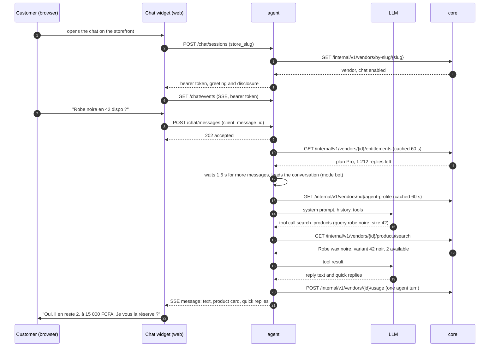

### 6.2 Checkout from the chat, paid with a Lightning wallet

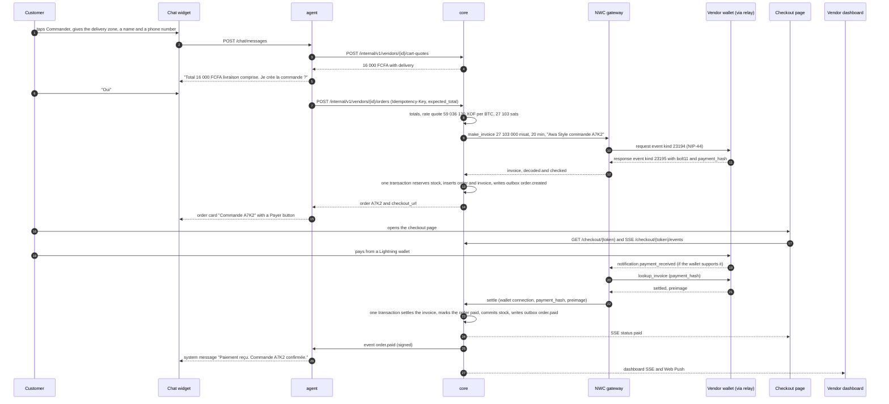

### 6.3 A vendor subscribes or renews

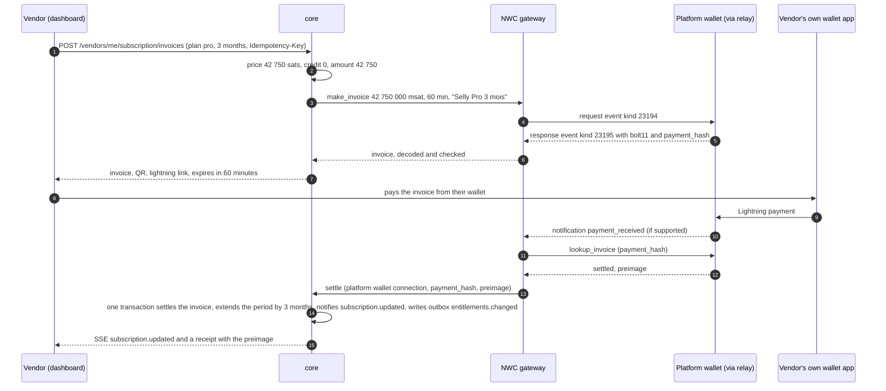

If the vendor has no sats, the dashboard links to the help page that explains how to buy some with Orange Money or Wave through Banxaas (§3.9). The invoice stays valid for an hour so the vendor can do that and come back.

### 6.4 Vendor onboarding

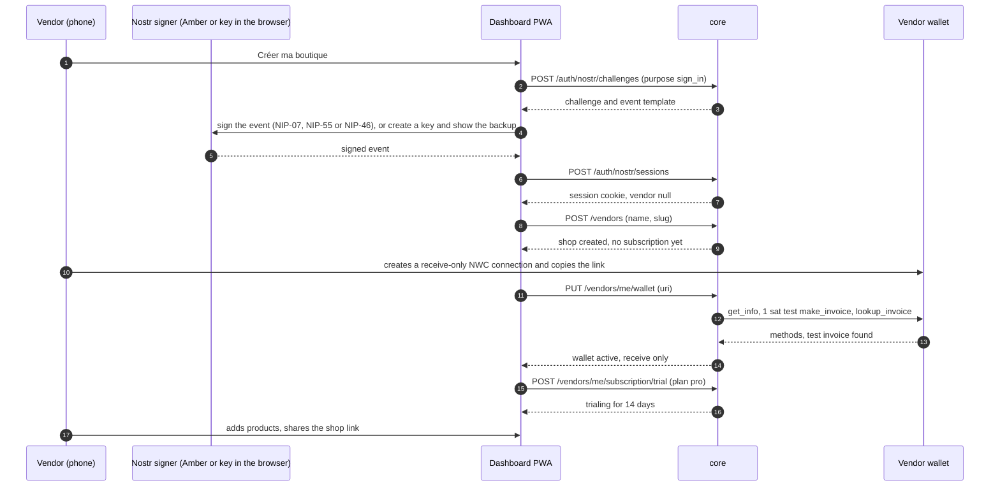

Why a Nostr key and not a code sent to the vendor: no message service, no cost per sign-in and no password to leak. A vendor with no signer app gets a key made in the browser. The page makes the vendor save the backup before it continues, and offers a second key as a spare (up to three, §5.3.2). The vendor must have a working wallet and a trial or paid plan before the shop goes live.

### 6.5 Restock from a photo, in the dashboard assistant

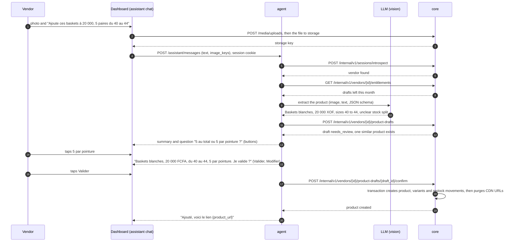

The dashboard's draft review screen (`restock-ai` and `drafts/{id}/confirm`) reaches the same result without the chat.

### 6.6 The vendor takes over a chat

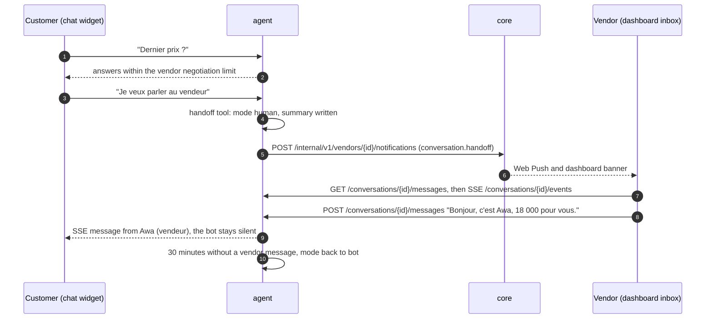

The vendor can also write first, from the inbox, to any open chat. Every vendor message sets `human_until` 30 minutes ahead. A vendor who does not look at the dashboard misses handoffs, so the alert uses Web Push, and Pro and Business can add a Nostr direct message (§3.7).

### 6.7 Expiry and late settlement

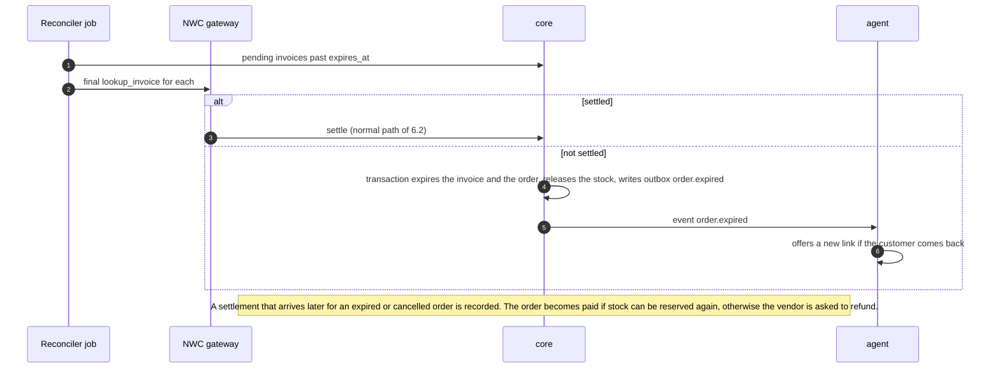

---

## 7. Inter-service communication and reliability

### 7.1 How components talk

| From → to                          | Mechanism                                                             | Delivery                                   | Authentication                                               | Timeouts and retries                                                                                                                    |
| ---------------------------------- | --------------------------------------------------------------------- | ------------------------------------------ | ------------------------------------------------------------ | --------------------------------------------------------------------------------------------------------------------------------------- |
| web → core                         | HTTPS REST, JSON. SSE for live updates                                | request and response                       | vendor cookie, or the checkout token in the path             | 10 s. Retry GET once. POST only with an `Idempotency-Key`.                                                                              |
| web → agent                        | HTTPS REST and SSE (chat, inbox, assistant)                           | request and response; stream               | chat bearer token, or the vendor cookie checked through core | POST answers 202 at once. Assistant POST 20 s (includes the LLM). Streams resume with `Last-Event-ID`.                                  |
| agent → core                       | REST on the private network, typed client                             | request and response                       | service token with scopes, `X-Request-Id`, `X-Actor`         | reads 3 s, writes 8 s, order creation 15 s (includes the NWC round trip). One retry on network errors, with the same `Idempotency-Key`. |
| core → agent                       | signed HTTP POST to `/internal/v1/events`, from the outbox dispatcher | at least once, in order per key (order id) | HMAC-SHA256                                                  | backoff 1 s, 5 s, 30 s, 2 min, 10 min, 1 h, then dead letter and an alert. The agent ignores an `event_id` it has already seen.         |
| core ↔ vendor and platform wallets | NIP-47 events through the wallet's relays                             | request and response, plus notifications   | the client key of the connection                             | `make_invoice` 10 s, `lookup_invoice` 8 s, `get_info` 8 s. One retry through another relay when the URI lists several.                  |
| core → price feeds                 | HTTPS                                                                 | request and response                       | none                                                         | 2 s per source. Median of the sources that answered.                                                                                    |
| core → browser                     | SSE and Web Push                                                      | at most once, with resume                  | session cookie, or the push subscription                     | the client reloads state on reconnect                                                                                                   |
| inside core                        | pg-boss jobs; LISTEN/NOTIFY for SSE fan-out                           | jobs at least once                         | none                                                         | per job type                                                                                                                            |

### 7.2 Chat message ingestion

The agent's equivalent of a webhook is the chat message request.

1. Check the bearer token (hash lookup), the rate limit and the message size. Answer 401 `CHAT_SESSION_EXPIRED` for an unknown or expired token.
2. Insert the message with its `client_message_id` (`on conflict do nothing`). A repeat returns the stored message.
3. Answer 202 immediately.
4. A job processes the conversation: one turn at a time per conversation (a job singleton key), messages that arrived within 1.5 seconds merged into one turn, then the mode check (in `human` or `paused` the message is only stored and the vendor is alerted), then the agent (§8.2).
5. The reply is stored and published on the conversation's SSE stream. A failed turn publishes the fixed handoff reply (§7.5).

### 7.3 Payment confirmation path

`NWC notification → NWC gateway → payments.settle(wallet_connection_id, payment_hash, preimage)`:

- A settlement is matched by wallet connection and payment hash together, never by hash alone. One vendor's wallet can never settle another vendor's order, and a vendor's wallet can never settle a subscription invoice, which belongs to the platform wallet's connection.
- When a preimage is present, check that `sha256(preimage) = payment_hash`.
- For an order invoice, one transaction: `update core.invoices set status = 'settled' ... where id = $1 and status <> 'settled'`; order to `paid` (or the `attention` flag of §4.4); stock commit; audit record; outbox `order.paid`.
- For a subscription invoice, one transaction: the same conditional update on `core.subscription_invoices`; the subscription period and status per the rules of §3.7; audit record; a `subscription.updated` notification for the dashboard and an outbox `entitlements.changed` for the agent.
- After the commit: `NOTIFY` → SSE subscribers (checkout page, dashboard). The outbox dispatcher sends `order.paid` to the agent, which adds a system message to the customer's chat. Core sends a Web Push to the dashboard.
- Idempotent: a second notification finds the invoice already settled and changes nothing.

Reconciliation, because notifications can be missed (F2):

- Order invoices, while a checkout page is connected: `lookup_invoice` every 3 seconds for 2 minutes, then every 10 seconds. Otherwise: every 30 seconds until expiry, then one final lookup.
- Subscription invoices, while the dashboard shows the invoice: every 3 seconds for 2 minutes, then every 10 seconds. Otherwise every 60 seconds until expiry, then one final lookup.
- Per wallet, at most 2 requests per second, to stay clear of `RATE_LIMITED`.

### 7.4 Error codes

Every error is `application/problem+json` with a stable `code`. The catalog lives in `packages/contracts/errors.ts`: HTTP status, whether a retry can help, and message keys in French, English and Wolof for the web and the agent.

| Code                                                                                                     | Status                  | Retry              | Web                                                                                    | Agent                                                  |
| -------------------------------------------------------------------------------------------------------- | ----------------------- | ------------------ | -------------------------------------------------------------------------------------- | ------------------------------------------------------ |
| `OUT_OF_STOCK`                                                                                           | 409                     | no                 | shows what is left                                                                     | suggests other sizes or colours                        |
| `PRICE_CHANGED`                                                                                          | 409                     | no                 | shows the new total and asks to confirm                                                | gives the new total and asks to confirm                |
| `PAYMENT_UNAVAILABLE`                                                                                    | 503                     | yes, `Retry-After` | « Paiement momentanément indisponible » and the vendor's WhatsApp link if there is one | apologises, hands off to the vendor, alerts the vendor |
| `RATE_UNAVAILABLE`                                                                                       | 503                     | yes                | same as above                                                                          | same as above                                          |
| `INVOICE_EXPIRED`                                                                                        | 410                     | no                 | button « Nouveau lien de paiement »                                                    | offers a new link                                      |
| `TOO_MANY_PENDING_ORDERS`                                                                                | 429                     | no                 | explains the limit                                                                     | explains the limit                                     |
| `VALIDATION_FAILED`                                                                                      | 422                     | no                 | field errors                                                                           | asks for the missing information                       |
| `UNAUTHORIZED`                                                                                           | 401                     | no                 | sign-in                                                                                | not applicable                                         |
| `RATE_LIMITED`                                                                                           | 429                     | yes, `Retry-After` | « Trop de requêtes, réessayez dans un instant. »                                       | waits, then hands off                                  |
| `STEP_UP_REQUIRED`                                                                                       | 403                     | no                 | asks for a new signature                                                               | not applicable                                         |
| `CHALLENGE_INVALID`                                                                                      | 401                     | no                 | « La signature n'est pas valide, réessayez. » Asks for a new challenge                 | not applicable                                         |
| `CHAT_SESSION_EXPIRED`                                                                                   | 401                     | no                 | the widget opens a new session                                                         | not applicable                                         |
| `STORE_PAUSED`                                                                                           | 403                     | no                 | « Boutique momentanément fermée »                                                      | not applicable                                         |
| `CHAT_UNAVAILABLE`                                                                                       | 403                     | no                 | hides the chat                                                                         | not applicable                                         |
| `PLAN_LIMIT_REACHED`                                                                                     | 409                     | no                 | shows the limit and the upgrade button                                                 | not applicable                                         |
| `FEATURE_NOT_IN_PLAN`                                                                                    | 403                     | no                 | shows what the next plan adds                                                          | « Écrivez-moi votre message » (voice notes)            |
| `DOWNGRADE_NOT_ALLOWED_YET`                                                                              | 409                     | no                 | says when the lower plan can be bought                                                 | not applicable                                         |
| `TRIAL_ALREADY_USED`                                                                                     | 409                     | no                 | says the trial was used by this key or wallet, offers the plans                        | not applicable                                         |
| `AGENT_QUOTA_EXCEEDED`                                                                                   | 429                     | no                 | not shown to customers                                                                 | fixed reply and handoff; the vendor is alerted         |
| `NWC_URI_INVALID`, `NWC_PERMISSIONS_TOO_BROAD`, `NWC_METHODS_MISSING`, `NWC_WALLET_ERROR`, `NWC_TIMEOUT` | 422, 422, 422, 422, 504 | timeout only       | messages of §5.3.4                                                                     | not applicable                                         |
| `PROVIDER_TIMEOUT`                                                                                       | 504                     | yes                | retries once                                                                           | retries once, then hands off                           |
| `IDEMPOTENCY_MISMATCH`                                                                                   | 422                     | no                 | bug report                                                                             | bug report                                             |
| `NOT_FOUND`, `FORBIDDEN`                                                                                 | 404, 403                | no                 | error page                                                                             | not applicable                                         |

### 7.5 When a dependency fails

| Dependency                 | Failure                                           | Detection                                                                                                      | Fallback                                                                                                                                                                                                          | What the user sees                                                                  |
| -------------------------- | ------------------------------------------------- | -------------------------------------------------------------------------------------------------------------- | ----------------------------------------------------------------------------------------------------------------------------------------------------------------------------------------------------------------- | ----------------------------------------------------------------------------------- |
| Vendor NWC wallet or relay | timeout, `UNAUTHORIZED`, `RESTRICTED`, relay down | timeouts and error codes; a circuit breaker per connection opens after 5 failures in 2 minutes, for 60 seconds | other relays in the URI, then the Lightning Address with LUD-21 if configured. Otherwise the order is not created. The connection is marked `degraded` and the vendor is alerted on the dashboard and by Web Push | « Le paiement est momentanément indisponible. Le vendeur a été prévenu. »           |
| Wallet notifications       | missed events                                     | not detectable                                                                                                 | polling (§7.3)                                                                                                                                                                                                    | a few seconds' delay                                                                |
| Platform NWC wallet        | timeout, relay down                               | same breaker, on the platform connection                                                                       | the platform Lightning Address with LUD-21; otherwise the vendor retries, and the grace period covers short outages. The operator is alerted                                                                      | « Impossible de créer la facture pour le moment. Réessayez dans quelques minutes. » |
| Price feeds                | every source down                                 | no fresh quote                                                                                                 | reuse the last quote if it is less than 10 minutes old; otherwise refuse XOF-priced orders (SAT-priced shops and subscriptions keep working)                                                                      | « Paiement momentanément indisponible. »                                            |
| LLM provider               | 5xx, timeout, rate limit                          | 12-second deadline per turn                                                                                    | one retry on the backup model or provider; then a fixed reply with a handoff                                                                                                                                      | « Je transmets votre message au vendeur, il vous répond très vite. »                |
| Product extraction         | low confidence, failure                           | schema validation, confidence below 0.6                                                                        | ask the vendor for the missing fields in text                                                                                                                                                                     | not applicable                                                                      |
| Speech to text             | low confidence, unknown language                  | confidence score                                                                                               | ask for a written message, or hand off                                                                                                                                                                            | « Je n'ai pas bien compris le vocal, pouvez-vous l'écrire ? »                       |
| Agent (chat)               | down                                              | health checks                                                                                                  | the storefront and checkout keep working. The widget shows « Chat indisponible », and the vendor's WhatsApp link if there is one                                                                                  | the chat is unavailable, the shop is not                                            |
| Core entitlements          | unreachable                                       | timeout                                                                                                        | the agent uses its last cached entitlements for up to 10 minutes, then the fixed reply and handoff                                                                                                                | same as above                                                                       |
| Nostr signer               | none installed, user cancels                      | the sign-in screen                                                                                             | the screen offers the other signers, or a key made in the browser                                                                                                                                                 | « Choisissez comment vous connecter. »                                              |
| PostgreSQL                 | down                                              | health checks                                                                                                  | the API answers 503                                                                                                                                                                                               | an error page                                                                       |
| Object storage or CDN      | down                                              | health checks                                                                                                  | pages render without images (alt text)                                                                                                                                                                            | text-only pages                                                                     |

### 7.6 Consistency rules

- Commerce data lives in core only. The agent never keeps prices or stock beyond one turn.
- Paid means confirmed by a direct `lookup_invoice` on the wallet that received the money (ADR-06): the vendor's wallet for orders, the platform's wallet for subscriptions.
- Every state change is a conditional update (`where status = <expected>`), so two workers can never apply the same change twice.
- Messages and notifications leave through the outbox after the commit, never from inside a transaction.
- A nightly job compares settled invoices, paid orders, stock movements and subscription periods, and reports any mismatch.

---

## 8. AI agent

### 8.1 Two roles, one engine

| Role             | Where                                                              | Who                  | Tools                                                                                                                                                |
| ---------------- | ------------------------------------------------------------------ | -------------------- | ---------------------------------------------------------------------------------------------------------------------------------------------------- |
| Sales agent      | the chat on the vendor's storefront (`web` channel)                | customers            | catalog search, product detail, cart quote, order creation, order status, shop information, handoff                                                  |
| Vendor assistant | the assistant chat in the dashboard (`web` channel, role `vendor`) | the signed-in vendor | product drafts from photo, text or voice; confirm drafts; adjust stock; change prices; list orders; mark fulfilled; metrics; pause or resume the bot |

Routing: the chat session token gives the conversation, and the conversation gives the vendor (fixed when the session was opened from the store slug). The assistant is reached with the vendor's session cookie, which core confirms. The engine does not know the channel: it receives normalised messages and returns an `AgentReply` that a `ChannelAdapter` renders (§3.9).

### 8.2 One turn

1. The conversation job takes the turn (one at a time) and waits 1.5 seconds for more messages from the same person.
2. Entitlements: core's answer says whether the shop is live, the chat is on and agent replies remain this month. Otherwise the turn ends with the fixed reply and a handoff (§3.7).
3. Pre-processing:
   - Voice note → speech to text, with a confidence score (Pro and Business).
   - A product the customer was viewing when the chat opened → added to the state as context.
   - Quick-reply taps → mapped to intents.
4. Mode check: in `human` or `paused` mode, the message is only stored.
5. Context, about 6,000 to 8,000 tokens:
   - the system prompt (role, scope rule F12, safety rules, style);
   - the shop profile from core, cached 60 seconds;
   - the conversation summary and the last 8 messages;
   - the conversation state (cart in progress, open question);
   - the tool definitions for this role only.
6. LLM call with tools: at most 4 tool rounds and a 12-second deadline for the whole turn.
7. Tools call core through the typed client. Tool results are data. Errors are handled by code (§7.4).
8. Rendering for the web: one message per turn, text with optional product or order cards and at most 4 quick replies. Links go to our own domain only: the product page for a product, the checkout for an order.
9. Store the reply, publish it on the SSE stream, report one usage unit to core, and refresh the summary about every 6 turns with a cheap model call.

### 8.3 Tools

The vendor id is never a tool parameter. It comes from the routing in §8.1.

```ts
// Sales agent (customer conversations)
search_products(p: { query: string; size?: string; color?: string; max_price_xof?: number; limit?: number }): {
  results: { product_id: string; title: string; price: Money; image_url: string; url: string;
             variants: { variant_id: string; options: Record<string, string>; available: number }[] }[];
};
get_product(p: { product_id: string }): ProductDetail;
quote_cart(p: { items: { variant_id: string; quantity: number }[];
                delivery: { method: 'delivery' | 'pickup'; zone_id?: string };
                discount_pct?: number }): { subtotal: Money; delivery_fee: Money; discount: Money; total: Money; max_discount_pct: number };
create_order(p: { items: { variant_id: string; quantity: number }[];
                  customer: { display_name: string; phone_e164?: string };
                  delivery: { method: 'delivery' | 'pickup'; zone_id?: string; address_text?: string; note?: string };
                  expected_total: Money }): { number: string; checkout_url: string; total: Money; total_sat: number; expires_at: string };
get_order_status(p: { number: string }): { status: OrderStatus; paid_at?: string; fulfilled_at?: string };
get_shop_info(p: { topic: 'delivery' | 'hours' | 'location' | 'returns' | 'payment' }): ShopInfo;
handoff_to_vendor(p: { reason: 'customer_request' | 'negotiation' | 'complaint' | 'unsure' | 'other'; summary: string }): { ok: true };

// Vendor assistant (vendor conversations only)
create_product_draft(p: { image_keys: string[]; text?: string }): Draft;
answer_draft_question(p: { draft_id: string; question_id: string; answer: string }): Draft;
confirm_product_draft(p: { draft_id: string; mode: 'new' | 'restock'; target_product_id?: string }): Product;
adjust_stock(p: { product_ref: string; options?: Record<string, string>; set_to?: number; delta?: number; reason: 'restock' | 'adjustment' }): Variant;
update_price(p: { product_ref: string; price: Money }): Product;
list_orders(p: { status?: OrderStatus; period?: 'today' | '7d' }): OrderSummary[];
mark_fulfilled(p: { number: string }): OrderSummary;
get_metrics(p: { period: 'today' | '7d' | '30d' }): Metrics;
set_bot_mode(p: { scope: 'all' | 'conversation'; mode: 'bot' | 'paused'; minutes?: number }): { ok: true };
```

### 8.4 Guardrails

- **Scope (F12).** The agent only handles this vendor's products, orders and shop information. Anything else gets a short, polite refusal and an offer to help with the shop. This also keeps the WhatsApp door open (§3.9).
- **Facts come from tools.** Prices, stock, delivery fees and totals come from core. The model never computes a total. `create_order` requires `expected_total` equal to the last quote.
- **No change without consent.** An order is created only after the customer says yes. Drafts need the vendor's confirmation. A price change over 30 % or stock set to 0 is applied with an « Annuler » button that undoes it within 5 minutes.
- **Prompt injection.** Customer text, transcripts and shop descriptions are untrusted data. Tools are scoped by server-side context. A customer conversation never gets vendor tools, because the tool list is chosen by role before the model is called.
- **Output filter.** Links only to our own domain and the vendor's contact. No phone numbers except the vendor's. A maximum length per message.
- **Negotiation.** Bargaining ("dernier prix ?") is common. The vendor sets `negotiation.mode` (`fixed` or `allow`) and `max_discount_pct`. Core enforces the limit in `quote_cart`, whatever the model asks for.
- **Handoff triggers.** The customer asks for a person, a negotiation goes past the limit, a complaint, two failed attempts to understand, a low-confidence voice note, a problem with an order, the plan's reply quota is used up.
- **Disclosure.** The first reply in a conversation says it is the shop's automated assistant (« Assistant de Awa Style ») and that the vendor can take over.
- **Budgets.** Per conversation, 30 turns per hour. Per vendor, the monthly reply quota of the plan (§3.7) and a daily token budget as a safety stop. Past either: the fixed reply and a handoff.
- **Logs.** Prompts and outputs are kept for 30 days with personal data redacted, for debugging and evaluation. A vendor can turn this off.

### 8.5 Language

- Detect the language of each message: French, Wolof, English or mixed.
- Reply in the customer's language when the evaluation (§12.4) shows good quality for it. Otherwise reply in simple French. Wolof replies are switched on per vendor only after the evaluation passes.
- Prices are always written « 15 000 FCFA », with a narrow no-break space as the thousands separator.
- `packages/money` parses amounts and quantities the way vendors write them: "20 000", "20.000", "20k", "20 mille", "vingt mille", and Wolof number words once a native speaker has checked them. Property-based tests cover the parser.
- Options are normalised through synonyms: noir, black, ñuul; "42", "T42", "pointure 42".

### 8.6 Restocking from a photo

- **Model.** A multimodal LLM with structured output (JSON Schema). It returns `title`, `description` (French, at most 300 characters), `category`, `price`, `variants` and `stock`. Each field carries a `confidence` and a `from` value: `text`, `image`, `price_tag` or `inferred`.
- **Where values come from.** Prices and quantities come from the vendor's words. A price read from a visible tag is flagged as such. Nothing is published before the vendor confirms (ADR-12).
- **Ambiguities** become questions with buttons, for example « 5 au total ou 5 par pointure ? ».
- **Matching.** When a similar product exists (trigram similarity on title and category), the agent asks « Réassort de "Baskets blanches" ? ». Image embeddings can come later.
- **Images.** Core re-encodes every image with sharp, removes EXIF data (which can hold the shop's location), produces 320, 640 and 960 px widths in WebP and AVIF, and keeps the private original for 30 days (a lifecycle rule on the private bucket).
- **Storage layout.** Uploads: `vendors/<vendor id>/uploads/<uuid>.<ext>` in the private bucket, written by the browser with a presigned PUT whose type and size are signed. Public images: `vendors/<vendor id>/images/<image id>/<width>.<webp|avif>`; `product_images.storage_key` names the 640 px WebP. Voice notes from the agent: `chat-audio/<yyyy-mm>/<uuid>.<ext>`, private. HEIC is not accepted: the prebuilt libvips cannot decode it, and iOS converts photos to JPEG when a page picks them.
- **Implementation status.** Built: uploads, re-encoding on product create and edit, drafts from the dashboard (`draft.requested` carries one-hour private links for the vision model) and from the assistant, confirm as a new product or a restock, the plan's draft quota, and stale drafts failed after 10 minutes. Not built: CDN purge (images get new URLs, but cached store pages live up to 30 seconds), image embeddings for matching.

### 8.7 Model choice and cost

- **Needs.** Tool calling, structured output, vision, French and some Wolof, a median latency under 3 seconds, and a low cost per turn.
- **Tiers.** A fast tier for replies and extraction, a cheaper tier for summaries.
- **Provider.** `LlmProvider` stays pluggable, with two providers configured so that one can take over when the other fails.
- **Caching.** Provider prompt caching for the fixed system prompt and the tool definitions.
- **Cost tracking.** Tokens and an estimated cost are recorded in `agent.llm_calls`. An admin view shows them per vendor.
- **Plan check.** The plan limits of §3.7 assume about 0.004 EUR per agent reply. Measure the real average per reply, per tier, during the pilot, and adjust the limits or the prices before launch if it is more than 0.006 EUR.

---

## 9. Security, privacy and compliance

### 9.1 Threats and controls

| Asset                                | Threat                                                                         | Controls                                                                                                                                                                                                                                                                                                                                                                                                                                                                                                        |
| ------------------------------------ | ------------------------------------------------------------------------------ | --------------------------------------------------------------------------------------------------------------------------------------------------------------------------------------------------------------------------------------------------------------------------------------------------------------------------------------------------------------------------------------------------------------------------------------------------------------------------------------------------------------- |
| Where the vendor's money goes        | An attacker links their own wallet to the vendor's shop and receives the sales | Replacing a wallet needs a step-up signature less than 10 minutes old. Every change writes an audit record, pushes a notice to the dashboard and shows a banner for 7 days.                                                                                                                                                                                                                                                                                                                                     |
| Vendor accounts                      | Sign-in replay, a forged or reused signature, a stolen session, a lost key     | A challenge is random, single-use and valid for 5 minutes. The signed event must name our URL and method and be less than 60 seconds old (NIP-98). Sessions are httpOnly, Secure, SameSite=Lax cookies with Origin checks, a 30-day rolling expiry and a device list. Up to three keys per vendor, so a lost key has a spare. Adding a key needs a step-up and a signature from the new key. A key generated in the browser is encrypted with a passphrase (NIP-49) on the device and never sent to the server. |
| NWC URI (a wallet credential)        | Database leak, logs, backups                                                   | Receive-only connections are required (§3.6), so a leaked URI cannot move funds. The URI is encrypted with AES-256-GCM under a key from the secret manager (key version stored, rotation supported). It is decrypted only inside `payments` and the link check, never returned by the API, and redacted from logs. CI rejects `nostr+walletconnect://` in logs, fixtures and test output. The platform wallet's URI follows the same rules.                                                                     |
| Orders, subscriptions and stock      | Fake payments (a faked return to a page, a forged notification), overselling   | Paid only on a wallet settlement matched by wallet connection and payment hash, with the preimage checked and the invoice decoded when it was created. Conditional updates and reservations.                                                                                                                                                                                                                                                                                                                    |
| Subscription limits                  | A vendor bypasses a limit, or a downgrade leaves them over it                  | Limits are checked in core, never in the browser or the agent. The agent only reads entitlements. Downgrades are refused while usage is over the lower plan.                                                                                                                                                                                                                                                                                                                                                    |
| The agent                            | Prompt injection, data leaks, runaway cost                                     | Tools chosen by role, context set by the server, output filter, rate limits, quota and budgets (§8.4).                                                                                                                                                                                                                                                                                                                                                                                                          |
| Chat sessions                        | Token theft, spam, scraping                                                    | Bearer tokens of 128 bits, stored hashed, expiring after 30 days of inactivity. Rate limits per IP and per token, message size caps. The browser never sends a vendor id.                                                                                                                                                                                                                                                                                                                                       |
| Customer data (name, phone, address) | Exposure to other vendors, logs                                                | Customers belong to one vendor. Every query is filtered by vendor. Phone numbers are masked in logs (`+221 77 *** ** 67`). Retention limits (§9.3). PostgreSQL row-level security as an extra layer after the MVP.                                                                                                                                                                                                                                                                                              |
| Uploads                              | Malicious files, SSRF                                                          | Presigned uploads with type and size limits. Every image is re-encoded. The server never fetches a URL given by a user, with one exception: a wallet's Lightning Address (§3.6), fetched through a guard that allows https to public addresses only, checked when the socket resolves the name, with no redirects, a 5-second timeout and a 64 KB limit.                                                                                                                                                        |

### 9.2 Meta platform rules (when the channels return)

Not in force for the web chat. When a Meta adapter is added (§3.9):

- Business-specific AI only (F12), with the disclosure of §8.4 and a path to the vendor in every conversation.
- Replies inside the 24-hour window. Outside it, only approved utility templates for order updates, written in French.
- Order updates go to customers who started the conversation and placed the order. No marketing broadcasts in the MVP.
- Coexistence history sync only with the vendor's explicit consent.

### 9.3 Privacy

- **Minimise.** Chat visitors are anonymous until they order. An order asks for a name, a phone number and, for delivery, an address, because the vendor needs them to deliver. The privacy notice says so. The agent never asks for anything else.
- **Retention defaults.** Conversations 90 days, LLM logs 30 days, image originals and voice notes 30 days, orders 2 years (vendor bookkeeping), a suspended shop's data 90 days.
- **Requests.** Access and deletion requests go through the vendor from the dashboard (by support in the MVP).
- **Law.** Senegal's personal data law (Loi n° 2008-12) and its authority, the CDP, apply. Check declaration duties and transfers outside Senegal (hosting in Europe) with counsel.

### 9.4 Regulatory position (to confirm with counsel)

- The platform never receives, holds or converts fiat, and never holds bitcoin for customers or vendors. Order invoices are created on the vendor's own wallet. The only money the platform receives is its own subscription revenue, in sats, on its own wallet.
- Questions for counsel: how WAEMU and BCEAO rules on crypto-assets apply to a shop that accepts only bitcoin; whether receiving subscription payments in bitcoin needs any declaration or licence; tax treatment of that revenue; consumer protection and refunds when the vendor pays refunds from their own wallet; invoicing duties for vendors.

---

## 10. Non-functional requirements

Targets for the pilot. Each one has a check.

| Area                  | Target                                                                                                        | Check                                     |
| --------------------- | ------------------------------------------------------------------------------------------------------------- | ----------------------------------------- |
| Storefront weight     | HTML ≤ 40 KB gzip, JavaScript ≤ 150 KB gzip before the chat and cart load, first product image ≤ 60 KB        | Lighthouse CI budgets                     |
| Chat widget weight    | ≤ 40 KB gzip, loaded after first interaction or idle, never on the critical path                              | bundle analysis in CI                     |
| Storefront speed      | LCP ≤ 2.5 s at p75 on a mid-range Android over "Slow 4G". Product pages usable without JavaScript.            | Playwright and Lighthouse with throttling |
| Checkout              | interactive ≤ 3 s on Slow 4G; payment shown ≤ 2 s after settlement is detected                                | end-to-end test with the fake wallet      |
| Chat reply (text)     | p50 ≤ 4 s, p95 ≤ 10 s from message accepted to reply published                                                | traces                                    |
| Voice note reply      | p95 ≤ 12 s                                                                                                    | traces                                    |
| Restock draft ready   | p95 ≤ 20 s                                                                                                    | traces                                    |
| Payment detection     | p95 ≤ 5 s with notifications, ≤ 15 s by polling while the checkout page (or the subscription invoice) is open | metrics                                   |
| API reads             | p95 ≤ 200 ms server time                                                                                      | metrics                                   |
| Order creation        | p95 ≤ 3 s, including the NWC round trip                                                                       | metrics                                   |
| Availability          | 99.5 % per month                                                                                              | uptime checks                             |
| Capacity (assumption) | 200 vendors, 50,000 chat messages and 2,000 orders per day, on one region and one database                    | k6 load test                              |
| Accessibility         | WCAG 2.2 AA on storefront, chat and checkout; text at least 16 px; tap targets at least 44 px                 | axe in CI                                 |
| Languages             | French by default, English, Wolof where checked                                                               | i18n key check in CI                      |

---

## 11. Deployment and operations

### 11.1 Topology

- **Region.** One European region close to Dakar over submarine cables (Paris or similar). Measure latency from the Orange, Free and Expresso networks in Dakar before choosing.
- **CDN** in front of web and images, with a Dakar point of presence (F8). Storefront pages are cached for 30 seconds with stale-while-revalidate. Images and static assets are cached for a year under content-hashed URLs. Checkout, chat and dashboard are never cached.
- **Containers.**
  - `web` (Next.js, Node output) and `core` (API): at least one instance each.
  - `core-worker` (NWC gateway, reconciler, outbox, images, subscription jobs): the NWC gateway runs as one active instance, elected with a PostgreSQL advisory lock.
  - `agent` (API, SSE and jobs): at least one instance. SSE connections are long-lived, so size instances for open streams, and keep idle timeouts above 60 seconds on the load balancer.
- **PostgreSQL 18**, managed, with daily backups and point-in-time recovery. A direct connection serves LISTEN/NOTIFY and pg-boss, a pooled one serves requests.
- **Object storage.** A private bucket for originals and audio, a public bucket behind the CDN for image variants.
- **Routing on one domain.** `/api/v1/chat/*`, `/api/v1/conversations*` and `/api/v1/assistant*` go to the agent. Other `/api/v1/*` paths go to core. Everything else goes to web. `/internal/*` is never routed from the internet.

### 11.2 Environments

| Environment | Lightning                                                                                                                              | Meta                              | LLM                                                     |
| ----------- | -------------------------------------------------------------------------------------------------------------------------------------- | --------------------------------- | ------------------------------------------------------- |
| local       | fake NWC wallet service (`packages/nwc/testkit`) on a local relay (strfry or nostr-rs-relay), one for vendors and one for the platform | none (the web chat needs no Meta) | scripted provider, or a real one with a development key |
| staging     | real NWC wallets with a few sats, or a regtest setup (for example Polar with an NWC wallet service)                                    | none                              | real, with a development budget                         |
| production  | the vendors' wallets, and the platform wallet for subscriptions                                                                        | none until a Meta adapter exists  | real, with budgets and alerts                           |

### 11.3 Configuration

Environment variables (examples): `DATABASE_URL`, `DATABASE_DIRECT_URL`, `APP_BASE_URL`, `CDN_PURGE_TOKEN`, `S3_ENDPOINT`, `S3_BUCKET_PUBLIC`, `S3_BUCKET_PRIVATE`, `S3_ACCESS_KEY_ID`, `S3_SECRET_ACCESS_KEY`, `SERVICE_TOKENS` (extra service tokens with fewer scopes, JSON; the agent's `SERVICE_TOKEN_AGENT` has every scope), `NWC_PAIRING_RELAYS` (where wallets announce a pairing), `VAPID_PUBLIC_KEY`, `VAPID_PRIVATE_KEY`, `VAPID_SUBJECT` (Web Push; the web app gets the public key as `NEXT_PUBLIC_VAPID_PUBLIC_KEY`), `SECRETS_PLATFORM_NOSTR_KEY` and `NOSTR_DM_RELAYS` (NIP-17 alerts), `MEDIA_STORE` (s3, or memory for development), `S3_PRESIGN_ENDPOINT` (the storage address browsers reach), `S3_REGION`, `S3_FORCE_PATH_STYLE`, `SECRETS_KEK_V1` (32-byte key, base64), `SECRETS_PLATFORM_NWC_URI` (the receive-only platform wallet, linked on first start), `SUBSCRIPTION_JOB_INTERVAL_MS` (300000), `PLATFORM_LUD16` (optional fallback), `SERVICE_TOKEN_AGENT`, `EVENTS_HMAC_SECRET`, `VAPID_PUBLIC_KEY`, `VAPID_PRIVATE_KEY` (Web Push), `NOSTR_NOTIFIER_NSEC` (optional, for Nostr direct messages to vendors), `NOSTR_NOTIFIER_RELAYS`, `LLM_PRIMARY`, `LLM_FALLBACK`, `LLM_API_KEY_*`, `ASR_PROVIDER`, `ASR_API_KEY`, `PRICE_SOURCES`, `INVOICE_PROVIDER` (`fake` or `nwc`), `LIGHTNING_NETWORK`, `NWC_MIN_INTERVAL_MS`, `NWC_MAKE_INVOICE_TIMEOUT_MS`, `NWC_LOOKUP_TIMEOUT_MS`, `NWC_GET_INFO_TIMEOUT_MS`, `SUBSCRIPTION_GRACE_DAYS` (7), `TRIAL_DAYS` (14).

In production core refuses to start with a missing or dev `SERVICE_TOKEN_AGENT`. The local Docker stack runs the production build with dev values and says so with `ALLOW_DEV_SECRETS=true`; nothing else may set it. Secrets come from the host's secret manager. `.env` files are for local development only and are git-ignored. Plan prices and limits are data (`core.plans`), not configuration.

### 11.4 Observability

- **Logs.** pino JSON logs with redaction (NWC URIs, tokens, secrets, full phone numbers, Nostr secret keys). One trace id flows from web to core to agent to the NWC gateway.
- **Traces and metrics.** OpenTelemetry.
- **Business metrics.** Chats opened, agent latency (p50, p95), tool error rate, orders created and paid, conversion (chat → order → paid), time to settlement, NWC failures per connection, LLM tokens and cost per vendor and per plan, subscriptions by status, sats collected per month, trial to paid conversion, renewals on time.
- **Alerts.** Settlement lag, LLM error spikes, degraded vendor wallets, a degraded platform wallet, outbox backlog, a vendor above 100 % of the reply quota, average agent cost above the plan assumption (§8.7).

### 11.5 CI and releases

- **Every pull request.** Biome, typecheck, unit and property tests, `api.json` validation (lint, and every example against its schema), contract generation and breaking-change checks once they exist, a migration dry run on a throwaway database, a Playwright smoke test of the storefront, the Lighthouse budget, a secret scan.
- **Releases.** Merging to `main` deploys to staging. A tag deploys to production.
- **Migrations** run before the new version starts and must work with the version still running: expand, migrate, then contract.

---

## 12. Team plan

### 12.1 Ownership

| Path                                                                           | Owner    | Reviewers                                                                                                                     |
| ------------------------------------------------------------------------------ | -------- | ----------------------------------------------------------------------------------------------------------------------------- |
| `apps/web`, `packages/ui`                                                      | Dev 1    | Dev 3 for API use                                                                                                             |
| `apps/agent`                                                                   | Dev 2    | Dev 3 for core client use                                                                                                     |
| `apps/core`, `packages/db`, `packages/nwc`, `packages/nostr`, `packages/money` | Dev 3    | Dev 2 for `packages/money`, which the agent also uses; Dev 1 for `packages/nostr`, whose browser half the sign-in screen uses |
| `packages/contracts`, `docs/api.json`                                          | Dev 3    | Dev 1 and Dev 2; both approve breaking changes                                                                                |
| `docs`, `.kiro`                                                                | everyone | everyone                                                                                                                      |

A `CODEOWNERS` file enforces this. Nobody edits another owner's folder without their review.

### 12.2 Working in parallel

- **First, together:** the contract for the first slice (`docs/api.json`), and the database schema v0.
- **Then each developer works against mocks:**
  - Dev 1: a mock server from `api.json`, a fake SSE stream, seeded store data, a fake signer for sign-in.
  - Dev 2: the scripted LLM provider, a mock core (MSW).
  - Dev 3: the fake NWC wallet service, Fastify inject tests.
- **Integration** happens on staging at the end of each milestone, following a written demo script.

### 12.3 Milestones, in order

| #     | Outcome                                                 | Dev 1 (web)                                                                                  | Dev 2 (agent)                                                      | Dev 3 (core)                                                                                                                      |
| ----- | ------------------------------------------------------- | -------------------------------------------------------------------------------------------- | ------------------------------------------------------------------ | --------------------------------------------------------------------------------------------------------------------------------- |
| M0    | Skeleton                                                | monorepo, design tokens, storefront shell                                                    | chat session endpoints, conversation store, SSE                    | schema v0, vendor and catalog endpoints, `api.json` validation in CI, mock server                                                 |
| M1    | Web checkout paid on Lightning: the riskiest part first | storefront, cart, checkout with QR and SSE                                                   | chat widget stub                                                   | rates, orders, reservations, NWC gateway (`make_invoice`, `lookup_invoice`, notifications), SSE                                   |
| M2    | The sales agent in the storefront chat, end to end      | chat widget, order card, payment confirmation in the chat                                    | agent loop, tools, entitlement stub, payment confirmation messages | internal API, outbox to agent events                                                                                              |
| M3    | Vendor onboarding and the assistant                     | Nostr sign-in (extension, Amber, local key), shop creation, wallet link, draft review, inbox | vendor assistant, photo extraction, drafts, human handoff          | Nostr auth, wallet link checks, drafts, media pipeline, CDN purge                                                                 |
| M4    | Subscriptions and plan limits                           | pricing page, plan picker, subscription invoice screen, usage banners, PWA install, Web Push | quota handling, voice notes, fixed handoff reply                   | plans, trial, subscription invoices on the platform wallet, renewals, grace and suspension jobs, entitlements and usage endpoints |
| M5    | Demo hardening                                          | performance budget, accessibility, help page for buying bitcoin                              | evaluation set, model choice, cost per reply                       | load test, security checklist, nightly reconciliation                                                                             |
| Later | Perspectives (§3.9)                                     | Banxaas checkout option                                                                      | a Meta `ChannelAdapter`                                            | `SwapProvider`, `swaps` table                                                                                                     |

### 12.4 Agent evaluation

- Build a set of at least 100 realistic messages from Senegalese commerce: French, Wolof, mixed, typos, voice note transcripts. Each one has the expected intent, the expected tool calls and the key facts.
- Measure intent accuracy, correct tools and parameters, factual accuracy of prices and stock (it must be 100 %, from tools), language fit, reply length, latency and cost per reply.
- Run the set on every prompt or model change and keep the results per model and prompt version.

---

## 13. Testing strategy

| Layer          | What                                                                                                                                                                                                                                                                                                                                                                                                                                                                                                                                                                                                                                                                                                                                                   | Tools                                                   |
| -------------- | ------------------------------------------------------------------------------------------------------------------------------------------------------------------------------------------------------------------------------------------------------------------------------------------------------------------------------------------------------------------------------------------------------------------------------------------------------------------------------------------------------------------------------------------------------------------------------------------------------------------------------------------------------------------------------------------------------------------------------------------------------ | ------------------------------------------------------- |
| Unit           | money conversion, amount parsing, state machines, NWC URI parsing and permission checks, subscription pricing (periods, credits), Nostr event verification                                                                                                                                                                                                                                                                                                                                                                                                                                                                                                                                                                                             | Vitest                                                  |
| Property-based | **P1** the sats amount never pays less than the XOF price at the quoted rate. **P2** concurrent reservations never make `reserved > on_hand`. **P3** order, invoice and subscription states only follow the diagrams of §4.4. **P4** settlement is idempotent: any number of notifications gives exactly one paid transition. **P5** every price in an agent reply appears in that turn's tool results. **P6** a subscription period is extended exactly once per settled subscription invoice, by exactly the months paid, and the amount settled equals `list_price_sat − credit_sat`. **P7** a sign-in challenge is accepted at most once, and never after it expires, with a wrong URL or method, or with a `created_at` more than 60 seconds off. | fast-check                                              |
| Integration    | API with PostgreSQL in a container, the fake NWC wallet service on a local relay (two instances: a vendor's and the platform's), a fake LLM                                                                                                                                                                                                                                                                                                                                                                                                                                                                                                                                                                                                            | Vitest, Fastify inject                                  |
| Contract       | `api.json` linted, every example validated against its schema, responses validated against it in integration tests; breaking-change check                                                                                                                                                                                                                                                                                                                                                                                                                                                                                                                                                                                                              | Redocly or Spectral, Ajv, oasdiff                       |
| Agent          | scripted LLM scenarios with fixed tool sequences; the evaluation set with real models, on demand                                                                                                                                                                                                                                                                                                                                                                                                                                                                                                                                                                                                                                                       | Vitest, evaluation harness                              |
| End to end     | storefront → chat → order → payment from the fake wallet → paid and confirmed in the chat; sign-in with a test key → shop → wallet → trial → subscription invoice paid → period extended; vendor takes over a chat                                                                                                                                                                                                                                                                                                                                                                                                                                                                                                                                     | Playwright with mobile profiles and a throttled network |
| Performance    | storefront budgets, chat bursts, the race for the last unit                                                                                                                                                                                                                                                                                                                                                                                                                                                                                                                                                                                                                                                                                            | Lighthouse CI, k6                                       |
| Security       | secret scan, dependency audit, redaction tests (no NWC URI, Nostr secret key or token in any log)                                                                                                                                                                                                                                                                                                                                                                                                                                                                                                                                                                                                                                                      | CI                                                      |

---

## 14. Risks and open questions

### 14.1 Risks

| Risk                                                                     | Impact                                          | Likelihood | Mitigation                                                                                                                                                                      | Owner        |
| ------------------------------------------------------------------------ | ----------------------------------------------- | ---------- | ------------------------------------------------------------------------------------------------------------------------------------------------------------------------------- | ------------ |
| Customers have no bitcoin and no Lightning wallet (bitcoin only, ADR-07) | low conversion, the main adoption risk          | high       | the help page and Banxaas as an external on-ramp now; a partner flow later (§3.9); pilot with vendors whose customers already hold bitcoin; measure checkout drop-off           | product      |
| Vendors have no always-online NWC wallet                                 | they cannot receive                             | high       | recommend one tested wallet; Lightning Address fallback; a French onboarding guide with screenshots; the shop cannot go live without a working wallet                           | Dev 3, Dev 1 |
| Vendors lose their Nostr key and lock themselves out                     | no access to the shop                           | medium     | forced backup at key creation, up to three keys, a spare key prompt; a manual recovery procedure by support for the pilot                                                       | Dev 3, Dev 1 |
| Vendors do not know Nostr                                                | sign-in friction                                | medium     | the sign-in screen offers a key made in the browser in one tap, with French copy that does not mention Nostr jargon; Amber for Android                                          | Dev 1        |
| Vendors miss chats because there is no WhatsApp notification             | slow answers, lost sales                        | high       | Web Push on the installed PWA, Nostr direct messages for Pro and Business, an honest handoff message to the customer (« réponse dans quelques heures »); WhatsApp channel later | Dev 1, Dev 2 |
| Chat on the website brings little traffic                                | the agent never gets used                       | medium     | shop links are shared where vendors already sell (statuses, DMs); `?chat=open` links; this is the proof of concept, and the channel adapter allows WhatsApp later               | product      |
| Subscription revenue cannot be debited automatically                     | vendors forget to renew                         | high       | prepaid periods, 3 and 12 month discounts, reminders at 7, 3 and 1 days, a 7-day grace period; measure on-time renewals                                                         | product      |
| Plan prices or limits are wrong                                          | losses on agent cost, or vendors who do not pay | medium     | cost per reply tracked (§8.7); five-vendor pilot; prices in the database, changes announced 30 days ahead                                                                       | product      |
| Sats-priced plans drift in FCFA terms                                    | a plan costs more or less in FCFA over time     | medium     | the pricing page shows the current FCFA value; review prices every quarter                                                                                                      | product      |
| Platform wallet is a single point of failure for renewals                | vendors cannot pay                              | low        | Lightning Address fallback, grace period, alert; keep a second wallet ready to switch                                                                                           | Dev 3        |
| Free-trial abuse with new keys and wallets                               | lost revenue and agent cost                     | medium     | one trial per key and per wallet, a trial reply cap of the Pro limit, reviews of unusual signups                                                                                | Dev 3        |
| Next.js JavaScript weight on slow networks                               | slow storefront                                 | medium     | server components, lazy chat and cart, 150 KB budget enforced in CI (§10)                                                                                                       | Dev 1        |
| Weak Wolof understanding (text and voice)                                | wrong answers                                   | high       | evaluation gate, French fallback, handoff                                                                                                                                       | Dev 2        |
| Cash on delivery is the habit                                            | low conversion                                  | medium     | later, a pay-at-delivery link the courier shows as a QR                                                                                                                         | product      |
| Relay reliability for NWC                                                | missed notifications, slow invoices             | medium     | polling, several relays, circuit breaker, Lightning Address fallback                                                                                                            | Dev 3        |
| BTC price moves while a Lightning invoice is open                        | the vendor receives slightly less in FCFA terms | low        | short invoice expiry; sats fixed at order time                                                                                                                                  | Dev 3        |
| Stock held by fake orders                                                | stock blocked                                   | low        | caps, rate limits, phone required, short expiry                                                                                                                                 | Dev 3        |
| Regulatory uncertainty (a bitcoin-only shop, subscriptions in bitcoin)   | launch delayed                                  | medium     | non-custodial design; counsel review before the pilot (§9.4)                                                                                                                    | product      |

### 14.2 Questions for Banxaas

Only needed for the partner flow of §3.9. The first step, the help page, needs nothing from them.

1. Can a buyer pay a given BOLT11 invoice (or a Lightning Address with an amount) with Wave, Orange Money or Free Money through Banxaas, starting from a link we generate?
2. Is there an API (quote, start, status)? How does authentication work? Are there signed webhooks? Is there a sandbox?
3. How long is a quote valid? What are the fees and the limits (per transaction, per day)? From what amount is KYC needed?
4. Which mobile money operators are supported, and how long does each take?
5. What happens when the invoice cannot be paid (expired, routing failure)? How are refunds made?
6. What must the user flow look like (redirect, embedded page, deep link), and are there branding rules?
7. Does Banxaas send bitcoin over Lightning, or only on-chain? This decides whether the help page can promise a quick path for a customer.
8. Commercial terms, and the support channel (Discord).

### 14.3 Questions for the team

1. Which wallet do we recommend to vendors? It must stay online, offer receive-only NWC connections and work with Banxaas for cash-out. Test it on a low-end Android phone.
2. Who operates the platform wallet, and how are subscription funds swept out and accounted for?
3. Plan prices and limits (§3.7): are they right for five pilot vendors? In particular the Starter price against what a small vendor earns in a month.
4. Is "the vendor's website" the Selly storefront (assumed here), or must the chat also run on a vendor's own domain? The Business plan lists the embed as planned after the MVP.
5. Key backup: is the forced backup plus three keys enough, or do we want a recovery contact (for example a WhatsApp number that support verifies by hand)?
6. Final product name and domain.

---

## 15. Repository layout

```
selly/
├─ apps/
│  ├─ web/          Next.js (React): storefront /s/{slug}, chat widget, checkout /c/{token}, dashboard PWA /app, /tarifs, /aide
│  ├─ core/         Fastify API and workers
│  │                src/modules/{auth,vendors,wallet,catalog,inventory,orders,payments,rates,subscriptions,media,events}
│  └─ agent/        Fastify API (chat, inbox, assistant) and jobs
│                   src/{chat,channels,conversations,engine,tools,vision,asr,quota}
├─ packages/
│  ├─ contracts/    Zod schemas (public, internal, events, errors), OpenAPI 3.1 output, typed clients
│  ├─ db/           Drizzle schemas (core, agent), migrations, seed data (including the plans)
│  ├─ nwc/          NWC client wrapper, URI parsing, permission policy, testkit (fake wallet service)
│  ├─ nostr/        sign-in challenge and NIP-98 event checks (server), signer adapters (browser: NIP-07, NIP-46, NIP-55, local key)
│  ├─ money/        XOF, sat and msat arithmetic, rate conversion, plan pricing, amount and quantity parsing (fr, wo, en)
│  ├─ ui/           React components, Tailwind preset, icons, the chat widget
│  └─ config/       tsconfig, Biome and Vitest presets
├─ infra/           docker-compose (PostgreSQL 18, RustFS, local relay), deployment files
├─ docs/
│  ├─ architecture.md   this document
│  ├─ api.json          OpenAPI 3.1 contract with every request and response
│  ├─ adr/              one file per decision
│  └─ runbooks/         wallet degraded, platform wallet down, signer or key lost, subscription disputes
└─ .kiro/           steering, specs and hooks, derived from this document
```

`packages/channels` (Meta Graph clients and webhook checks) and `packages/dexpay` from v0.2 are gone. `packages/channels` returns with a Meta adapter (§3.9).

---

## 16. Using this document with Kiro

- **Steering, always included.**
  - `product.md`: §1, the glossary in §4.1 and the plans of §3.7.
  - `tech.md`: §3.3 and the commands.
  - `structure.md`: §15, the ownership in §12.1, and the boundary rules: the agent never touches the `core` schema, only `payments` decrypts NWC URIs, and only `subscriptions` writes subscription state.
- **Steering, included by file match.**
  - `payments-security.md` for `apps/core/src/modules/{payments,subscriptions,wallet,auth}/**`, `packages/nwc/**` and `packages/nostr/**`: §3.6, §3.7, §4.5, §7.3 and §9.
  - `agent.md` for `apps/agent/**`: §8 and §3.8.
  - `web-performance.md` for `apps/web/**`: §3.4 and §10.
- **Specs**, one per component, requirements first:
  - `core-commerce`: catalog, inventory, orders.
  - `payments`: rates, Lightning invoices, settlement, reconciliation.
  - `subscriptions`: plans, trial, invoices, periods, limits, grace.
  - `agent-chat`: chat sessions, agent, tools, extraction, speech to text, quotas.
  - `web-storefront-checkout`.
  - `vendor-dashboard-onboarding`: Nostr sign-in, wallet link, inbox, assistant.
- **Property tests.** P1 to P7 of §13 become property-based tests in those specs.
- **Contract.** `docs/api.json` is the source for mocks and typed clients until `packages/contracts` generates it (§5.4).
- **Hooks.**
  - On save of `docs/api.json` or `packages/contracts/**`: validate the OpenAPI file and its examples.
  - On save of any file: block secret patterns (`nostr+walletconnect://`, `nsec1`, tokens).
  - On migration files: lint them.
- **Models.** Plan the specs with a strong model, implement with the default, and review payment, subscription and authentication code with a strong model.
- **MCP.** Add Context7 to `.kiro/settings/mcp.json` for library documentation.

---

## 17. References

- NIP-47, Nostr Wallet Connect: https://github.com/nostr-protocol/nips/blob/master/47.md
- NWC extension specifications: https://github.com/nostr-wallet-connect/nwc
- NIP-98, HTTP Auth: https://nips.nostr.com/98
- NIP-55, Android signer application: https://nips.nostr.com/55
- NIP-46, Nostr Connect (remote signing): https://github.com/nostr-protocol/nips/blob/master/46.md
- Amber, an Android Nostr signer: https://github.com/greenart7c3/Amber
- Alby JS SDK (NWC client): https://github.com/getalby/js-sdk
- LUD-21 `verify`: https://github.com/lnurl/luds/blob/luds/21.md (with LUD-06 payRequest and LUD-16 Lightning Address in the same repository)
- Banxaas: https://hrf.org/latest/hrfs-bitcoin-development-fund-announces-support-for-26-projects-worldwide/ and https://ellipse-21.co/banxaas-la-solution-pour-enfin-echanger-facilement-du-bitcoin-au-senegal/
- Omnilingual ASR: https://github.com/facebookresearch/omnilingual-asr
- Cloudflare Dakar data centre: https://community.cloudflare.com/t/dkr-dakar-on-2025-10-28/850826
- Next.js progressive web apps guide: https://nextjs.org/docs/app/guides/progressive-web-apps
- For the later Meta channels: WhatsApp pricing https://developers.facebook.com/docs/whatsapp/pricing and https://www.saysimple.com/blog/how-whatsapp-business-api-pricing-works ; policy on general-purpose AI (15 January 2026) https://techcrunch.com/2025/10/18/whatssapp-changes-its-terms-to-bar-general-purpose-chatbots-from-its-platform/ and https://respond.io/blog/whatsapp-general-purpose-chatbots-ban ; coexistence https://docs.360dialog.com/docs/resources/phone-numbers/coexistence ; Messenger and Instagram policy https://developers.facebook.com/docs/messenger-platform/policy/policy-overview

Content from these sources was rephrased for compliance with licensing restrictions.
